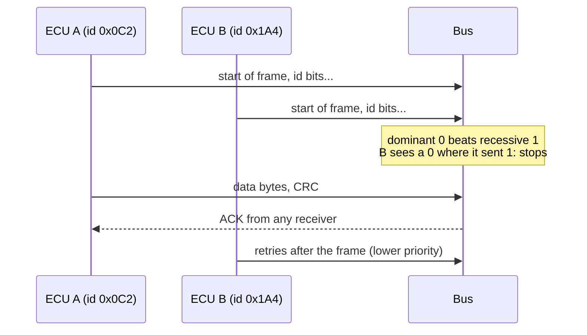

## Problem and purpose

A car contains dozens of control units that must share speed, pedal, steering and fault information in real time over cheap, noise-resistant wiring. **CAN (Controller Area Network)**, created by Bosch in the 1980s, is a broadcast bus where every node sees every message and messages carry priorities. It is also used in trucks, tractors (J1939), industrial machines (CANopen), medical devices and robots.

## Core concepts and terminology

- **Frame** — identifier (11-bit standard, 29-bit extended), up to 8 data bytes (classic) or 64 (CAN FD), CRC, acknowledgement.
- **Broadcast** — no addresses; receivers filter by id.
- **Arbitration** — when two nodes transmit, the lower id wins bit by bit without corrupting the frame: id = priority.
- **Bit rate** — commonly 500 kbit/s for powertrain buses; CAN FD speeds up the data phase.
- **DBC** — vendor database mapping ids and bit ranges to named physical signals.
- **Error handling** — CRC, acknowledgement, error counters; a faulty node goes "bus off".
- **OBD-II** — the standardized diagnostic port (often CAN underneath).

*Search keywords:* `CAN bus arbitration`, `CAN frame format`, `CAN FD`, `DBC file signals`, `SocketCAN vcan`, `J1939`.

## How it works



## Related features and components

[[vehicle-integration]] · [[independent-safety-layer]] · [[drive-logging-and-replay]] (raw CAN is logged).

## Required technical knowledge

Bits and bytes, endianness, two's complement; [[publish-subscribe-messaging]] (CAN is a hardware pub/sub bus).

## Implementation techniques and APIs

> [!tested] Python — `drivekit/can.py` (signal packing and counters)
> - **Used for:** Decoding/encoding DBC-style signals and detecting dropped frames by rolling counter.
> - **Input:** `Signal` definitions and frame bytes; a stream of 4-bit counter values.
> - **Expected output:** Exact round trips for 1000 random signals in both byte orders; `CounterChecker(modulo=4)` flags the jump from 0 to 2 and the repeated 3 as errors (2 errors total).
>
> ```python
> from drivekit.can import CounterChecker
> c = CounterChecker(modulo=4)
> print([c.check(v) for v in [0, 1, 2, 3, 0, 2, 3, 3]], c.errors)
> # [True, True, True, True, True, False, True, False] 2
> ```

Linux: **SocketCAN** (`ip link add dev vcan0 type vcan` for a virtual bus; `candump`, `cansend` from can-utils). Python: **python-can**, **cantools** ([[can-bus-in-python]]). Hardware: comma panda, PEAK PCAN, Kvaser, CANable.

## Error handling and edge cases

- Byte order (Intel vs Motorola) and signed values are the most common decoding bugs.
- Bus load above ~70 % increases latency for low-priority frames.
- Termination resistors (120 Ω at each end) — missing ones cause errors on real hardware.
- No authentication in classic CAN: any node can spoof any id (SecOC adds MACs on newer cars).

## Testing and debugging

- Virtual buses (vcan, python-can `virtual`) for unit and integration tests.
- Record and replay real traffic (`candump -l`, `canplayer`).
- Plot candidate signals while performing known actions to identify them.

## Limitations and engineering trade-offs

- 8-byte payloads (classic) limit data per frame; CAN FD and automotive Ethernet carry more.
- Broadcast + priority gives deterministic latency for high-priority messages but starves low-priority ones under load.

## Competency checklist

> [!level1] Recognition
> Explain frames, broadcast, id-based arbitration, DBC files and why CAN has no security by default.

> [!level2] Implementation
> Decode/encode DBC signals, use a virtual bus with python-can, and detect dropped frames.

> [!level3] Engineering
> Analyse bus load and latency, reverse engineer signals from logs, and design secure, robust message sets.

## References

- Bosch, *CAN Specification 2.0* (1991).
- ISO 11898-1 *Road vehicles — Controller area network (CAN) — Data link layer and physical signalling*.
- Linux kernel, *SocketCAN* — https://docs.kernel.org/networking/can.html
- CSS Electronics, *CAN Bus Explained* — https://www.csselectronics.com/pages/can-bus-simple-intro-tutorial
