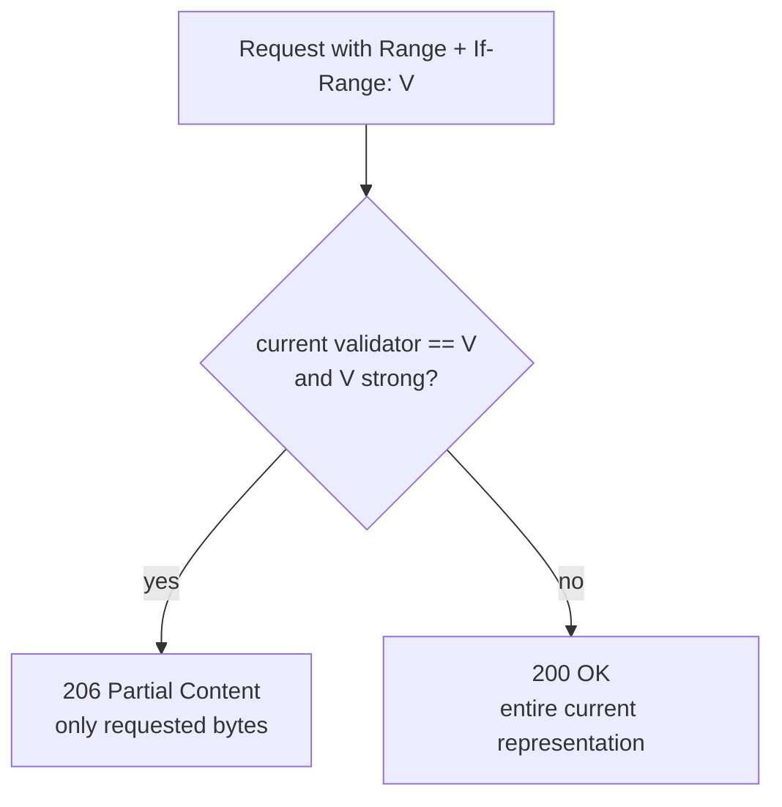
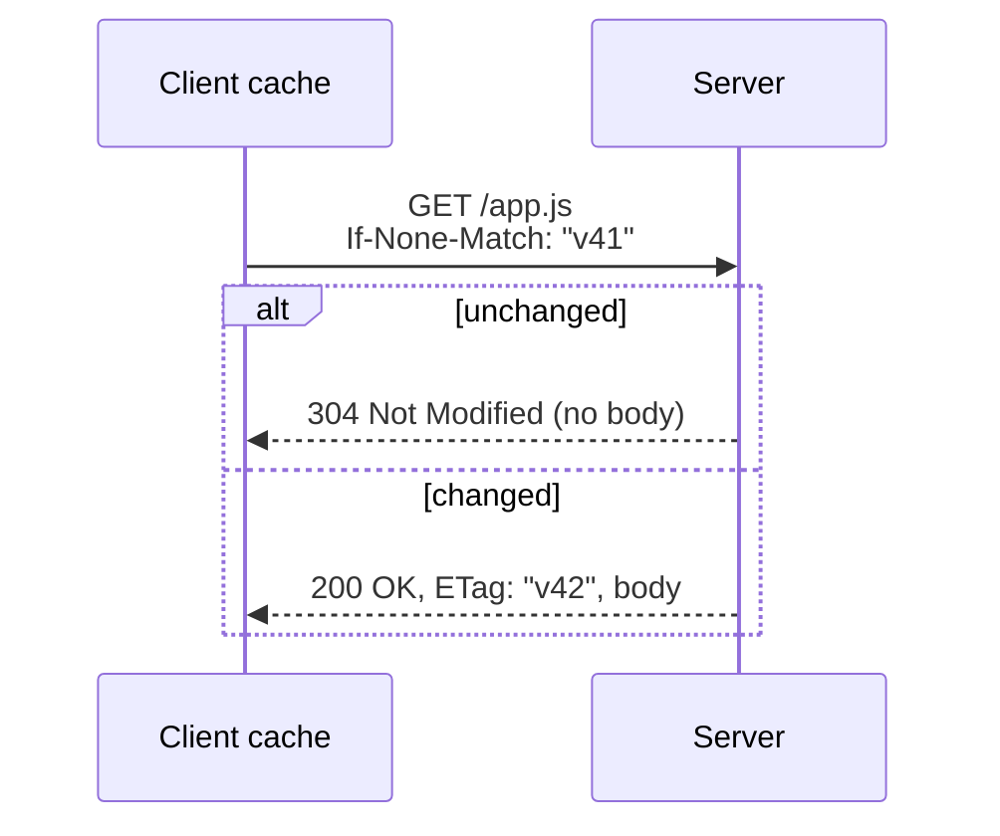

## Problem and purpose

A client that already holds some version of a resource wants to ask: *"has it changed?"* — to reuse a cached copy, to resume a download safely, or to avoid overwriting someone else's edit. **Conditional requests** attach a **validator** to the request; the server acts only if the condition holds.

This concept is central to download resume ([[pause-and-resume]]), browser and CDN caching (planned Cloudflare slice), and optimistic concurrency in REST APIs.

## Core concepts and terminology

| Header | Direction | Purpose |
|---|---|---|
| `ETag: "v42"` | response | opaque version identifier; **strong** by default, `W/"v42"` = **weak** |
| `Last-Modified: <date>` | response | modification time, 1-second resolution |
| `If-None-Match: "v42"` | request | "send body only if version differs" → `304 Not Modified` otherwise |
| `If-Modified-Since: <date>` | request | date-based variant of the above |
| `If-Match: "v42"` | request | "apply this PUT/DELETE only if still v42" → `412 Precondition Failed` otherwise |
| `If-Range: "v42"` | request | "send the range if still v42, otherwise the **whole** file with 200" |

**Strong** validators change whenever any byte changes — required for range combination. **Weak** validators mean "semantically equivalent" and must not be used with `If-Range`.

*Search keywords:* `ETag If-None-Match 304`, `If-Range resume download`, `strong vs weak ETag`, `optimistic concurrency If-Match 412`.

## How it works





## Related features and components

[[pause-and-resume]] · [[segmented-download]] · HTTP caches / CDNs (planned) · REST API concurrency control.

## Required technical knowledge

[[http-range-requests]] · HTTP caching basics (MDN *HTTP caching*).

## Implementation techniques and APIs

- Store `ETag` and `Last-Modified` from the first response with your download state.
- On resume send `If-Range` with the strong ETag if present, otherwise `Last-Modified`.
- Treat **any non-206** answer to a resume request as "file changed" — discard partial data.

> [!tested] Python — `DownloadState.validator()` in `minidm/state.py`
> Returns the strong ETag, else `Last-Modified`, never a weak ETag. Covered by `test_weak_etag_is_not_used_for_if_range` and `test_changed_remote_file_restarts_from_scratch`.

> [!mwe] Observe a 304 with curl
> - **Used for:** Seeing a conditional request in action: the server confirms your cached copy is still current.
> - **Input:** A URL whose server sends an `ETag` (example.com does).
> - **Expected output:** `304` — the server sent no body because the ETag still matches. If the server sends no ETag, you get `200` instead.
>
> ```bash
> etag=$(curl -sI https://example.com/ | awk -F': ' 'tolower($1)=="etag"{print $2}' | tr -d '\r')
> curl -s -o /dev/null -w '%{http_code}\n' -H "If-None-Match: $etag" https://example.com/
> # 304
> ```

## Error handling and edge cases

- Servers behind load balancers may generate **different ETags per node** (e.g. inode-based ETags in old Apache configs) — resume then restarts every time. Fall back to `Last-Modified` + size check.
- Compression proxies may weaken ETags (`W/` prefix added) — `If-Range` then cannot be used.
- Some servers ignore `If-Range` entirely and always send 206 — integrity verification at the end is the last line of defence.

## Testing and debugging

- Local test server with a configurable ETag: change it between runs and assert the client restarts.
- `curl -v -H 'If-Range: "x"' -r 0-9 URL` shows whether the server honours the condition (expect 200 for a wrong validator).

## Limitations and engineering trade-offs

- `Last-Modified` has one-second granularity and depends on server clocks.
- Validators prove version equality only as far as the server's ETag scheme is correct.

## Competency checklist

> [!level1] Recognition
> Name the validators and conditional headers, and the statuses 304, 412, 206/200 under If-Range.

> [!level2] Implementation
> Store validators, resume with `If-Range`, and restart correctly when the answer is 200.

## References

- RFC 9110 §8.8 *Validator Fields* and §13 *Conditional Requests* — https://www.rfc-editor.org/rfc/rfc9110#section-13
- MDN *HTTP conditional requests* — https://developer.mozilla.org/en-US/docs/Web/HTTP/Guides/Conditional_requests
