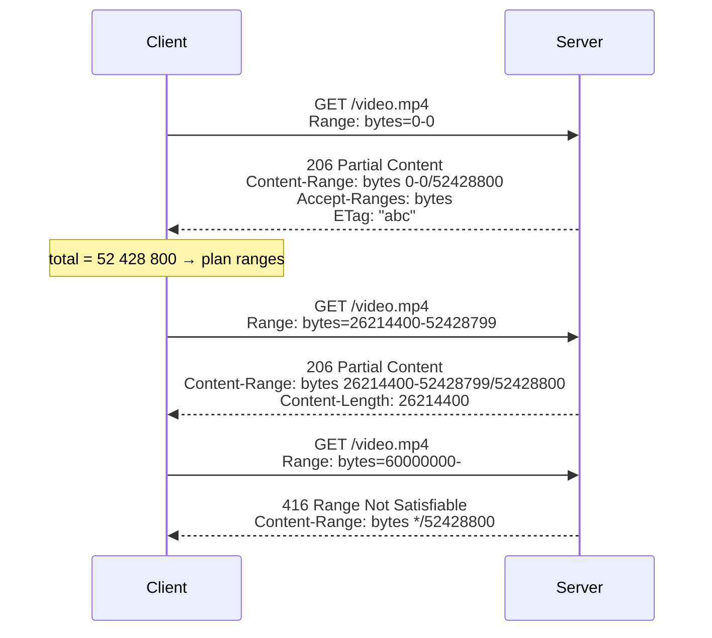

## Problem and purpose

Clients often need **part** of a resource: the rest of an interrupted download, one segment for a parallel download, the seconds of video the user jumped to, the last 10 KB of a log, or the central directory at the end of a ZIP file. HTTP range requests let a client ask for specific bytes and let the server answer with only those bytes.

## Core concepts and terminology

| Term | Meaning |
|---|---|
| `Range: bytes=500-999` | request header: bytes 500 through 999 **inclusive** (500 bytes) |
| `Range: bytes=500-` | from byte 500 to the end |
| `Range: bytes=-500` | the **last** 500 bytes (suffix range) |
| `206 Partial Content` | success; body contains only the requested range |
| `Content-Range: bytes 500-999/8000` | which bytes this response holds, and total size (`*` if unknown) |
| `Accept-Ranges: bytes` | server advertises range support (`none` = not supported) |
| `416 Range Not Satisfiable` | requested range starts beyond the end; response carries `Content-Range: bytes */8000` |
| `multipart/byteranges` | response format when several ranges are requested at once |

*Search keywords:* `HTTP Range header`, `206 Partial Content`, `Content-Range`, `Accept-Ranges`, `416 Range Not Satisfiable`, `RFC 9110 section 14`.

## How it works



Servers are **allowed to ignore** `Range` and answer `200 OK` with the full body. A client must check the status code, not assume.

### Probing: `HEAD` vs `Range: bytes=0-0`

| Probe | Pros | Cons |
|---|---|---|
| `HEAD` | no body at all | some servers/CDNs answer HEAD differently from GET, or omit `Accept-Ranges`; does not prove ranges work |
| `GET` with `Range: bytes=0-0` | a `206` *proves* range support and gives total size in `Content-Range` | one byte of body; a server ignoring ranges sends the whole body (close the connection) |

Robust clients prefer the 1-byte range probe.

## Related features and components

[[segmented-download]] · [[pause-and-resume]] · video seeking in media players · ZIP/Parquet readers over HTTP (`fsspec`, cloud-optimized GeoTIFF) · S3 `GetObject` with `Range`.

## Required technical knowledge

HTTP request/response structure, status codes, headers (MDN *An overview of HTTP*). Pairs with [[http-conditional-requests]] for safe resume.

## Implementation techniques and APIs

| Language | Request a range | Read the answer |
|---|---|---|
| Python `urllib` | `Request(url, headers={"Range": "bytes=0-99"})` | `resp.status`, `resp.headers["Content-Range"]` |
| Python `httpx` | `client.get(url, headers={"Range": ...})` | `r.status_code`, `r.headers` |
| Node `fetch` | `fetch(url, {headers: {Range: ...}})` | `res.status`, `res.headers.get("content-range")` |
| C++ libcurl | `curl_easy_setopt(h, CURLOPT_RANGE, "0-99")` | `CURLINFO_RESPONSE_CODE` |
| CLI | `curl -r 0-99 URL`, `wget -c URL` (continue) | `curl -v` |

Serving ranges: most static servers (NGINX, Apache, Caddy, S3, CDNs) do it automatically for static files. Frameworks: Starlette `FileResponse`, Express `res.sendFile`, Go `http.ServeContent`.

> [!mwe] Parse `Content-Range` (Python 3.10+)
> ```python
> def parse_content_range(value: str) -> tuple[int, int, int | None]:
>     unit, _, rest = value.strip().partition(" ")
>     if unit != "bytes" or "/" not in rest:
>         raise ValueError(f"unsupported Content-Range: {value!r}")
>     span, _, total = rest.partition("/")
>     start, _, end = span.partition("-")
>     return int(start), int(end), None if total == "*" else int(total)
>
> assert parse_content_range("bytes 0-99/1234") == (0, 99, 1234)
> ```

> [!mwe] Try it on the command line
> ```bash
> curl -s -D - -o /dev/null -r 0-0 https://www.rfc-editor.org/rfc/rfc9110.txt
> # look for: HTTP/... 206 and Content-Range: bytes 0-0/<total size>
> ```
> Any large static file works; if the server answers 200, it does not support ranges.

## Error handling and edge cases

- **Off-by-one:** ranges are inclusive. `bytes=0-99` is 100 bytes. Splitting `total` bytes means the last range ends at `total - 1`.
- **Response range differs from request:** servers may return a smaller range (e.g. capped). Always use the `Content-Range` start, and loop until your range is complete.
- **Compression:** with `Content-Encoding: gzip`, ranges apply to the *encoded* bytes. Request `Accept-Encoding: identity` for downloads (urllib does not ask for gzip by default; `httpx` and browsers do).
- **Dynamic content:** generated responses rarely support ranges; check for `Accept-Ranges: none` or plain 200.
- **Many small ranges** in one request (`bytes=0-1,5-6,...`) can be rejected — servers limit this as a DoS defense (CVE-2011-3192 "Apache Killer").

## Testing and debugging

- `curl -v -r` against the real server is the fastest check.
- In tests, run a local server that you control (see [[testing-network-code-locally]]) so you can test 200 fallback, 416 and short responses deterministically.
- Browser DevTools → Network: video elements show `206` responses with `Range` headers.

## Limitations and engineering trade-offs

- Each range request costs a round trip and, on a new connection, a TCP+TLS handshake.
- Range support says nothing about file stability; combine with `If-Range` ([[http-conditional-requests]]).
- Multipart byteranges responses are complex to parse; prefer one range per request.

## Competency checklist

> [!level1] Recognition
> Read a `Range`/`Content-Range` pair and say how many bytes are transferred; know 206 vs 200 vs 416.

> [!level2] Implementation
> Probe a server, fetch an arbitrary range, verify the returned `Content-Range`, and handle servers that ignore ranges.

> [!level3] Engineering
> Handle capped ranges, compression interactions, multipart responses, CDN differences between HEAD and GET, and range request abuse on the server side.

## References

- RFC 9110 §14 *Range Requests* — https://www.rfc-editor.org/rfc/rfc9110#section-14
- MDN *HTTP range requests* — https://developer.mozilla.org/en-US/docs/Web/HTTP/Guides/Range_requests
- AWS S3 `GetObject` `Range` parameter — https://docs.aws.amazon.com/AmazonS3/latest/API/API_GetObject.html
