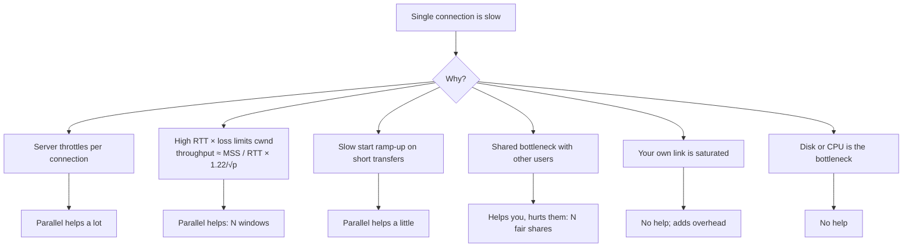

## Problem and purpose

Why does downloading with 8 connections often beat 1 connection on the same link? Knowing the reasons tells you **when** parallelism helps and when it only adds load — the core design decision behind [[segmented-download]].

## Core concepts and terminology

- **Throughput** — bytes per second actually delivered.
- **RTT (round-trip time)** — time for a packet to reach the server and the ACK to come back.
- **Congestion window (cwnd)** — how much unacknowledged data a TCP sender allows itself; grows during **slow start**, shrinks on loss.
- **Receive window (rwnd)** — how much the receiver can buffer; **flow control**.
- **Bandwidth-delay product (BDP)** — `bandwidth × RTT`: data that must be "in flight" to fill the pipe. 100 Mbit/s × 100 ms = 1.25 MB.
- **Per-flow fairness** — at a congested bottleneck, competing TCP flows tend to get roughly equal shares; N flows from one client get about N shares.
- **Head-of-line blocking** — one lost packet stalls everything behind it on the same connection.

*Search keywords:* `bandwidth delay product`, `TCP slow start`, `Mathis equation throughput loss`, `parallel TCP streams GridFTP`, `HTTP/2 multiplexing head of line blocking`.

## How it works

Reasons a single connection under-performs, and whether parallel connections help:



The **Mathis approximation** for a long-lived TCP Reno-style flow: `throughput ≈ (MSS / RTT) × (C / √p)` with `C ≈ 1.22` and loss rate `p`. With MSS 1460 B, RTT 150 ms and 0.1 % loss, one flow tops out around 1460 / 0.15 × 1.22 / 0.0316 ≈ **3.0 Mbit/s**, regardless of link speed. Eight independent flows can reach roughly eight times that. Modern congestion control (CUBIC, BBR) changes the constants but not the shape: loss and RTT cap a single flow.

## Related features and components

[[segmented-download]] · [[bandwidth-limiting]] (flow control is how receive-side limiting works) · CDN design (planned): moving servers closer reduces RTT, which raises per-flow throughput.

## Required technical knowledge

TCP basics: handshake, ACKs, windows. *Computer Networking: A Top-Down Approach* chapter 3, or *High Performance Browser Networking* chapter 2 (free online).

## Implementation techniques and APIs

Mostly a **measurement** concept:

```bash
ping -c 5 example.com                         # RTT
iperf3 -c <server> -P 1   vs   iperf3 -c <server> -P 8   # 1 vs 8 parallel streams
ss -ti                                         # Linux: per-socket cwnd, rtt, retransmits
```

> [!pseudocode] Adaptive connection count
> ```
> conns = 2
> loop every 5 s:
>     t = measured_throughput()
>     if t > best * 1.10 and conns < MAX: best = t; conns += 1   # still scaling
>     elif t < best * 0.90 and conns > 1: conns -= 1             # overload or throttling
> ```

## Error handling and edge cases

- Servers may punish many connections per IP (429/503, resets, bans). Respect `Retry-After`.
- With HTTP/2 or HTTP/3, opening several *streams* to the same origin usually reuses one connection — parallel streams then share one congestion window. To get separate flows you need separate connections (e.g. separate clients), which browsers and servers may discourage.

## Testing and debugging

- Simulate latency and loss on Linux: `sudo tc qdisc add dev lo root netem delay 100ms loss 0.5%`; remove with `sudo tc qdisc del dev lo root`.
- Compare 1 vs 4 vs 8 connections against a local server under netem; plot throughput.

## Limitations and engineering trade-offs

- Parallel flows are **unfair** to other users on shared links — a deliberate trade-off download managers make for their user.
- More connections = more TLS handshakes, memory, and server load.
- On low-RTT, loss-free links, one modern TCP flow already saturates the link.

## Competency checklist

> [!level1] Recognition
> Explain RTT, BDP, slow start, and why loss caps single-flow throughput; know when parallel connections do not help.

> [!level3] Engineering
> Measure with iperf3/ss/netem, choose connection counts adaptively, and reason about HTTP/2 multiplexing and fairness.

## References

- Ilya Grigorik, *High Performance Browser Networking*, ch. 2 "Building Blocks of TCP" — https://hpbn.co/building-blocks-of-tcp/
- Mathis et al., *The Macroscopic Behavior of the TCP Congestion Avoidance Algorithm* (1997) — https://dl.acm.org/doi/10.1145/263932.264023
- RFC 9293 *Transmission Control Protocol* — https://www.rfc-editor.org/rfc/rfc9293
