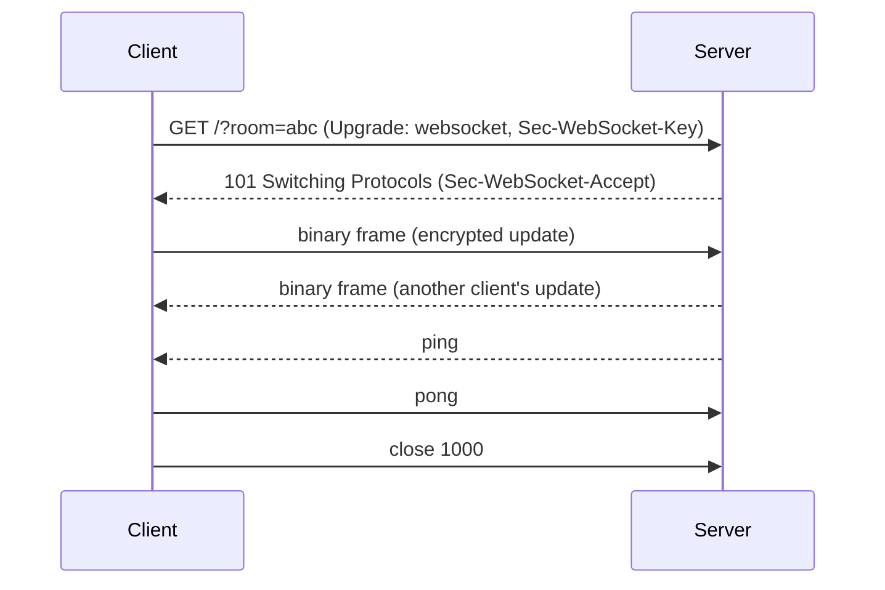

## Problem and purpose

HTTP is request/response: the server cannot push a collaborator's change to you unless you ask. Polling every second wastes bandwidth and adds latency. **WebSockets** upgrade one HTTP connection into a persistent, full-duplex channel: either side can send messages at any time with a few bytes of overhead.

Used by collaborative editors, chat, live dashboards, multiplayer games, trading UIs and notification feeds.

## Core concepts and terminology

- **Upgrade handshake** — `GET` with `Upgrade: websocket`, answered by `101 Switching Protocols` (RFC 6455).
- **Frame / message** — text (UTF-8) or binary; messages can span frames.
- **Ping/pong** — keep-alive and dead-connection detection.
- **Close codes** — 1000 normal, 1001 going away, 1008 policy violation, 1011 server error.
- **Room / channel** — server-side grouping of connections that receive the same broadcasts.
- **Alternatives** — Server-Sent Events (server→client only), long polling, WebRTC data channels (peer-to-peer), WebTransport.

*Search keywords:* `websocket handshake 101`, `RFC 6455`, `websocket reconnect exponential backoff`, `socket.io vs websocket`, `SSE vs websocket`.

## How it works



## Related features and components

[[real-time-collaboration]] · [[encrypted-sharing-links]] (rooms keyed by link) · [[retry-with-exponential-backoff]] (reconnects) · [[debounce-and-throttle]] (message rate).

## Required technical knowledge

HTTP basics, TCP ([[parallel-tcp-throughput]]), [[async-io-event-loop]] (servers handle thousands of sockets on one thread).

## Implementation techniques and APIs

- **Browser and Node 22+ client:** global `WebSocket` (`onopen`, `onmessage`, `send`, `close`, `binaryType = "arraybuffer"`).
- **Node server:** `ws` package (`WebSocketServer`); Socket.IO adds rooms, reconnection and fallbacks on top (Excalidraw's relay uses Socket.IO).
- **Python server:** `websockets` (asyncio); **C++:** Boost.Beast, uWebSockets.

> [!tested] Relay server — `examples/whiteboard/typescript/relay/relay-server.ts` (condensed below)
> - **Used for:** Forwarding every message in a room to the other clients, without reading it.
> - **Input:** Clients connecting to `ws://host:port/?room=<8–64 chars [A-Za-z0-9_-]>`.
> - **Expected output:** Prints `relay listening on ws://localhost:<port>`; messages from one client arrive at the others; an invalid room name is closed with code 1008. Exercised by `examples/whiteboard/smoke_test.sh`.
>
> ```ts
> import { WebSocketServer } from "ws";
> const rooms = new Map<string, Set<import("ws").WebSocket>>();
> const wss = new WebSocketServer({ port: 3002, maxPayload: 2 * 1024 * 1024 });
> wss.on("connection", (ws, req) => {
>   const room = new URL(req.url ?? "/", "http://x").searchParams.get("room");
>   if (!room || !/^[A-Za-z0-9_-]{8,64}$/.test(room)) return ws.close(1008, "invalid room");
>   const peers = rooms.get(room) ?? rooms.set(room, new Set()).get(room)!;
>   peers.add(ws);
>   ws.on("message", (data, isBinary) => {
>     for (const p of peers) if (p !== ws && p.readyState === p.OPEN) p.send(data, { binary: isBinary });
>   });
>   ws.on("close", () => { peers.delete(ws); if (!peers.size) rooms.delete(room); });
> });
> ```

Cookbook: [[websockets-in-typescript]].

## Error handling and edge cases

- Connections drop silently (mobile networks, sleeping laptops): use ping/pong or app-level heartbeats and reconnect with backoff.
- Messages sent while disconnected are lost — queue them and resend (idempotent updates make resending safe).
- Limit message size (`maxPayload`) and rate per connection; validate every message.
- Proxies and load balancers need WebSocket support and long idle timeouts; sticky sessions or a shared pub/sub (Redis) for multi-server rooms.
- Use `wss://` (TLS) in production; browsers block `ws://` from HTTPS pages.

## Testing and debugging

- Browser DevTools → Network → WS shows every frame.
- Integration test with a real server on a random port and two clients (the whiteboard smoke test).
- `websocat` or `wscat` for manual poking from a terminal.

## Limitations and engineering trade-offs

- One persistent connection per client costs server memory; scale out with pub/sub between servers.
- WebSockets are TCP: one lost packet delays later messages (head-of-line blocking); WebRTC or WebTransport avoid it for games/media.

## Competency checklist

> [!level1] Recognition
> Explain the upgrade handshake, full duplex, rooms, and when SSE or polling is enough.

> [!level2] Implementation
> Write a room relay server and clients with reconnect, size limits and validation; test with two clients.

> [!level3] Engineering
> Scale across servers with pub/sub, handle backpressure, heartbeats, auth on connect and graceful deploys.

## References

- RFC 6455 *The WebSocket Protocol* — https://www.rfc-editor.org/rfc/rfc6455
- MDN, *WebSocket API* — https://developer.mozilla.org/en-US/docs/Web/API/WebSockets_API
- `ws` (Node.js) — https://github.com/websockets/ws
- Excalidraw relay (Socket.IO) — https://github.com/excalidraw/excalidraw-room
