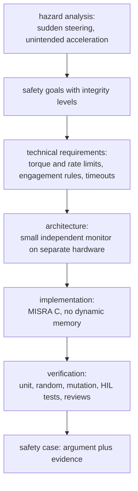

## Problem and purpose

When software moves physical things — cars, robots, insulin pumps, aircraft — a bug can injure people. **Functional safety** is the engineering discipline of making a system behave safely even when parts of it fail: identify hazards, decide how much risk reduction each needs, design so that faults are detected and lead to a safe state, and prove it with evidence. Standards: **ISO 26262** (road vehicles), **IEC 61508** (general), **DO-178C** (avionics), **IEC 62304** (medical software).

## Core concepts and terminology

- **Hazard** — potential source of harm (unintended steering). **Hazard analysis and risk assessment (HARA)** ranks them.
- **ASIL** (ISO 26262) — Automotive Safety Integrity Level A–D, set from severity, exposure and controllability.
- **Safety goal / requirement** — e.g. "steering torque change shall not exceed X per 10 ms".
- **Safe state** — what the system does on a fault (stop commanding, hand over to the driver).
- **Fault detection** — watchdogs, plausibility checks, timeouts, redundancy, monitors.
- **Freedom from interference** — a non-safety component cannot corrupt a safety component (separate hardware/memory).
- **Coding standards** — MISRA C/C++, static analysis, coverage requirements.

*Search keywords:* `ISO 26262 overview`, `ASIL decomposition`, `safety monitor pattern`, `fail-safe vs fail-operational`, `MISRA C`, `watchdog timer`.

## How it works



## Related features and components

[[independent-safety-layer]] · [[driver-monitoring]] · [[vehicle-integration]] · [[finite-state-machine]] (explicit, testable modes).

## Required technical knowledge

[[finite-state-machine]] · [[fixed-rate-control-loops]] (timeouts and watchdogs) · testing practice ([[record-and-replay-testing]]).

## Implementation techniques and APIs

Patterns that make code safety-friendly:

- **Monitor/actuator split** — a complex function proposes; a simple monitor disposes (openpilot: controls propose, panda firmware enforces).
- **Explicit state machines** for modes such as disabled/enabled/soft-disabling ([[finite-state-machine]]).
- **Defensive limits** — clamp magnitudes and rates at the last point before the actuator.
- **Timeouts** — every required input has a maximum age; stale → safe state.
- **No surprises** — no dynamic allocation, recursion or unbounded loops in safety code.

> [!tested] Engagement rules — `drivekit/engagement.py`
> - **Used for:** Deciding when the system may actuate, including a grace period to take over before disengaging.
> - **Input:** One set of events per 10 ms frame (`engage`, `gas`, `soft_fault`, `brake`, …).
> - **Expected output:** Brake (or cancel, hard fault) disengages immediately, even if other events arrive in the same frame; `gas` pauses actuation (overriding) without disengaging; a soft fault keeps control for 300 frames (3 s) while alerting, then disengages.
>
> ```python
> from drivekit.engagement import Engagement
>
> e = Engagement()
> e.step({"engage"}); e.step({"soft_fault"})
> for _ in range(299):
>     e.step()
> print(e.state)                    # State.DISABLED after 3 s without the fault clearing
> ```
> Test: `test_engagement_state_machine`.

## Error handling and edge cases

- **Stale state in monitors:** a monitor that remembers the last accepted value must forget it when it stops accepting (disengage, fault), or the first command after recovery is judged against a value the actuator never saw.
- Common-cause failures (same bug in "redundant" copies) — diversity of implementation helps (the C++/Python safety twins here are a small illustration).
- Degraded sensors — detect, inform the driver, reduce capability.
- Human factors — alerts must be timely and understandable; takeover takes seconds.

## Testing and debugging

- Requirements-based tests for every safety requirement; randomized and fault-injection tests.
- **Mutation testing**: deliberately alter the safety code; tests must fail (openpilot's panda safety code is mutation-tested).
- Static analysis (MISRA checkers, cppcheck), coverage measurement, hardware-in-the-loop.

## Limitations and engineering trade-offs

- Process rigour costs time; small, isolated safety-critical parts keep that cost manageable.
- Standards certify processes and evidence, not that software is bug-free; real-world monitoring remains necessary.

## Competency checklist

> [!level1] Recognition
> Explain hazards, safety goals, safe states, independence and why standards like ISO 26262 exist.

> [!level2] Implementation
> Implement limits, timeouts and an engagement state machine with exhaustive tests and fault injection.

> [!level3] Engineering
> Run a hazard analysis, derive requirements, design a monitor architecture and build a verification plan with mutation testing and static analysis.

## References

- ISO 26262 *Road vehicles — Functional safety* (overview) — https://www.iso.org/standard/68383.html
- openpilot `docs/SAFETY.md` — https://github.com/commaai/openpilot/blob/master/docs/SAFETY.md
- Philip Koopman, *Better Embedded System Software* and the Safe Autonomy blog — https://safeautonomy.blogspot.com/
- MISRA — https://misra.org.uk/
