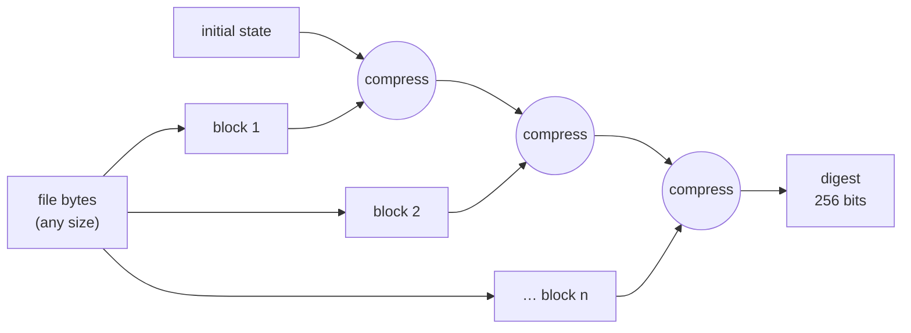

## Problem and purpose

You need a short, fixed-size fingerprint of arbitrary data such that any change — accidental or deliberate — changes the fingerprint, and nobody can construct different data with the same fingerprint. Used for download verification ([[file-integrity-verification]]), Git object IDs, content-addressed storage and caching (planned CDN slice), password hashing (with special slow variants), digital signatures, and deduplication.

## Core concepts and terminology

- **Digest** — the output (SHA-256: 32 bytes, usually shown as 64 hex characters).
- **Preimage resistance** — given a digest, you cannot find an input that produces it.
- **Second-preimage resistance** — given an input, you cannot find another with the same digest.
- **Collision resistance** — you cannot find *any* two inputs with the same digest.
- **Avalanche effect** — a one-bit change flips about half the output bits.
- **Checksum vs cryptographic hash** — CRC32/Adler-32 detect random errors fast but are trivially forgeable.
- **HMAC** — keyed hash proving integrity *and* knowledge of a secret key.

*Search keywords:* `SHA-256 vs MD5 collision`, `hashlib sha256 file`, `HMAC vs hash`, `BLAKE3 performance`, `password hashing argon2 bcrypt`.

## How it works



SHA-256 uses the **Merkle–Damgård** construction: the input is padded and split into 512-bit blocks, each mixed into a running internal state. This is why hashing can be **streamed**: feed blocks as they come, memory stays constant.

| Algorithm | Digest | Status |
|---|---|---|
| MD5 | 128 bit | collisions practical since 2004 — integrity against accidents only |
| SHA-1 | 160 bit | collision demonstrated 2017 (SHAttered) — legacy only |
| SHA-256 / SHA-512 (SHA-2) | 256/512 bit | standard choice |
| SHA3-256 | 256 bit | standard, different design (sponge) |
| BLAKE2 / BLAKE3 | 256 bit (default) | secure, very fast in software |

## Related features and components

[[file-integrity-verification]] · [[pause-and-resume]] (final safety net) · content-addressed caches, Git, ETag generation (see [[http-conditional-requests]]).

## Required technical knowledge

Bytes vs hex strings; streaming reads ([[random-access-file-io]]).

## Implementation techniques and APIs

| Language | Streaming SHA-256 |
|---|---|
| Python | `hashlib.sha256()`, `.update(chunk)`, `.hexdigest()`; `hashlib.file_digest(f, "sha256")` (3.11+) |
| Node.js | `crypto.createHash("sha256")`, pipe a read stream, `.digest("hex")` |
| C++ | OpenSSL `EVP_DigestInit_ex(ctx, EVP_sha256(), nullptr)`, `EVP_DigestUpdate`, `EVP_DigestFinal_ex` |
| CLI | `sha256sum`, `shasum -a 256`, `certutil -hashfile f SHA256` |

Cookbook: [[file-hashing-in-python]].

> [!mwe] Node.js streaming hash
> - **Used for:** Computing the SHA-256 of a file of any size in Node.js with constant memory.
> - **Input:** `await sha256File(path)` with the path of an existing file.
> - **Expected output:** The hex digest string (64 characters), e.g. `e3b0c442…7852b855` for an empty file; the promise rejects if the file cannot be read.
>
> ```ts
> import { createHash } from "node:crypto";
> import { createReadStream } from "node:fs";
>
> export function sha256File(path: string): Promise<string> {
>   return new Promise((resolve, reject) => {
>     const h = createHash("sha256");
>     createReadStream(path).on("error", reject).on("data", (c) => h.update(c)).on("end", () => resolve(h.digest("hex")));
>   });
> }
> ```

## Error handling and edge cases

- Hash **bytes**, not text — newline or encoding conversion changes the digest.
- Compare digests in constant time (`hmac.compare_digest`) when the comparison guards a secret (e.g. HMAC tokens); for public download checksums it does not matter.
- Never use fast hashes (SHA-256, MD5) to store passwords; use Argon2id, scrypt or bcrypt.

## Testing and debugging

- Known-answer tests: SHA-256(`""`) = `e3b0c442…b855`; SHA-256(`"abc"`) = `ba7816bf8f01cfea414140de5dae2223b00361a396177a9cb410ff61f20015ad`.
- Compare your output with `sha256sum` on the same file.

## Limitations and engineering trade-offs

- A hash proves nothing about the publisher; combine with HTTPS or signatures.
- Hashing large files is I/O-bound on HDDs and CPU-bound on fast NVMe; BLAKE3 parallelizes, SHA-256 per stream does not.

## Competency checklist

> [!level1] Recognition
> Name the security properties, which algorithms are broken, and the difference between checksum, hash, HMAC and password hash.

> [!level2] Implementation
> Stream-hash files in Python and Node, verify against known answers, and compare correctly.

## References

- NIST FIPS 180-4 — https://csrc.nist.gov/pubs/fips/180-4/upd1/final
- Python `hashlib` — https://docs.python.org/3/library/hashlib.html
- SHAttered (SHA-1 collision) — https://shattered.io/
- OWASP *Password Storage Cheat Sheet* — https://cheatsheetseries.owasp.org/cheatsheets/Password_Storage_Cheat_Sheet.html
