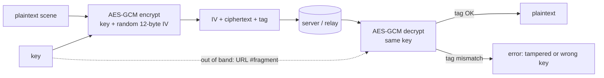

## Problem and purpose

When data travels through or is stored on servers you do not fully trust (a relay, a cloud bucket, a chat provider), TLS protects it only *in transit* — the server still sees plaintext. **End-to-end encryption** encrypts on the sender's device and decrypts only on recipients' devices; servers handle ciphertext they cannot read.

Used by Signal and WhatsApp, Excalidraw rooms and links, password managers, encrypted backups.

## Core concepts and terminology

- **Symmetric encryption** — same key encrypts and decrypts (AES).
- **Authenticated encryption (AEAD)** — encryption plus an integrity tag; tampering is detected. **AES-GCM** is the common choice.
- **IV / nonce** — per-message random value; reusing it with the same key breaks GCM's security.
- **Key distribution** — how recipients get the key: out-of-band in a link fragment (Excalidraw), or public-key exchange (Signal protocol).
- **Threat model** — what you defend against: curious server, stolen database, network attacker, malicious code delivery.

*Search keywords:* `AES-GCM web crypto`, `authenticated encryption`, `IV reuse GCM`, `end to end encryption web app threat model`, `key in url fragment`.

## How it works



## Related features and components

[[encrypted-sharing-links]] · [[real-time-collaboration]] · [[cryptographic-hash-functions]] (integrity without secrecy) · [[websockets]].

## Required technical knowledge

Bytes vs text encodings, base64/base64url, async/await (Web Crypto is promise-based).

## Implementation techniques and APIs

> [!tested] TypeScript — `src/crypto.ts`
> - **Used for:** Encrypting and decrypting JSON with AES-GCM and transporting the key as text.
> - **Input:** Any JSON-serializable value; a key from `generateKey()` or `importKey(text)`.
> - **Expected output:** `exportKey` gives a 22-character base64url string (128-bit key); decrypting returns the original value; a wrong key or one flipped ciphertext bit makes `decryptJSON` reject; two encryptions of the same value use different IVs.
>
> ```ts
> import { generateKey, exportKey, importKey, encryptJSON, decryptJSON } from "./src/crypto.ts";
>
> const key = await generateKey();
> const text = await exportKey(key);                        // e.g. "q3k9…" (22 chars)
> const { iv, data } = await encryptJSON(key, { hello: "world" });
> const back = await decryptJSON(await importKey(text), iv, data);   // { hello: "world" }
> ```
> Test: `AES-GCM round trip, wrong key and tampering fail`.

> [!mwe] Python equivalent (cryptography package)
> - **Used for:** The same AES-GCM operation server-side or in scripts.
> - **Input:** `pip install cryptography`; any bytes.
> - **Expected output:** `b'hello'`; decrypting with a different key raises `cryptography.exceptions.InvalidTag`.
>
> ```python
> import os
> from cryptography.hazmat.primitives.ciphers.aead import AESGCM
> key = AESGCM.generate_key(bit_length=128)
> iv = os.urandom(12)
> ct = AESGCM(key).encrypt(iv, b"hello", None)
> print(AESGCM(key).decrypt(iv, ct, None))
> ```

## Error handling and edge cases

- **Never reuse an IV** with the same key; generate 12 random bytes per message (random IVs are safe for up to about 2³² messages per key).
- Decryption failure is normal for wrong links — show a friendly error.
- Do not invent your own crypto or use ECB/CBC without authentication.
- Keys must not end up in logs, analytics, error reports or URLs' query strings.

## Testing and debugging

- Round trip, wrong key, tampered ciphertext and IV-uniqueness tests (sketchkit).
- Inspect server storage/logs: only ciphertext should appear.

## Limitations and engineering trade-offs

- Servers cannot search, preview or virus-scan content.
- Losing the key means losing the data — no "password reset".
- In web apps the server delivers the code; E2EE defends against storage breaches and curious operators, not a compromised code host.

## Competency checklist

> [!level1] Recognition
> Explain E2EE vs TLS, AEAD, IV uniqueness and the threat model of a web app.

> [!level2] Implementation
> Encrypt/decrypt with Web Crypto or `cryptography`, transport keys safely and test tampering.

> [!level3] Engineering
> Design key distribution (links, public keys, rotation), choose threat models, and review for key leaks.

## References

- NIST SP 800-38D *Galois/Counter Mode* — https://csrc.nist.gov/pubs/sp/800/38/d/final
- MDN, *SubtleCrypto* — https://developer.mozilla.org/en-US/docs/Web/API/SubtleCrypto
- `cryptography` (Python) AEAD — https://cryptography.io/en/latest/hazmat/primitives/aead/
- Excalidraw blog, *End-to-End Encryption in the Browser* — https://blog.excalidraw.com/end-to-end-encryption/
