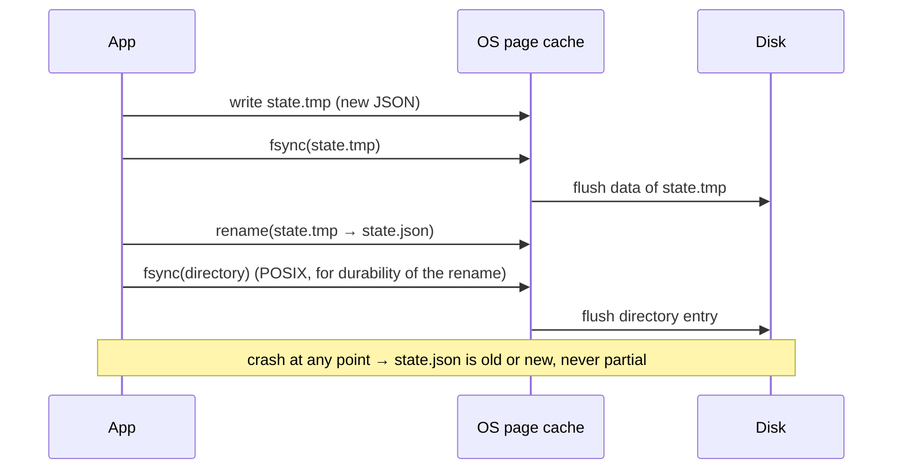

## Problem and purpose

If a program crashes or the power fails **while writing a file**, the file can end up empty, half-written, or with the new length but old content. For state files (download progress, settings, save games) that is fatal: on restart the program cannot trust what it reads. **Atomic replacement** guarantees readers see either the complete old file or the complete new one.

## Core concepts and terminology

- **Atomic rename** — `rename(2)` / `os.replace()` replaces the target in one step on the same filesystem.
- **Write-temp-then-rename** — write `file.tmp`, flush, `fsync`, rename over `file`.
- **`fsync`** — forces a file's data (and metadata) from the OS cache to stable storage.
- **Directory fsync** — on POSIX, the rename itself is durable only after the *directory* is fsynced.
- **Durability ordering** — make the data durable before writing the record that refers to it.
- **Write-ahead log (WAL)** — the database generalization: log the change durably, then apply it.

*Search keywords:* `atomic file write rename fsync`, `os.replace atomic windows`, `fsync directory after rename`, `crash consistency`, `write ahead log`.

## How it works



What a crash leaves behind under different strategies:

| Strategy | Crash during write leaves |
|---|---|
| `open("state.json", "w")` + write | empty or truncated file ✗ |
| write temp + rename, **no fsync** | possibly a zero-length new file after power loss on some filesystems ✗ |
| write temp + fsync + rename | old or new file ✓ |
| + fsync directory | old or new, and the rename survives power loss ✓ |

## Related features and components

[[pause-and-resume]] (progress sidecar) · [[segmented-download]] (`.part` → final rename) · settings files, save games, package managers' lockfiles, databases.

## Required technical knowledge

[[random-access-file-io]] (page cache, fsync) · file system basics (directories, inodes).

## Implementation techniques and APIs

- Create the temp file **in the same directory** as the target; rename across filesystems is a copy, not atomic.
- Python: `tempfile.mkstemp(dir=...)`, `os.fsync`, `os.replace` (atomic on POSIX; on Windows it calls `MoveFileExW` with `MOVEFILE_REPLACE_EXISTING`, which is atomic in practice on NTFS but not formally guaranteed).
- Node: `fs.promises.writeFile(tmp)`, `filehandle.sync()`, `fs.promises.rename` (or the `write-file-atomic` package).
- C++17: `std::filesystem::rename`; POSIX `fsync`, `rename`; Windows `ReplaceFileW` / `MoveFileExW(MOVEFILE_REPLACE_EXISTING | MOVEFILE_WRITE_THROUGH)`.

> [!tested] Python — `atomic_write_json()` in `minidm/state.py`
> - **Used for:** Saving a small state or settings file so a crash never leaves it half-written.
> - **Input:** The target path and a JSON-serializable `dict`.
> - **Expected output:** Returns `None`; `path` now contains the new JSON. After a crash at any point, `path` holds either the complete old or the complete new content, and no temporary file is left after an exception.
>
> ```python
> def atomic_write_json(path: str, data: dict) -> None:
>     directory = os.path.dirname(os.path.abspath(path))
>     fd, tmp = tempfile.mkstemp(prefix=".tmp-", dir=directory)
>     try:
>         with os.fdopen(fd, "w", encoding="utf-8") as f:
>             json.dump(data, f); f.flush(); os.fsync(f.fileno())
>         os.replace(tmp, path)
>     except BaseException:
>         if os.path.exists(tmp): os.unlink(tmp)
>         raise
> ```
> The reference skips the directory fsync: losing the *latest* checkpoint on power loss only means re-downloading a few MiB. A database could not accept that.

> [!pseudocode] Durability ordering for progress records
> - **Used for:** The order of operations that keeps recorded progress truthful after a crash.
> - **Input:** Chunks of downloaded data and the current progress record.
> - **Expected output:** A progress file that never claims more bytes than are actually on disk.
>
> ```
> write data chunk(s) to data file
> fsync(data file)                 # 1. bytes are on disk
> progress.done += n               # 2. only now claim them
> atomic_write(progress file)      # 3. persist the claim
> ```

## Error handling and edge cases

- Leftover `*.tmp` files after crashes: clean them up at startup or use a recognizable prefix.
- Windows: `os.replace` fails with `PermissionError` if another process (antivirus, indexer, editor) holds the target open — retry briefly.
- Network filesystems (NFS, SMB) have weaker rename/fsync guarantees.
- Never keep the only copy of important data in a single file being rewritten in place.

## Testing and debugging

- Kill the process with `SIGKILL` in a loop at random points; on restart the state must always parse.
- Simulate power loss in tests only with special tooling (dm-flakey, CrashMonkey); for most apps, SIGKILL testing plus correct fsync ordering is enough.
- `strace -f -e trace=fsync,rename,openat` to confirm the call order.

## Limitations and engineering trade-offs

- `fsync` costs milliseconds; calling it per chunk can halve throughput. Checkpoint every 1–4 MiB instead.
- Atomic rename handles whole-file replacement; for large files with small updates, use a WAL or a database (SQLite gives you crash safety for free).

## Competency checklist

> [!level1] Recognition
> Explain what a crash mid-write does, and why temp + fsync + rename fixes it.

> [!level2] Implementation
> Implement atomic JSON writes and durability-ordered checkpoints; test with SIGKILL loops.

> [!level3] Engineering
> Reason about directory fsync, filesystem differences, network filesystems, and when to switch to SQLite/WAL.

## References

- Dan Luu, *Files are hard* — https://danluu.com/file-consistency/
- Pillai et al., *All File Systems Are Not Created Equal* (OSDI 2014) — https://www.usenix.org/conference/osdi14/technical-sessions/presentation/pillai
- `rename(2)` — https://man7.org/linux/man-pages/man2/rename.2.html
- Python `os.replace` — https://docs.python.org/3/library/os.html#os.replace
- SQLite, *Atomic Commit In SQLite* — https://www.sqlite.org/atomiccommit.html
