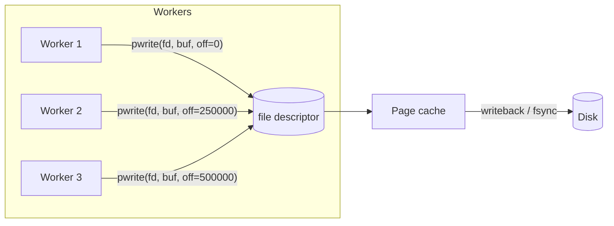

## Problem and purpose

Most programs read and write files front to back. A segmented downloader receives bytes **out of order** from several connections and must place each chunk at its exact offset. Databases, video editors, torrent clients and disk images do the same. **Random-access I/O** writes or reads at an explicit position.

## Core concepts and terminology

- **File offset / cursor** — position where the next `read`/`write` happens; shared by everyone using the same file handle.
- **`seek` + `write`** — move the cursor, then write; two steps, so not safe if threads share one handle.
- **Positional write (`pwrite`)** — write at an offset in one call without moving the shared cursor; safe across threads on one descriptor.
- **Sparse file** — a file whose unwritten regions take no disk space ("holes"); created by `truncate`/`ftruncate` to a larger size on most Linux/macOS filesystems and NTFS (when marked sparse).
- **Preallocation** — actually reserving disk blocks (`fallocate`, `posix_fallocate`, `SetFileValidData`/`SetEndOfFile` on Windows) to fail early on full disks and reduce fragmentation.
- **Page cache** — the OS buffers writes in memory; data reaches the disk later unless you `fsync`.

*Search keywords:* `pwrite thread safe`, `os.pwrite python`, `sparse file truncate`, `posix_fallocate vs ftruncate`, `FileHandle.write position node`.

## How it works



Two safe patterns for concurrent writers:

| Pattern | How | Portability |
|---|---|---|
| One descriptor, positional writes | `pwrite(fd, buf, n, off)` | POSIX; Windows via `WriteFile` with `OVERLAPPED.Offset` |
| One handle per worker | each worker `open()`s the file, `seek`s once, writes sequentially | everywhere (used by the Python reference) |

Writes to **disjoint** byte ranges never conflict; overlapping ranges are a bug.

## Related features and components

[[segmented-download]] · [[pause-and-resume]] (data must be durable before progress is recorded — see [[atomic-writes-and-crash-safety]]) · [[file-integrity-verification]] (sequential read for hashing).

## Required technical knowledge

File descriptors/handles, binary vs text mode, buffering.

## Implementation techniques and APIs

| Operation | Python | Node.js | C/C++ (POSIX) |
|---|---|---|---|
| Open for update without truncation | `open(p, "r+b")` | `fs.promises.open(p, "r+")` | `open(p, O_WRONLY)` |
| Set size / sparse | `f.truncate(n)` | `fh.truncate(n)` | `ftruncate(fd, n)` |
| Reserve blocks | `os.posix_fallocate(fd, 0, n)` (Unix) | — | `posix_fallocate(fd, 0, n)` |
| Positional write | `os.pwrite(fd, b, off)` (Unix) | `fh.write(buf, 0, len, off)` | `pwrite(fd, buf, len, off)` |
| Flush to disk | `f.flush(); os.fsync(f.fileno())` | `fh.sync()` | `fsync(fd)` |

> [!mwe] Out-of-order writes into a preallocated file (Python 3.10+, any OS)
> ```python
> import os
> from concurrent.futures import ThreadPoolExecutor
>
> path, data = "out.bin", os.urandom(1_000_000)
> with open(path, "wb") as f:
>     f.truncate(len(data))                          # sparse on most filesystems
>
> def write_part(start: int, end: int) -> None:      # one handle per worker
>     with open(path, "r+b") as f:
>         f.seek(start); f.write(data[start:end])
>
> parts = [(i, min(i + 250_000, len(data))) for i in range(0, len(data), 250_000)]
> with ThreadPoolExecutor(4) as pool:
>     list(pool.map(lambda p: write_part(*p), reversed(parts)))   # deliberately backwards
> assert open(path, "rb").read() == data
> ```

> [!tested] C++ — `pwrite` from libcurl write callbacks in `examples/download-manager/cpp/segmented_download.cpp`

## Error handling and edge cases

- `open(p, "w")` **truncates** — resuming with `"w"` destroys progress. Use `"r+b"`.
- `pwrite` may write fewer bytes than asked (rare for regular files, but check the return value).
- Disk full (`ENOSPC`) may appear only at write or `fsync` time unless you preallocate with `fallocate`.
- Sparse-file support differs: FAT32/exFAT do not support sparse files, so `truncate` there writes zeros (slow for large sizes).
- Windows: files opened by another process with sharing denied fail with `PermissionError`; antivirus can briefly lock new files.
- Max file size: FAT32 is limited to 4 GiB − 1 byte.

## Testing and debugging

- Write segments in random order in tests and compare with the source.
- `ls -ls` / `du -h --apparent-size` vs `du -h` shows sparse allocation on Linux.
- `strace -e trace=pwrite64,fsync` (Linux) shows exactly what the program does.

## Limitations and engineering trade-offs

- Sparse files fragment as holes fill in random order; preallocation avoids that at the cost of an upfront write on some filesystems.
- `fsync` is slow (milliseconds on SSD, much more on HDD); batch it (see [[atomic-writes-and-crash-safety]]).
- Memory-mapped files (`mmap`) are an alternative for random access but complicate error handling (I/O errors become signals).

## Competency checklist

> [!level1] Recognition
> Explain file offsets, why sharing a cursor across threads is unsafe, and what sparse files and fsync are.

> [!level2] Implementation
> Preallocate a file and write segments out of order from several workers correctly, on any OS.

> [!level3] Engineering
> Choose between sparse, preallocated and mmap strategies per filesystem; handle ENOSPC, partial writes, and Windows locking.

## References

- `pwrite(2)` — https://man7.org/linux/man-pages/man2/pwrite.2.html
- `posix_fallocate(3)` — https://man7.org/linux/man-pages/man3/posix_fallocate.3.html
- Python `os` file descriptor operations — https://docs.python.org/3/library/os.html#file-descriptor-operations
- Node.js `filehandle.write` — https://nodejs.org/api/fs.html#filehandlewritebuffer-offset-length-position
