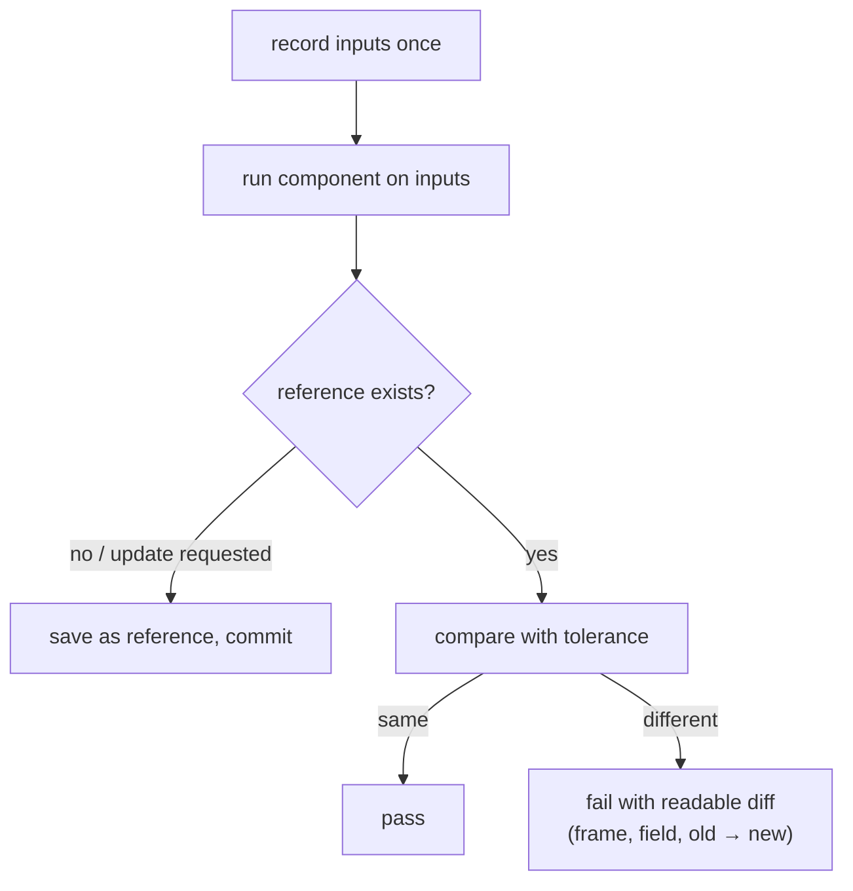

## Problem and purpose

For complex systems (planners, compilers, renderers, pricing engines) you often cannot write down the exact expected output for every input — but you *can* record what the system does on real inputs today, and fail tests when that behaviour changes unexpectedly. **Record and replay testing** (also golden master, snapshot or characterization testing) catches regressions on realistic data and documents intended changes as reviewable diffs.

Used by openpilot's process replay, Jest snapshot tests, compiler test suites (expected output files), visual regression testing of UIs, and traffic replay for web services.

## Core concepts and terminology

- **Recording** — capture inputs (and optionally outputs) from real runs.
- **Reference (golden) output** — stored expected output, committed to the repository.
- **Determinism** — same input → same output; prerequisite for meaningful diffs.
- **Tolerance** — numeric comparisons allow small differences (floating point across machines).
- **Reference update** — an explicit, reviewed step when behaviour is meant to change.
- **Open loop** — replayed inputs do not react to the new outputs (contrast: closed-loop simulation).

*Search keywords:* `golden master testing`, `snapshot testing`, `characterization tests legacy code`, `process replay openpilot`, `approval tests`.

## How it works



## Related features and components

[[drive-logging-and-replay]] · [[testing-network-code-locally]] (fault injection, the complementary technique) · [[scene-files-and-export]] (deterministic SVG export enables snapshot tests).

## Required technical knowledge

Unit testing (pytest), serialization (JSON lines), [[seeded-pseudorandom-numbers]] (determinism).

## Implementation techniques and APIs

> [!tested] Python — `drivekit/replay.py` and `tests/test_replay.py`
> - **Used for:** Replaying a logged drive through the MPC planner and diffing against a committed reference.
> - **Input:** `logged_inputs()` (150 frames) and `tests/reference/follow_mpc.jsonl`.
> - **Expected output:** Pass when unchanged; otherwise `planner behaviour changed:` followed by lines like `frame 0 accel: -0.246 -> -0.1652`. While building drivekit this test caught the effect of adding a jerk limit to the planner — exactly its job.
>
> ```bash
> cd examples/driver-assist/python
> python -m pytest tests/test_replay.py                       # compare with the reference
> UPDATE_REFERENCE=1 python -m pytest tests/test_replay.py    # intended change: rewrite it, then review the git diff
> ```

Libraries: `pytest-regressions`, `syrupy` (pytest snapshots), ApprovalTests, Jest `toMatchSnapshot`, Playwright visual comparisons.

## Error handling and edge cases

- Flaky diffs from non-determinism (time, randomness, thread scheduling, dict ordering in old Pythons) — fix the source, do not raise tolerances blindly.
- Huge references are unreviewable — keep them small and focused; summarize diffs.
- Blindly updating references hides real regressions — require a reviewer to look at the reference diff.

## Testing and debugging

- The first differing frame is the best clue; plot the signal around it.
- Keep several short, varied recordings rather than one long one.

## Limitations and engineering trade-offs

- Tells you behaviour *changed*, not whether it got *better* — pair with metric-based evaluation.
- Open loop cannot show consequences of new outputs; closed-loop simulation complements it.

## Competency checklist

> [!level1] Recognition
> Explain golden/reference outputs, determinism, tolerances and open vs closed loop.

> [!level2] Implementation
> Build a replay test with a committed reference, readable diffs and an explicit update path.

> [!level3] Engineering
> Run replay at scale in CI across many recordings, manage reference churn, and combine with metrics and simulation.

## References

- openpilot process replay — https://github.com/commaai/openpilot/tree/master/selfdrive/test/process_replay
- `pytest-regressions` — https://pytest-regressions.readthedocs.io/
- Approval Tests — https://approvaltests.com/
