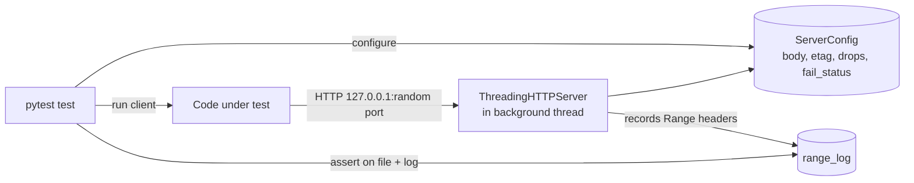

Concepts: [[http-range-requests]] · [[retry-with-exponential-backoff]] · [[pause-and-resume]].

## Why a local server

Tests against real websites are slow, flaky, and cannot produce the failures you need to test (a connection dropped after exactly 50 000 bytes, a 503 twice then success, an ETag that changes between runs). A small in-process server makes every scenario **deterministic** and offline.



## Recipe

> [!tested] `examples/download-manager/python/tests/rangeserver.py` + `conftest.py` (abridged)
> ```python
> @dataclass
> class ServerConfig:
>     body: bytes = b""
>     etag: str = '"v1"'
>     support_ranges: bool = True
>     drop_after: int | None = None      # close connection after N body bytes ...
>     drops: int = 0                     # ... this many times
>     fail_status: int | None = None     # answer this status ...
>     fail_times: int = 0                # ... this many times
>     range_log: list = field(default_factory=list)
>
> @pytest.fixture
> def server():
>     cfg = ServerConfig()
>     httpd = ThreadingHTTPServer(("127.0.0.1", 0), make_handler(cfg))   # port 0 = pick a free one
>     threading.Thread(target=httpd.serve_forever, daemon=True).start()
>     cfg.url = f"http://127.0.0.1:{httpd.server_address[1]}/file.bin"
>     yield cfg
>     httpd.shutdown(); httpd.server_close()
> ```
> The handler parses `Range`, honours `If-Range`, returns 206/200/416, and injects drops and failures from the config.

> [!tested] A fault-injection test
> ```python
> def test_dropped_connections_are_retried_and_resumed(server, tmp_path):
>     server.body = BODY
>     server.drop_after, server.drops = 50_000, 3
>     dest = tmp_path / "out.bin"
>     assert Downloader(server.url, str(dest), fast_opts()).run()
>     assert dest.read_bytes() == BODY
>     starts = [int(r[6:].split("-")[0]) for r in server.range_log if r and r != "bytes=0-0"]
>     assert len(starts) > 4 and len(set(starts)) == len(starts)   # never re-requests the same offset
> ```

Run all tests:

```bash
cd examples/download-manager/python
python -m pip install pytest
python -m pytest -q
```

## Techniques worth reusing

- **Port 0** lets the OS choose a free port — tests can run in parallel.
- **Record requests** (here, `Range` headers) and assert on them, not only on outputs.
- **Inject time:** pass `clock`/`sleep` into rate limiters and backoff; use tiny backoff values in tests.
- **Pause deterministically:** trigger the stop flag from the progress callback at a byte threshold instead of `sleep()`.
- **`tmp_path` fixture** gives each test an isolated directory.

## Alternatives

- `pytest-httpserver`, `pytest-localserver` — ready-made fixtures.
- `respx` (httpx) / `responses` (requests) — mock at the client layer; fast, but they do not exercise real sockets, so they miss premature-EOF and timeout behaviour.
- Toxiproxy — network fault injection proxy (latency, resets) for integration tests.
- Linux `tc netem` — real latency/loss on loopback (see [[parallel-tcp-throughput]]).

## References

- `http.server` — https://docs.python.org/3/library/http.server.html
- pytest fixtures — https://docs.pytest.org/en/stable/how-to/fixtures.html
- Toxiproxy — https://github.com/Shopify/toxiproxy
