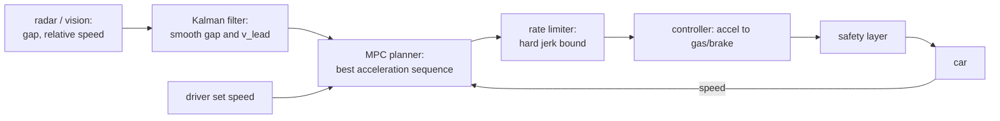

> [!danger] Educational only
> Code on this page runs in simulation. Never connect it to a vehicle.

## Problem and purpose

Plain cruise control holds a set speed and forces the driver to brake whenever traffic slows. **Adaptive cruise control (ACC)** measures the gap to the car ahead and adjusts speed to keep a safe, comfortable distance — down to a stop in traffic jams — while never exceeding the driver's set speed.

The same pattern — track a moving target under acceleration, comfort and safety limits — appears in robot motion planning, drones following a subject, elevator and train control.

## Core concepts and terminology

- **Lead vehicle** — the car ahead; its distance and relative speed come from radar and/or a camera model.
- **Time gap** — headway in seconds; desired gap ≈ standstill gap + time gap × speed (e.g. 4 m + 1.5 s × v).
- **Longitudinal control** — gas and brake; **lateral** is steering.
- **Planner vs controller** — the planner chooses a target acceleration; the controller makes the car achieve it.
- **Comfort limits** — bounds on acceleration and jerk (rate of change of acceleration).
- **Receding horizon** — re-plan every cycle with fresh measurements ([[model-predictive-control]]).

*Search keywords:* `adaptive cruise control time gap`, `longitudinal MPC following`, `ACC jerk limit`, `lead vehicle tracking kalman`.

## How it works



## Related features and components

[[lane-centering]] (the lateral counterpart) · [[independent-safety-layer]] (bounds what ACC may command) · [[driver-monitoring]] · [[drive-logging-and-replay]].

## Required technical knowledge

[[model-predictive-control]] · [[kalman-filter]] · [[pid-controller]] · [[fixed-rate-control-loops]].

## Implementation techniques and APIs

> [!tested] Python — `drivekit/mpc.py` with `drivekit/sim.py`
> - **Used for:** Following a lead car that brakes hard, in a closed-loop simulation.
> - **Input:** Gap 50 m, ego and lead at 25 m/s; the lead brakes at −3 m/s² from t = 2 s to 7 s (down to 10 m/s).
> - **Expected output:** No collision (gap stays above 4 m; it settles at about 4 + 1.5 × 10 = 19 m), ego speed ends at 10 m/s, acceleration stays within −3.5…+2 m/s², jerk never exceeds 4 m/s³.
>
> ```python
> from drivekit.mpc import FollowMPC
> from drivekit.sim import Longitudinal
>
> mpc, car, a = FollowMPC(), Longitudinal(gap=50.0, v_ego=25.0, v_lead=25.0), 0.0
> for i in range(300):                                   # 30 s at 10 Hz
>     a = mpc.step(car.gap, car.v_ego, car.v_lead, a_prev=a)
>     car.step(a, a_lead=-3.0 if 2.0 <= i * 0.1 < 7.0 else 0.0, dt=0.1)
> print(round(car.gap, 1), round(car.v_ego, 2))         # ≈ 19.0 10.0
> ```
> Tests: `test_mpc_follows_braking_lead_without_collision`, `test_mpc_closes_a_large_gap_smoothly`.

Real stacks add: stopping and starting at a standstill, set-speed and curve-speed limits, a dedicated QP solver (openpilot uses **acados**), and car-specific tuning of how acceleration maps to gas/brake.

## Error handling and edge cases

- **Cut-ins:** a car merging close ahead makes the gap jump down — limits must still allow firm braking.
- **Lost lead:** when tracking drops, do not suddenly accelerate to the set speed; ramp.
- **Stationary objects** are hard for radar-based ACC (filtered as clutter) — a known limitation of many systems.
- **Actuator lag:** brakes respond with a delay; the plan must anticipate it (the simulator models 0.3 s).

## Testing and debugging

- Closed-loop scenario tests (lead brakes, cut-in, stop-and-go) with assertions on minimum gap, limits and final state.
- Process replay against recorded drives ([[record-and-replay-testing]]).
- Plot gap, speeds and acceleration over time — most ACC bugs are visible in a plot.

## Limitations and engineering trade-offs

- Short time gaps feel natural in traffic but reduce safety margin; long ones invite cut-ins.
- Comfort (low jerk) vs responsiveness (fast braking): soft cost weights plus hard limits balance them.
- ACC handles following, not emergencies — automatic emergency braking is a separate, more conservative system.

## Competency checklist

> [!level1] Recognition
> Explain time gap, planner vs controller, and why acceleration and jerk are limited.

> [!level2] Implementation
> Build a following controller (MPC or simpler) and pass closed-loop braking and gap-closing scenarios in simulation.

> [!level3] Engineering
> Handle cut-ins, stop-and-go, lost leads and actuator lag; tune with recorded data; justify comfort/safety trade-offs.

## References

- ISO 15622 *Intelligent transport systems — Adaptive cruise control systems — Performance requirements and test procedures*.
- acados (fast optimal control solvers) — https://docs.acados.org/
- openpilot longitudinal planner — https://github.com/commaai/openpilot/tree/master/selfdrive/controls/lib
