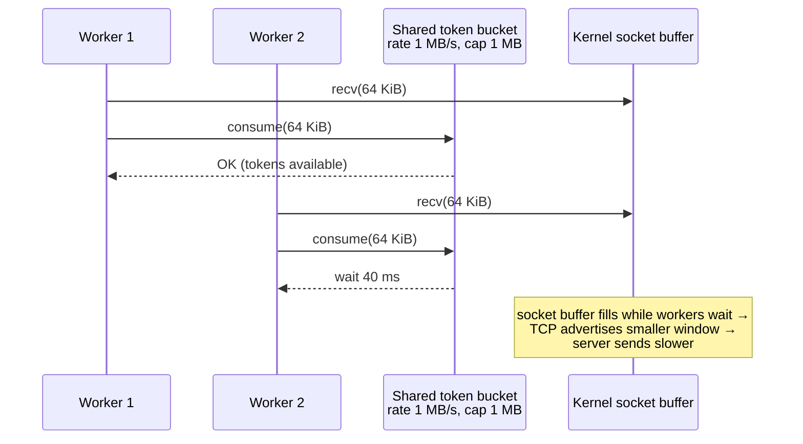

## Problem and purpose

A download that uses the whole link makes video calls stutter and other users complain. A **speed limiter** caps throughput (e.g. 2 MB/s) across all of an app's connections while still allowing short bursts.

The same mechanism — under the name **rate limiting** — protects APIs (requests per second per key), shapes traffic in routers, and drives Cloudflare/NGINX `limit_req`.

## Core concepts and terminology

- **Rate** — average allowed throughput (bytes/s or requests/s).
- **Burst / capacity** — how much may be consumed instantly after an idle period.
- **Token bucket** — the standard algorithm; see [[token-bucket]].
- **Shaping vs policing** — shaping delays traffic to fit the rate; policing drops it. A download manager *shapes* (it sleeps before reading more).
- **Receive-side limiting** — the client limits by reading slower; TCP flow control then slows the sender.

*Search keywords:* `token bucket rate limiter`, `throttle download speed TCP receive window`, `leaky bucket vs token bucket`, `limit_rate nginx`.

## How it works



The limiter does not touch the network; it makes the application read slower. TCP's **flow control** (receive window) propagates the slowdown to the sender, so the link is not flooded.

## Related features and components

- [[segmented-download]] — one bucket shared by all segments, so the cap applies to the total.
- [[download-queue-and-scheduler]] — a global bucket across all tasks; optionally per-task buckets underneath.

## Required technical knowledge

[[token-bucket]] · [[worker-pool]] (shared state between threads) · [[parallel-tcp-throughput]] (flow control)

## Implementation techniques and APIs

- Read in fixed chunks (16–64 KiB), call `bucket.consume(len(chunk))` after each read.
- Make the bucket **thread-safe** (lock) or confine it to one event loop.
- Inject the clock and sleep functions so tests run instantly.
- For hierarchical limits (global 5 MB/s, each task ≤ 2 MB/s), consume from both buckets.

> [!tested] Python — `examples/download-manager/python/minidm/ratelimit.py`
> Thread-safe `TokenBucket(rate, capacity, clock, sleep)`; tests in `tests/test_units.py` use a fake clock to assert exact waiting times.

> [!mwe] Command-line equivalents for comparison
> ```bash
> curl --limit-rate 500K -O https://example.com/big.iso
> aria2c --max-overall-download-limit=1M https://example.com/big.iso
> ```

## Error handling and edge cases

- **Requests larger than capacity** must be split, otherwise they wait forever.
- **Rate changes at runtime** (user moves a slider): update rate under the lock; keep current tokens capped to the new capacity.
- **Clock jumps:** use a monotonic clock (`time.monotonic()`, `performance.now()`, `std::chrono::steady_clock`), never wall-clock time.
- Very low limits with large chunks produce jerky progress — reduce chunk size when the rate is low.

## Testing and debugging

- Unit test with a fake clock: consume known amounts, assert total sleep time.
- Integration test: download 5 MB at 1 MB/s from a local server, assert elapsed ≈ 5 s minus initial burst (allow ±10 %).
- Plot bytes over time; a sawtooth with period = chunk/rate is expected.

## Limitations and engineering trade-offs

- Receive-side limiting reacts after data already arrived in kernel buffers, so short spikes above the cap happen (bounded by the socket buffer size).
- Exact OS-level shaping (Linux `tc`, Windows QoS policies) is more precise but needs privileges and is outside the app.
- A large burst capacity feels responsive but briefly violates the limit — choose capacity ≈ 1 s of rate.

## Competency checklist

> [!level1] Recognition
> Explain rate vs burst, shaping vs policing, and why reading slower slows the sender.

> [!level2] Implementation
> Implement a thread-safe token bucket with injectable clock and use it to cap a multi-connection download; test it without real sleeping.

> [!level3] Engineering
> Design hierarchical limits, runtime rate changes, and explain the interaction with TCP buffers and auto-tuning.

## References

- Token bucket — https://en.wikipedia.org/wiki/Token_bucket
- RFC 2697 *A Single Rate Three Color Marker* (token-bucket based metering) — https://www.rfc-editor.org/rfc/rfc2697
- curl `--limit-rate` — https://curl.se/docs/manpage.html#--limit-rate
