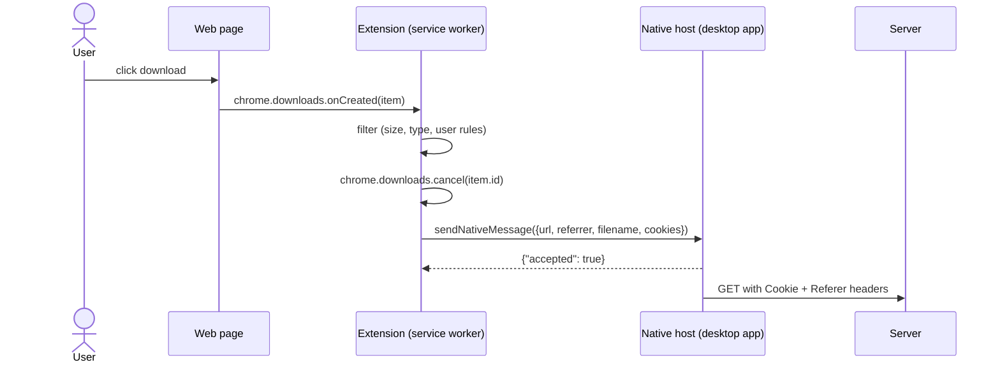

## Problem and purpose

Users start downloads in the browser. Copying links into a separate app is tedious and often fails because the server needs the browser's **cookies**, **referrer** or authentication. **Download capture** lets a browser extension intercept the download and hand it — with its context — to the desktop app.

Same pattern: password managers (extension ↔ desktop vault), 1Password/Bitwarden, Zotero connector, video downloaders, enterprise DLP agents.

## Core concepts and terminology

- **Browser extension** — JavaScript running with extra permissions (Manifest V3 in Chromium; WebExtensions in Firefox).
- **Native messaging** — browser-managed channel between an extension and a local executable (JSON over stdin/stdout). See [[browser-extension-native-messaging]].
- **Native messaging host manifest** — JSON file registered with the browser that names the executable and the extensions allowed to call it.
- **Context forwarding** — passing URL, final URL after redirects, cookies, referrer, user agent, suggested filename.

*Search keywords:* `chrome.downloads.onCreated cancel`, `native messaging host manifest`, `connectNative`, `Manifest V3 service worker`, `webextension downloads API`.

## How it works



## Related features and components

- [[download-queue-and-scheduler]] — captured items enter the queue.
- [[segmented-download]] — captured URL is downloaded by the engine.

## Required technical knowledge

[[browser-extension-native-messaging]] · HTTP cookies and `Referer` (MDN) · JSON

## Implementation techniques and APIs

- Extension permissions: `"downloads"`, `"nativeMessaging"`, optionally `"cookies"` with host permissions.
- Read cookies for the URL with `chrome.cookies.getAll({url})` and forward them — the desktop app has no access to browser cookies otherwise.
- Native host: any executable that reads 4-byte length-prefixed JSON from stdin and writes the same to stdout.

> [!mwe] Extension service worker (Manifest V3, Chromium)
> ```ts
> chrome.downloads.onCreated.addListener(async (item) => {
>   if (!item.finalUrl.startsWith("http")) return;          // skip blob:, data:
>   await chrome.downloads.cancel(item.id);
>   const cookies = await chrome.cookies.getAll({ url: item.finalUrl });
>   chrome.runtime.sendNativeMessage("com.example.minidm", {
>     url: item.finalUrl,
>     referrer: item.referrer,
>     filename: item.filename,
>     cookie: cookies.map((c) => `${c.name}=${c.value}`).join("; "),
>   });
> });
> ```
> The native host side is shown in [[browser-extension-native-messaging]].

## Error handling and edge cases

- **Host not installed:** `chrome.runtime.lastError` / rejected promise → let the browser download normally instead of cancelling first (check connectivity before cancel, or re-issue `chrome.downloads.download`).
- `blob:` and `data:` URLs exist only inside the page — cannot be handed off.
- POST-initiated downloads cannot be replayed by URL alone.
- Cookies are sensitive: transmit only to the registered host, never log them.

## Testing and debugging

- Load unpacked extension (`chrome://extensions`, Developer mode), inspect the service worker console.
- Chrome logs native host start failures with `--enable-logging --v=1`.
- Test the native host independently by piping a length-prefixed message into it.

## Limitations and engineering trade-offs

- Manifest V3 removed blocking `webRequest` for most extensions, so modern capture relies on the `downloads` API.
- Each browser needs its own host manifest location (registry on Windows, per-browser directories on macOS/Linux).
- Security: the native host runs with the user's privileges; validate every message.

## Competency checklist

> [!level1] Recognition
> Explain why the app needs cookies/referrer, and what native messaging is.

> [!level2] Implementation
> Build an extension that cancels a browser download and sends it to a local host that logs the request; handle the host-missing case.

## References

- Chrome `chrome.downloads` — https://developer.chrome.com/docs/extensions/reference/api/downloads
- Chrome native messaging — https://developer.chrome.com/docs/extensions/develop/concepts/native-messaging
- MDN native messaging (Firefox) — https://developer.mozilla.org/en-US/docs/Mozilla/Add-ons/WebExtensions/Native_messaging
