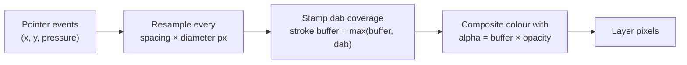
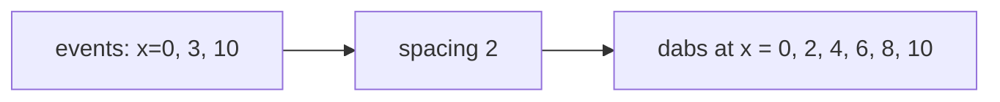

## Problem and purpose

Mouse and pen events arrive as scattered points, 60–240 per second. Drawing a line between them looks jagged and ignores pen pressure. A **brush engine** turns those points into a smooth, anti-aliased stroke by stamping a soft round **dab** at even intervals along the path, then compositing the stroke onto the layer.

Same technique in Krita, Procreate, GIMP, MyPaint, signature pads, whiteboard apps and game decal systems.

## Core concepts and terminology

- **Dab / stamp** — one imprint of the brush tip.
- **Spacing** — distance between dabs as a fraction of the diameter (Photoshop default 25 %).
- **Hardness** — how much of the radius is fully opaque before the edge fades.
- **Opacity vs Flow** — Opacity caps how opaque one *stroke* can get; Flow is how much each *dab* adds, so overlapping dabs build up to the opacity cap.
- **Stroke buffer** — the stroke is accumulated separately, then composited once.
- **Pressure / tilt** — tablet inputs mapped to size or opacity.

*Search keywords:* `brush engine dab spacing`, `brush hardness falloff smoothstep`, `opacity vs flow`, `stroke interpolation catmull-rom`, `pointer events pressure`.

## How it works



Resampling carries leftover distance between event segments, so the dab spacing stays even however the events were sampled:



## Related features and components

[[layers-and-blend-modes]] (paints into the active layer) · [[selections-and-masks]] (painting is clipped by the selection; painting on a mask edits the mask) · [[undo-redo-history]] (one stroke = one command).

## Required technical knowledge

[[alpha-compositing]] · [[raster-images-and-pixel-formats]] · [[command-pattern]] (snapshot the stroke's bounding box before painting).

## Implementation techniques and APIs

> [!tested] Python — `pixkit/brush.py`
> - **Used for:** Painting a soft or hard round brush stroke along a path, as one undoable edit.
> - **Input:** A document with layer 0, a list of `(x, y)` points, colour, diameter 12 px, hardness 0.5, opacity 0.8.
> - **Expected output:** The layer gets an anti-aliased stroke; its alpha never exceeds 0.8 even where dabs overlap; `undo()` restores the bounding box exactly.
>
> ```python
> from pixkit import History, PixelEdit, paint_stroke, stroke_bbox
>
> pts = [(10, 10), (60, 25), (120, 18)]
> y0, y1, x0, x1 = stroke_bbox(pts, 12, doc.height, doc.width)
> def paint(patch):   # paint in patch coordinates
>     local = [(x - x0, y - y0) for x, y in pts]
>     return paint_stroke(patch, local, (0.9, 0.2, 0.1), diameter=12, hardness=0.5, opacity=0.8)
> hist.execute(PixelEdit(0, (y0, y1, x0, x1), paint, "brush"))
> ```
> Tests: `test_spaced_points_are_even_across_segments`, `test_stroke_opacity_caps_overlapping_dabs`, `test_stroke_bbox_contains_all_painted_pixels`.

- **Browser input:** `pointermove` events with `event.pressure`, `getCoalescedEvents()` for the high-rate samples the browser merged.
- **Smoothing:** fit a Catmull-Rom spline through events before resampling; or apply lazy-mouse stabilization.

## Error handling and edge cases

- A single click (one point) must still paint one dab.
- Dabs partly outside the canvas must be clipped, not crash.
- Very fast strokes produce long segments — resampling (not one dab per event) keeps them continuous.
- Spacing below about 1 px wastes time without visual gain; clamp it.

## Testing and debugging

- Even spacing across segment boundaries (test above).
- Opacity cap: many overlapping dabs never exceed the stroke opacity.
- Bounding box must contain every painted pixel, or undo leaves residue.
- Visual: draw slow and fast strokes; gaps or beads reveal spacing bugs.

## Limitations and engineering trade-offs

- Python per-dab loops are slow for big brushes; real engines stamp on the GPU or in C++ with precomputed dab textures.
- Max-coverage strokes are simple; true Flow needs accumulating dab alpha with a cap.
- Wet media (smudge, mixer brush) read the canvas while painting — far more complex.

## Competency checklist

> [!level1] Recognition
> Explain dabs, spacing, hardness, opacity vs flow and why events must be resampled.

> [!level2] Implementation
> Implement spacing-correct resampling, round dabs with hardness, opacity-capped strokes, and undo by bounding box.

> [!level3] Engineering
> Add pressure curves, smoothing, textured tips, GPU stamping and low-latency rendering.

## References

- Adobe, *Brush settings* (spacing, hardness, flow) — https://helpx.adobe.com/photoshop/user-guide.html
- MDN, *Pointer events* (pressure, coalesced events) — https://developer.mozilla.org/en-US/docs/Web/API/Pointer_events
- MyPaint brush engine (open source) — https://github.com/mypaint/libmypaint
