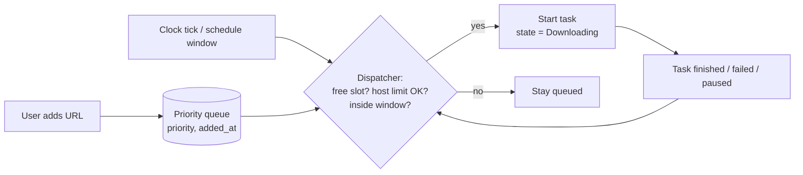

## Problem and purpose

Starting 40 downloads at once makes all of them slow and may get you blocked by servers. Users also want "download these overnight" or "shut down when finished". A **queue and scheduler** decides *which* tasks run, *how many* at once, and *when*.

The same component exists in print spoolers, CI runners, Celery/Sidekiq job queues, Kubernetes schedulers, and email delivery systems.

## Core concepts and terminology

- **Queue** — ordered collection of pending tasks; **priority queue** when order depends on priority.
- **Concurrency limit** — maximum number of tasks running at once (global and per host).
- **Dispatcher** — the loop that moves tasks from queued to running when a slot frees up.
- **Schedule window** — time range in which a queue may run (e.g. 01:00–06:00).
- **Starvation** — a low-priority task never runs because higher ones keep arriving; fixed with **aging**.

*Search keywords:* `job scheduler concurrency limit semaphore`, `priority queue aging starvation`, `per-host connection limit`, `cron expression`.

## How it works



> [!pseudocode] Dispatcher
> ```
> on any event (task added, task ended, timer tick):
>     while running.count < MAX_ACTIVE and window_open(now):
>         task = queue.pop_highest_priority(where host_active[task.host] < MAX_PER_HOST)
>         if none: break
>         running.add(task); host_active[task.host] += 1
>         task.start(on_end = lambda: running.remove(task); host_active[task.host] -= 1; dispatch())
> ```

## Related features and components

- [[segmented-download]] — each task may itself open several connections; budget connections, not only tasks.
- [[pause-and-resume]] — pausing a queue = pausing each running task and not dispatching new ones.
- [[bandwidth-limiting]] — a global limiter shared across all running tasks.

## Required technical knowledge

[[priority-queue]] · [[producer-consumer-queue]] · [[finite-state-machine]] · [[worker-pool]]

## Implementation techniques and APIs

- **Python:** `heapq` with tuples `(-priority, added_at, task_id)`; `asyncio.Semaphore` or a fixed-size worker pool for the global limit; a `dict[host, Semaphore]` for per-host limits. See [[python-threads-and-asyncio]].
- **TypeScript:** `p-limit` / `p-queue` packages, or a hand-written semaphore with Promises.
- **C++:** `std::priority_queue` + `std::condition_variable` + worker threads.
- **Schedules:** compare `datetime.now()` against window start/end each minute; for cron-like rules use `croniter` (Python) or `cron-parser` (Node).

> [!mwe] Global + per-host limits with asyncio (Python 3.11+)
> ```python
> import asyncio
> from collections import defaultdict
> from urllib.parse import urlsplit
>
> MAX_ACTIVE, MAX_PER_HOST = 3, 2
> active = asyncio.Semaphore(MAX_ACTIVE)
> per_host = defaultdict(lambda: asyncio.Semaphore(MAX_PER_HOST))
>
> async def run_task(url: str) -> None:
>     async with active, per_host[urlsplit(url).hostname]:
>         print("start", url); await asyncio.sleep(1); print("done ", url)
>
> async def main(urls: list[str]) -> None:
>     async with asyncio.TaskGroup() as tg:
>         for u in urls:
>             tg.create_task(run_task(u))
>
> asyncio.run(main([f"https://a.example/{i}" for i in range(4)] + ["https://b.example/x"]))
> ```
> At most 3 run concurrently and never more than 2 for `a.example`. Order among waiters is FIFO, not by priority — add a heap in front for priorities.

## Error handling and edge cases

- A failed task must **release its slot** (use `finally` / `async with`), or the queue slowly deadlocks.
- Retrying tasks should go back to the queue with a *not-before* time, not block a slot while sleeping.
- Schedule windows crossing midnight (22:00–06:00) and daylight-saving changes: compare in local time with explicit handling, or store in UTC.
- "Shut down computer when done": confirm with a countdown; never do it if any task failed silently.

## Testing and debugging

- Inject a fake clock and fake tasks that complete on command; assert the number of running tasks never exceeds limits.
- Property test: random sequences of add/finish/fail never leave `host_active` negative or slots leaked.
- Log every state transition with task id and timestamp — scheduling bugs are ordering bugs.

## Limitations and engineering trade-offs

- Strict priority can starve; aging (raise priority with wait time) trades predictability for fairness.
- Per-host limits need host normalization (`www.` vs bare, CDN redirects change hosts mid-task).
- In-memory queues vanish on crash; persist the queue (JSON file or SQLite) if it matters.

## Competency checklist

> [!level1] Recognition
> Explain concurrency limits, priority, starvation and aging; recognize a semaphore as the tool for "at most N at once".

> [!level2] Implementation
> Build a dispatcher with global and per-host limits, priorities, and slot release on failure; test it with a fake clock.

## References

- Python `heapq` — https://docs.python.org/3/library/heapq.html
- Python `asyncio` synchronization primitives — https://docs.python.org/3/library/asyncio-sync.html
- *Operating Systems: Three Easy Pieces*, chapters on scheduling — https://pages.cs.wisc.edu/~remzi/OSTEP/
