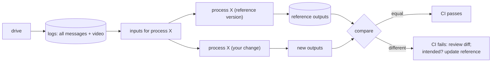

## Problem and purpose

You cannot test driving software by driving after every commit. openpilot logs every message every process publishes while driving, plus camera video, and uploads the drives. Developers then **replay** those logs: feed the recorded inputs through the new code and compare its outputs to the recorded or reference outputs. A behaviour change shows up as a diff before the code ever reaches a car. The same logs also train the driving models.

This "record real inputs, replay offline" approach is used in trading systems (market data replay), games (deterministic replays), network services (traffic shadowing) and browsers (record/replay debugging).

## Core concepts and terminology

- **Log** — timestamped messages from every topic; openpilot splits drives into 1-minute **segments** with a full log (`rlog`), a decimated log (`qlog`) and videos.
- **Process replay** — run one process on logged inputs; compare outputs with a stored **reference** ([[record-and-replay-testing]]).
- **Determinism** — same inputs must give the same outputs; otherwise diffs are noise.
- **Reference update** — when a change is intended, regenerate the reference and review the diff.
- **Data flywheel** — more users → more logs → better models and tests.

*Search keywords:* `process replay testing`, `golden master testing`, `record replay debugging`, `regression test with production logs`, `openpilot rlog qlog`.

## How it works



## Related features and components

[[vehicle-integration]] (raw CAN in the logs) · [[adaptive-cruise-control]] and [[lane-centering]] (processes under test) · [[independent-safety-layer]].

## Required technical knowledge

[[record-and-replay-testing]] · [[publish-subscribe-messaging]] (what gets logged) · [[ring-buffer]] · [[seeded-pseudorandom-numbers]] (determinism).

## Implementation techniques and APIs

> [!tested] Python — `drivekit/replay.py`, `tests/test_replay.py`
> - **Used for:** Replaying a recorded drive through the MPC planner and failing when its output changes.
> - **Input:** 150 logged frames (gap, ego speed, lead speed at 10 Hz) and the stored reference `tests/reference/follow_mpc.jsonl`.
> - **Expected output:** The test passes when behaviour is unchanged. After a code change it fails with lines like `frame 0 accel: -0.246 -> -0.1652`; if the change is intended, `UPDATE_REFERENCE=1 python -m pytest tests/test_replay.py` rewrites the reference.
>
> ```python
> from drivekit.replay import compare, load_jsonl, run
>
> outputs = run(planner_process, logged_inputs())     # fresh process state every replay
> diffs = compare(load_jsonl("tests/reference/follow_mpc.jsonl"), outputs, tolerance=1e-3)
> assert not diffs, "\n".join(diffs[:20])
> ```

openpilot tools: `selfdrive/test/process_replay` (CI), `tools/replay` (replays a whole drive into the live message bus), **PlotJuggler** (plots any signal over time), **cabana** (CAN), and the web UI comma connect.

## Error handling and edge cases

- Non-determinism (unseeded randomness, wall-clock time, thread timing, floating-point differences across CPUs) makes replays flaky — inject time and seeds; compare with tolerances.
- Logs from old versions may lack fields the new code needs — migrate logs or provide defaults.
- Privacy: logs contain location and video; consent, opt-out and retention rules matter.

## Testing and debugging

- The replay test itself is the regression test; keep reference logs small but representative (several car brands, day/night, edge cases).
- When a replay diff appears, plot the first differing signal over time — the earliest divergence points at the cause.

## Limitations and engineering trade-offs

- Replay is **open loop**: the recorded car did not react to your new commands, so it cannot show what *would* have happened. Closed-loop simulation fills that gap.
- Storage and upload costs grow with fleet size; decimated logs (qlogs) trade detail for size.

## Competency checklist

> [!level1] Recognition
> Explain process replay, reference outputs, determinism, and open-loop vs closed-loop testing.

> [!level2] Implementation
> Log inputs/outputs, replay a component deterministically, diff against a reference with tolerances, and support intentional reference updates.

> [!level3] Engineering
> Build a fleet-scale logging pipeline with segmenting, decimation, privacy controls and CI that replays many logs per commit.

## References

- openpilot process replay (directory `selfdrive/test/process_replay` in the repository) — https://github.com/commaai/openpilot
- openpilot tools (replay, PlotJuggler, cabana) (directory `tools` in the repository) — https://github.com/commaai/openpilot
- Michael Feathers, *Working Effectively with Legacy Code* (characterization tests).
