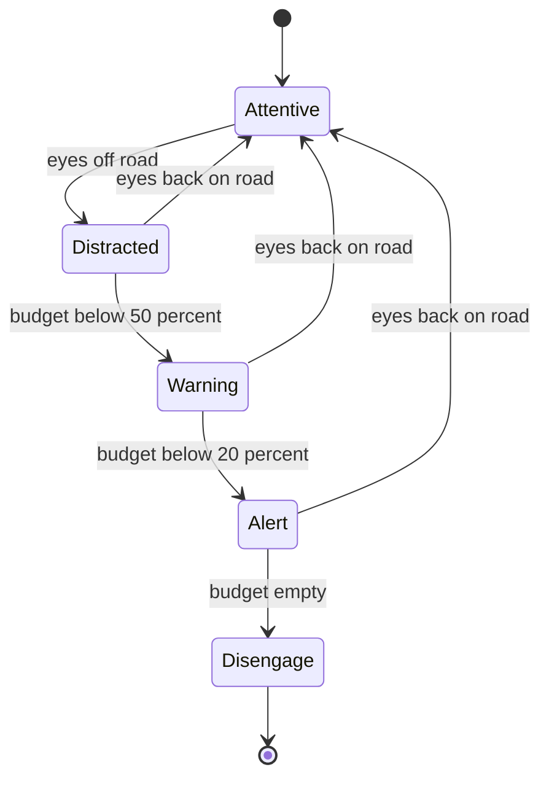

## Problem and purpose

A Level 2 system works well enough that drivers stop paying attention — exactly when it fails. **Driver monitoring** uses an inward-facing camera to check that the driver's eyes are on the road, escalates alerts when they are not, and eventually disengages. It is mandatory on new cars in the EU (General Safety Regulation) and part of openpilot's safety model.

## Core concepts and terminology

- **Face / gaze / eye-closure estimation** — a neural network predicts head pose, eye openness and gaze from an infrared camera image.
- **Awareness budget** — a timer that drains while the driver is distracted and refills when attentive.
- **Escalation** — silent → visual warning → audible alert → disengage.
- **Infrared illumination** — works at night and through most sunglasses.

*Search keywords:* `driver monitoring system gaze estimation`, `distraction alert escalation`, `EU GSR driver drowsiness and attention warning`.

## How it works



> [!pseudocode] Awareness budget
> - **Used for:** Turning per-frame attention estimates into stable warnings.
> - **Input:** Per-frame `distracted` boolean from the model, at a fixed rate.
> - **Expected output:** A warning level that rises only after sustained distraction and resets when the driver looks back.
>
> ```
> every frame:
>     if distracted: budget -= dt / DISTRACTED_TIME_LIMIT
>     else:          budget = min(1, budget + dt / RECOVERY_TIME)
>     level = ALERT if budget < 0.2 else WARNING if budget < 0.5 else NONE
>     if budget <= 0: request disengage (engagement state machine)
> ```

## Related features and components

[[independent-safety-layer]] (disengagement goes through engagement logic) · [[adaptive-cruise-control]] · [[lane-centering]].

## Required technical knowledge

[[on-device-ml-inference]] · [[finite-state-machine]] · [[debounce-and-throttle]] (filtering noisy per-frame predictions).

## Implementation techniques and APIs

- Camera frames → face detection → pose/gaze model (openpilot runs its own monitoring model on the device).
- Hysteresis and time windows to avoid flickering alerts.
- Different limits for "eyes off road" vs "eyes closed" (drowsiness).

## Error handling and edge cases

- Face not visible (camera blocked, extreme lighting): treat as unknown, warn rather than assume attentive.
- Model uncertainty: low-confidence frames should not reset the budget.
- Privacy: inward camera video is sensitive — openpilot lets users disable uploading it.

## Testing and debugging

- Labelled datasets of attentive/distracted drivers; measure false alarms per hour and missed distractions.
- Unit-test the escalation logic with synthetic distraction sequences.

## Limitations and engineering trade-offs

- Too strict → annoying alerts and users disabling the system; too lax → unsafe.
- Gaze ≠ attention: a driver can look at the road and still be mentally distracted.

## Competency checklist

> [!level1] Recognition
> Explain why Level 2 needs monitoring, and the budget/escalation idea.

> [!level2] Implementation
> Implement a budget-based escalation state machine with hysteresis and test it with synthetic sequences.

## References

- EU Regulation 2019/2144 (General Safety Regulation), driver drowsiness and attention warning.
- Euro NCAP, *Driver Engagement* protocols — https://www.euroncap.com/en/for-engineers/protocols/
- openpilot driver monitoring — https://github.com/commaai/openpilot/tree/master/selfdrive/monitoring
