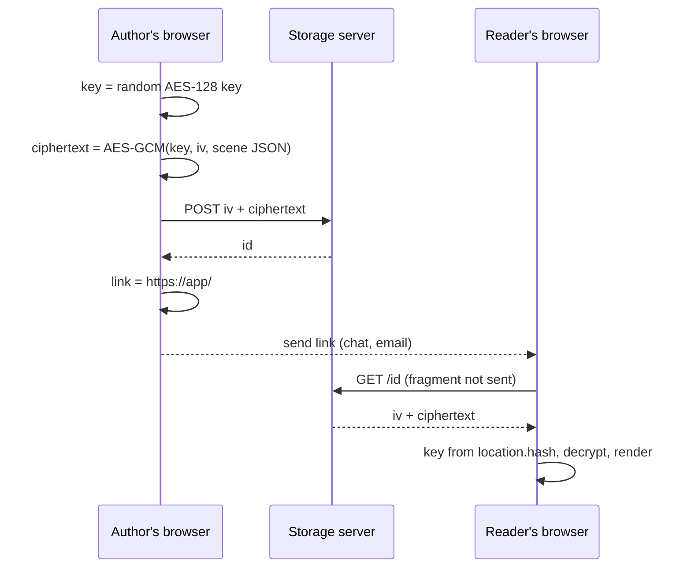

## Problem and purpose

"Share a link to this drawing" normally means uploading it to a server that can read it. For diagrams of unreleased products or internal systems, users may not want the host to see them. Excalidraw encrypts the scene **in the browser**, uploads only ciphertext, and puts the decryption key in the link's **fragment** (`#…`), which browsers never send to servers.

The same pattern is used by Firefox Send (discontinued), PrivateBin, Bitwarden Send and many "zero-knowledge" paste services.

## Core concepts and terminology

- **End-to-end encryption (E2EE)** — only the communicating clients hold the key ([[end-to-end-encryption]]).
- **URL fragment** — the part after `#`; available to page JavaScript, not included in HTTP requests or server logs.
- **AES-GCM** — authenticated symmetric encryption: confidentiality plus tamper detection.
- **IV / nonce** — 12 random bytes per encryption; must never repeat with the same key.
- **Capability URL** — possessing the link *is* the permission; anyone with it can read.

*Search keywords:* `key in url fragment encryption`, `web crypto aes-gcm`, `zero knowledge share link`, `capability url`.

## How it works



## Related features and components

[[real-time-collaboration]] (rooms use the same idea: `#room=id,key`) · [[scene-files-and-export]] (what gets encrypted).

## Required technical knowledge

[[end-to-end-encryption]] · [[cryptographic-hash-functions]] (integrity concepts) · URLs and HTTP requests.

## Implementation techniques and APIs

> [!tested] TypeScript — `src/crypto.ts`
> - **Used for:** Encrypting a scene for upload and building/parsing the share-link fragment.
> - **Input:** A scene object; the storage id returned by your server.
> - **Expected output:** `iv` (12 bytes) and `data` (ciphertext) to upload; a link such as `https://app/#json=abc123,<22-char key>`; decryption returns the original scene, and throws on a wrong key or modified bytes.
>
> ```ts
> import { generateKey, exportKey, encryptJSON, importKey, decryptJSON, parseShareFragment } from "./src/crypto.ts";
>
> const key = await generateKey();
> const { iv, data } = await encryptJSON(key, scene);
> const id = await upload(iv, data);                         // your storage API
> const link = `${location.origin}/#json=${id},${await exportKey(key)}`;
>
> // reader side
> const parsed = parseShareFragment(location.hash)!;
> const blob = await download(parsed.id);
> const restored = await decryptJSON(await importKey(parsed.key), blob.iv, blob.data);
> ```
> Tests: `AES-GCM round trip, wrong key and tampering fail`, `share links keep the key in the fragment`.

Cookbook: [[web-crypto-aes-gcm]].

## Error handling and edge cases

- Anyone with the link can read the drawing — treat links like passwords; offer expiry or revocation of the stored blob.
- The fragment is still visible to browser extensions, browser history and anyone who sees the screen.
- Analytics or error-reporting scripts that record `location.href` would leak the key — strip the fragment before reporting.
- Corrupted or truncated links: show "cannot decrypt" instead of crashing.

## Testing and debugging

- Round-trip, wrong-key and tamper tests (above).
- Check server logs during manual testing: the key must never appear.
- `new URL(link).search` and the request line seen by the server contain no key.

## Limitations and engineering trade-offs

- The server cannot index, search or generate previews of content it cannot read.
- The JavaScript itself comes from the server; a malicious server could ship code that steals keys. E2EE in web apps protects against storage leaks and curious operators, not a compromised app host.

## Competency checklist

> [!level1] Recognition
> Explain why the fragment keeps the key from the server and what AES-GCM's IV and authentication tag do.

> [!level2] Implementation
> Implement encrypt-upload-link and download-decrypt with Web Crypto, with round-trip and tamper tests.

## References

- Excalidraw blog, *End-to-End Encryption in the Browser* — https://blog.excalidraw.com/end-to-end-encryption/
- MDN, `SubtleCrypto.encrypt` (AES-GCM) — https://developer.mozilla.org/en-US/docs/Web/API/SubtleCrypto/encrypt
- RFC 3986 §3.5 *Fragment* — https://www.rfc-editor.org/rfc/rfc3986#section-3.5
- W3C, *Good Practices for Capability URLs* — https://www.w3.org/TR/capability-urls/
