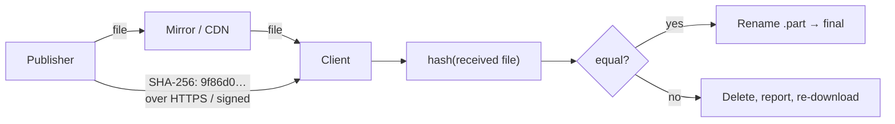

## Problem and purpose

A download can be wrong in ways the transfer did not notice: a resume bug, a disk error, a truncated proxy response, or a malicious mirror. **Integrity verification** compares a cryptographic hash of the received file with a value published by the source (`SHA256SUMS`, a checksum next to the download link, a package manifest).

Used by: package managers (pip `--require-hashes`, npm `integrity` in lockfiles, apt), Linux ISO downloads, aria2 `--checksum`, browser Subresource Integrity (SRI), container image digests, Git object IDs.

## Core concepts and terminology

- **Checksum / digest / hash** — fixed-size fingerprint of the content.
- **Integrity vs authenticity** — a hash proves the file matches the published hash; it does not prove *who* published it. Authenticity needs a **signature** (GPG, Sigstore, code signing).
- **Streaming hash** — update the hash chunk by chunk; memory use stays constant.

*Search keywords:* `verify sha256 checksum file`, `sha256sum -c`, `hashlib file_digest`, `subresource integrity`, `pip require-hashes`.

## How it works



## Related features and components

- [[pause-and-resume]] and [[segmented-download]] — verification is the final safety net for their bugs.

## Required technical knowledge

[[cryptographic-hash-functions]] · [[random-access-file-io]] (streaming reads)

## Implementation techniques and APIs

Hash while downloading only if bytes arrive **in order** (single stream). With segments arriving out of order, hash the finished file in one sequential pass — cheap compared to the network.

> [!mwe] Command line
> ```bash
> sha256sum ubuntu.iso                  # Linux
> shasum -a 256 ubuntu.iso              # macOS
> certutil -hashfile ubuntu.iso SHA256  # Windows
> sha256sum -c SHA256SUMS --ignore-missing
> ```

Cookbook: [[file-hashing-in-python]].

> [!tested] Python — `minidm.sha256_file()` and `Options(expected_sha256=...)`
> Mismatch raises `IntegrityError`, deletes the `.part` and state file, and never creates the final file. Test: `test_checksum_verified`.

## Error handling and edge cases

- Compare in a normalized form (lower-case hex, trimmed).
- On mismatch, never leave the bad file under the final name.
- Checksums fetched over plain HTTP from the same mirror protect against accidents only, not attackers.
- MD5 and SHA-1 still detect accidental corruption but are broken for adversarial use — accept them only for legacy sources.

## Testing and debugging

- Test both outcomes: correct hash → success; wrong hash → error and no final file.
- Known test vector: SHA-256 of the empty input is `e3b0c44298fc1c149afbf4c8996fb92427ae41e4649b934ca495991b7852b855`.

## Limitations and engineering trade-offs

- Requires the publisher to provide a hash; many sites do not.
- Hashing a 50 GB file takes noticeable time (SHA-256 typically 0.5–2 GB/s per core, faster with hardware SHA extensions); show progress.

## Competency checklist

> [!level1] Recognition
> Explain integrity vs authenticity; know where checksums are published and which algorithms are acceptable.

> [!level2] Implementation
> Stream-hash a file of any size, compare safely, and handle mismatch without leaving a bad file behind.

## References

- NIST FIPS 180-4 *Secure Hash Standard* — https://csrc.nist.gov/pubs/fips/180-4/upd1/final
- Python `hashlib.file_digest` — https://docs.python.org/3/library/hashlib.html#file-hashing
- MDN *Subresource Integrity* — https://developer.mozilla.org/en-US/docs/Web/Security/Subresource_Integrity
