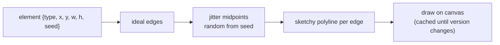

## Problem and purpose

Polished diagrams signal "finished" and discourage feedback; rough sketches invite it. Excalidraw draws every rectangle, ellipse and arrow with slightly wobbly, overlapping strokes, like a marker on paper. The challenge is making the wobble **random-looking but stable**: a shape must look the same on every redraw and on every collaborator's screen.

## Core concepts and terminology

- **Sketchy rendering** — perturb points along an ideal path and draw it more than once.
- **Seed** — a number stored with each element; it feeds a seeded random generator ([[seeded-pseudorandom-numbers]]).
- **Roughness** — amplitude of the perturbation.
- **Freehand stroke** — pointer samples turned into a smooth, pressure-sensitive outline (Excalidraw uses the perfect-freehand library).
- **Vector vs raster** — shapes are stored as parameters, rendered to pixels on demand ([[vector-graphics-and-scene-model]]).

*Search keywords:* `rough.js hand drawn`, `sketchy rendering`, `seeded random rendering stable`, `perfect-freehand`, `catmull-rom smoothing`.

## How it works



Why the seed matters: with `Math.random()` the jitter would change on every frame and the drawing would shimmer; and two collaborators would see different strokes for the same element.

## Related features and components

[[infinite-canvas]] (cached drawings are re-blitted when panning) · [[scene-files-and-export]] (SVG export reuses the same strokes) · [[real-time-collaboration]] (the seed travels with the element).

## Required technical knowledge

[[seeded-pseudorandom-numbers]] · [[vector-graphics-and-scene-model]] · [[canvas-2d-drawing]].

## Implementation techniques and APIs

> [!tested] TypeScript — `sketchyLine` in `src/random.ts`
> - **Used for:** Turning one straight edge into a reproducible hand-drawn polyline.
> - **Input:** Endpoints `a` and `b`, the element's `seed`, roughness (default 1), number of segments (default 4).
> - **Expected output:** An array of 5 points: the first and last equal `a` and `b`; the middle ones are offset sideways by at most `roughness × min(2, length / 50)` pixels; the same seed always gives the same points.
>
> ```ts
> import { sketchyLine } from "./src/random.ts";
>
> const pts = sketchyLine({ x: 0, y: 0 }, { x: 200, y: 0 }, el.seed);
> ctx.beginPath();
> ctx.moveTo(pts[0].x, pts[0].y);
> for (const p of pts.slice(1)) ctx.lineTo(p.x, p.y);
> ctx.stroke();
> ```
> Test: `sketchy line: fixed endpoints, same seed same wobble`.

> [!mwe] Rough.js in the browser
> - **Used for:** Getting production-quality hand-drawn shapes from the library Excalidraw uses.
> - **Input:** A `<canvas id="c">`; Rough.js loaded (`npm install roughjs`).
> - **Expected output:** A sketchy rectangle and circle; with `seed` set they look identical on every reload.
>
> ```ts
> import rough from "roughjs";
> const rc = rough.canvas(document.getElementById("c") as HTMLCanvasElement);
> rc.rectangle(20, 20, 160, 90, { seed: 42, roughness: 1.5 });
> rc.circle(260, 65, 80, { seed: 7, fill: "#a7c080", fillStyle: "hachure" });
> ```

## Error handling and edge cases

- Very short edges: scale the wobble down (sketchkit caps it by length/50), or tiny shapes become blobs.
- Changing the seed on edit (e.g. on every resize) makes shapes "jump" — keep the seed for the element's lifetime.
- Zero-length lines must not divide by zero when computing the normal.

## Testing and debugging

- Determinism tests: same seed → identical points; different seed → different points.
- Snapshot test of the SVG export string (deterministic by construction).

## Limitations and engineering trade-offs

- Generating sketchy paths costs CPU; cache per element and regenerate only when its `version` changes.
- Hand-drawn style hurts precision diagrams; Excalidraw offers a lower "sloppiness" setting.

## Competency checklist

> [!level1] Recognition
> Explain how sketchy rendering works and why it needs a stored seed.

> [!level2] Implementation
> Implement seeded jitter for lines and shapes, render it on canvas and in SVG, and test determinism.

## References

- Rough.js — https://roughjs.com/ and source https://github.com/rough-stuff/rough
- perfect-freehand (pressure-sensitive strokes) — https://github.com/steveruizok/perfect-freehand
- Excalidraw source, rendering code — https://github.com/excalidraw/excalidraw
