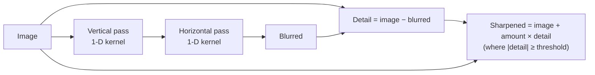

## Problem and purpose

Photos are often too noisy, too soft, or need a creative effect (background blur, glow). **Filters** compute each output pixel from a neighbourhood of input pixels. Blur and sharpen are the workhorses; many others (noise reduction, edge detection, emboss) use the same machinery.

Same technique elsewhere: phone camera pipelines, video encoders (pre-filtering), computer vision (edge detection before recognition), CSS `filter: blur()`, game post-processing (bloom, depth of field).

## Core concepts and terminology

- **Kernel** — small weight matrix slid over the image ([[convolution-and-kernels]]).
- **Gaussian blur** — weights from a bell curve with standard deviation **sigma**; Photoshop calls its parameter *Radius* (pixels).
- **Separable filter** — 2-D kernel = outer product of two 1-D kernels; two passes instead of one big one.
- **Unsharp mask (USM)** — sharpen by adding back `amount × (image − blurred)`; Photoshop's options are Amount, Radius, Threshold.
- **Edge handling** — what to read beyond the border: clamp, reflect, wrap, zero.

*Search keywords:* `gaussian blur separable kernel`, `unsharp mask amount radius threshold`, `premultiplied alpha blur dark fringe`, `box blur running sum`.

## How it works



A Gaussian with sigma 3 has radius 9 (19 taps). Direct 2-D convolution costs 19 × 19 = 361 multiply-adds per channel per pixel; two separable passes cost 2 × 19 = 38.

## Related features and components

[[selections-and-masks]] (filters applied through a mask; feathering is a blur) · [[undo-redo-history]] (a full-image filter is the most expensive command to snapshot) · [[layers-and-blend-modes]] (filters on one layer).

## Required technical knowledge

[[convolution-and-kernels]] · [[alpha-compositing]] (premultiplied alpha) · [[tiled-image-processing]] (parallel and large images) · [[worker-pool]].

## Implementation techniques and APIs

> [!tested] Python — `pixkit/filters.py`
> - **Used for:** Blurring and sharpening an RGBA image.
> - **Input:** `img`, a float32 `(H, W, 4)` image in [0, 1].
> - **Expected output:** Arrays of the same shape: `soft` blurred with sigma 2; `crisp` with stronger local contrast at edges; flat areas unchanged.
>
> ```python
> from pixkit import gaussian_blur, unsharp_mask
>
> soft = gaussian_blur(img, sigma=2.0, edge="clamp")
> crisp = unsharp_mask(img, sigma=1.0, amount=0.8, threshold=0.02)
> ```
> Tests: kernel normalization, constant image unchanged, impulse response = outer product, known box-blur values, no dark fringe at transparent edges, unsharp overshoot and threshold.

> [!tested] C++ — `examples/image-editor/cpp/gaussian_blur.cpp`
> - **Used for:** A dependency-free, multithreaded separable blur; shows the loops NumPy hides.
> - **Input:** A binary PPM (P6) image, sigma, optional thread count.
> - **Expected output:** `out.ppm` and a line like `blurred 53x37 with 13-tap kernel on 4 threads`; CI checks it matches the Python result exactly (max difference 0).
>
> ```bash
> g++ -std=c++17 -O2 examples/image-editor/cpp/gaussian_blur.cpp -pthread -o gaussian_blur
> ./gaussian_blur in.ppm out.ppm 2.0 4
> ```

Libraries in practice: OpenCV `cv2.GaussianBlur`, Pillow `ImageFilter.GaussianBlur`, scipy `ndimage.gaussian_filter`, Halide, GPU shaders, Apple vImage, Intel IPP. Cookbook: [[numpy-image-processing]], [[image-processing-in-cpp]].

## Error handling and edge cases

- **Dark fringes** at transparent edges if you blur straight (non-premultiplied) RGBA: transparent pixels are often stored as black. Blur premultiplied values, then unpremultiply.
- **Borders:** zero padding darkens edges; clamp or reflect for photos.
- **Clipping:** sharpening overshoots below 0 and above 1 — clamp, or keep float until the end.
- **Large sigma:** kernel radius grows linearly; for very large blurs use repeated box blurs or downsample–blur–upsample.

## Testing and debugging

- Invariants: blur of a constant image is unchanged; kernel sums to 1; impulse response equals the kernel.
- Cross-check against a second implementation (C++ vs Python here, or OpenCV) with a tolerance of 1/255.
- Visual: blur a checkerboard and inspect edges and borders.

## Limitations and engineering trade-offs

- Gaussian blur also blurs edges; edge-preserving filters (bilateral, guided, median) cost more.
- Gamma: blurring gamma-encoded values darkens bright/dark transitions; linear-light blur is more physically correct ([[color-spaces-and-gamma]]).
- CPU vs GPU: GPU wins for real-time previews; CPU code is easier to test and deterministic.

## Competency checklist

> [!level1] Recognition
> Explain kernels, sigma, separability, unsharp masking and edge modes.

> [!level2] Implementation
> Implement separable Gaussian blur and unsharp mask with correct alpha handling and tests against invariants.

> [!level3] Engineering
> Make it fast (tiling, threads, SIMD or GPU), handle huge sigmas, and match a reference to within 1/255.

## References

- Adobe, *Blur filters* / *Sharpen* (Photoshop user guide) — https://helpx.adobe.com/photoshop/using/filter-effects-reference.html
- Gonzalez & Woods, *Digital Image Processing*, chapter 3 (spatial filtering).
- OpenCV, *Smoothing Images* tutorial — https://docs.opencv.org/4.x/d4/d13/tutorial_py_filtering.html
