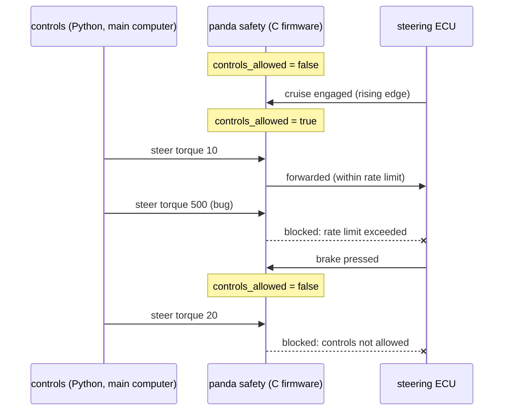

> [!danger] Educational only
> This page explains the principle. Real safety layers are certified engineering artefacts; never trust example code with a vehicle.

## Problem and purpose

A large, fast-changing Python codebase with a neural network will have bugs. If those bugs can command full steering torque instantly, people get hurt. openpilot therefore enforces safety in a **small, separate program on separate hardware** — the panda's firmware, written in C — which forwards an actuator message only if (1) the driver has engaged the system through the car's own controls and has not braked since, and (2) the command stays within car-specific limits such as maximum steering torque and how fast torque may change.

The pattern — keep the safety-critical part tiny, independent and exhaustively tested — is used by industrial robot controllers (safety PLCs), medical devices, aircraft (monitors and command/monitor architectures) and payment systems.

## Core concepts and terminology

- **Controls allowed** — the gate: set on the rising edge of the car's cruise engagement, cleared by braking or cancelling.
- **Actuator limits** — max torque, max rate up (away from zero), max rate down (toward zero, allowed faster so the driver regains control quickly).
- **Fail-safe** — on any doubt, send nothing (zero torque); the car's own systems remain in charge.
- **Independence** — runs on a different processor, so a crash or bug in the main computer cannot bypass it.
- **Small trusted computing base** — little enough code to review line by line and test exhaustively.

*Search keywords:* `safety monitor architecture`, `actuator rate limit safety`, `openpilot safety model panda`, `MISRA C`, `ISO 26262 freedom from interference`.

## How it works



## Related features and components

[[vehicle-integration]] (what is being checked) · [[driver-monitoring]] · [[adaptive-cruise-control]] · [[lane-centering]].

## Required technical knowledge

[[functional-safety]] · [[finite-state-machine]] (engagement) · [[can-bus]] · [[fixed-rate-control-loops]].

## Implementation techniques and APIs

> [!tested] Python — `drivekit/safety.py` (C++ twin: `examples/driver-assist/cpp/safety.hpp`)
> - **Used for:** Deciding, per outgoing steering command, whether it may reach the car.
> - **Input:** Brake and cruise events from the car; requested torque values every frame.
> - **Expected output:** Nonzero torque is blocked until cruise engages; braking blocks everything until a *new* engagement; a jump of 11 units from 0 is blocked (rate up 10); relaxing by 25 is allowed; torque above 1500 is blocked. Over 20 000 random commands, the forwarded sequence never violates the limits.
>
> ```python
> from drivekit.safety import SafetyChecker
>
> s = SafetyChecker()
> s.allow_steer(5)        # False: not engaged
> s.on_cruise(True)
> s.allow_steer(11)       # False: rate up is 10 per frame
> s.allow_steer(10)       # True
> s.on_brake(True)
> s.allow_steer(10)       # False: driver braked
> ```
> Tests: `test_nothing_allowed_until_cruise_engages`, `test_brake_disengages_and_only_a_new_rising_edge_reengages`, `test_torque_and_rate_limits`, `test_well_behaved_controller_never_violates`, `test_random_commands_never_produce_an_unsafe_output_sequence`.

> [!tested] Cross-implementation check — `examples/driver-assist/smoke_test.sh`
> - **Used for:** Proving the C++ safety checker and the Python one make identical decisions.
> - **Input:** 50 000 random brake/cruise/steer events generated with a fixed seed.
> - **Expected output:** `C++ and Python agree on every decision` (byte-identical decision streams).
>
> ```bash
> examples/driver-assist/smoke_test.sh
> ```

## Error handling and edge cases

- **Rising edge, not level:** if the car's cruise was already engaged when the safety code started, it must not grant control.
- **Direction changes** must pass through zero within the rate limits.
- **Message timeouts:** if the expected status messages stop arriving, revoke control.
- **Blocked ≠ disabled:** a blocked command is simply not sent; persistent violations should disengage via the main software.

## Testing and debugging

- Exhaustive unit tests per rule, randomized sequences, and **cross-implementation** comparison.
- openpilot's panda safety code is tested per car, checked against MISRA C:2012 rules, and covered by mutation testing (deliberately broken code must make tests fail).
- Hardware-in-the-loop tests with a real panda and recorded CAN traffic.

## Limitations and engineering trade-offs

- Limits must allow normal driving (curves, evasive steering by the driver) yet block dangerous commands — tuned per car.
- The safety layer cannot judge whether a *legal* command is *wise* (e.g. steering gently into another lane); that is the driver's job at Level 2.

## Competency checklist

> [!level1] Recognition
> Explain why safety logic is separated, what "controls allowed" means, and why rate limits are asymmetric.

> [!level2] Implementation
> Implement an engagement gate and torque/rate checks; test them exhaustively and with random sequences.

> [!level3] Engineering
> Design a safety architecture with independence, timeouts, cross-implementation tests, static analysis (MISRA) and mutation testing.

## References

- openpilot `docs/SAFETY.md` — https://github.com/commaai/openpilot/blob/master/docs/SAFETY.md
- panda safety code — https://github.com/commaai/panda
- ISO 26262 *Road vehicles — Functional safety* (overview) — https://www.iso.org/standard/68383.html
