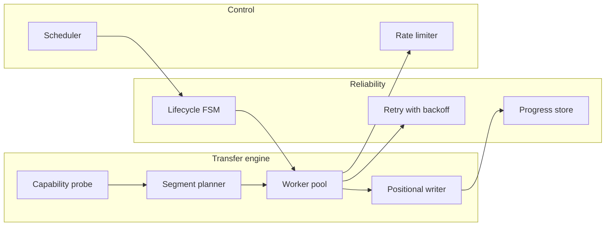

A **feature** is something a user can see ("pause a download"). A **component** is a part an engineer builds to deliver it ("progress store with atomic writes"). Features are documented once here and reused by every product that has them.

| Feature | Seen in | Key concepts |
|---|---|---|
| [[segmented-download]] | IDM, aria2, cloud SDK transfer managers | [[http-range-requests]], [[worker-pool]], [[random-access-file-io]] |
| [[pause-and-resume]] | IDM, browsers, resumable uploads (tus, S3 multipart) | [[http-conditional-requests]], [[atomic-writes-and-crash-safety]], [[finite-state-machine]] |
| [[download-queue-and-scheduler]] | IDM, CI runners, job queues | [[priority-queue]], [[producer-consumer-queue]] |
| [[bandwidth-limiting]] | IDM, curl, API gateways, Cloudflare | [[token-bucket]] |
| [[file-integrity-verification]] | package managers, ISO downloads, SRI | [[cryptographic-hash-functions]] |
| [[browser-download-capture]] | IDM, password managers, Zotero | [[browser-extension-native-messaging]] |

## Reusable components

Components such as the **rate limiter**, **retry with backoff** and **lifecycle state machine** recur in almost every networked product — expect to meet them again in Cloudflare and Salesforce slices.
