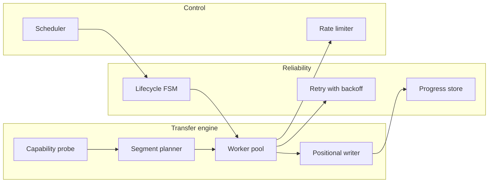

A **feature** is something a user can see ("pause a download"). A **component** is a part an engineer builds to deliver it ("progress store with atomic writes"). Features are documented once here and reused by every product that has them.

| Feature | Seen in | Key concepts |
|---|---|---|
| [[segmented-download]] | IDM, aria2, cloud SDK transfer managers | [[http-range-requests]], [[worker-pool]], [[random-access-file-io]] |
| [[pause-and-resume]] | IDM, browsers, resumable uploads (tus, S3 multipart) | [[http-conditional-requests]], [[atomic-writes-and-crash-safety]], [[finite-state-machine]] |
| [[download-queue-and-scheduler]] | IDM, CI runners, job queues | [[priority-queue]], [[producer-consumer-queue]] |
| [[bandwidth-limiting]] | IDM, curl, API gateways, Cloudflare | [[token-bucket]] |
| [[file-integrity-verification]] | package managers, ISO downloads, SRI | [[cryptographic-hash-functions]] |
| [[browser-download-capture]] | IDM, password managers, Zotero | [[browser-extension-native-messaging]] |
| [[layers-and-blend-modes]] | Photoshop, GIMP, Figma, CSS `mix-blend-mode`, video editors | [[alpha-compositing]], [[raster-images-and-pixel-formats]] |
| [[undo-redo-history]] | Photoshop, every editor, IDEs, spreadsheets | [[command-pattern]], [[copy-on-write]] |
| [[selections-and-masks]] | Photoshop, GIMP, Krita, photo apps | [[flood-fill]], [[convolution-and-kernels]] |
| [[image-filters]] | Photoshop, camera pipelines, CSS `filter`, game post-processing | [[convolution-and-kernels]], [[tiled-image-processing]] |
| [[tonal-adjustments]] | Photoshop, Lightroom, video colour grading | [[lookup-tables]], [[color-spaces-and-gamma]] |
| [[brush-painting]] | Photoshop, Krita, Procreate, whiteboards | [[alpha-compositing]], [[command-pattern]] |
| [[infinite-canvas]] | Excalidraw, Figma, Miro, online maps | [[coordinate-transforms]], [[spatial-index]] |
| [[hand-drawn-shapes]] | Excalidraw, tldraw, Balsamiq | [[seeded-pseudorandom-numbers]], [[vector-graphics-and-scene-model]] |
| [[selection-and-transform]] | Excalidraw, Figma, Illustrator, CAD, games | [[hit-testing]], [[spatial-index]] |
| [[real-time-collaboration]] | Excalidraw, Figma, Google Docs, multiplayer games | [[conflict-resolution]], [[websockets]], [[fractional-indexing]] |
| [[encrypted-sharing-links]] | Excalidraw, PrivateBin, Bitwarden Send | [[end-to-end-encryption]] |
| [[scene-files-and-export]] | Excalidraw, draw.io, any document editor | [[vector-graphics-and-scene-model]], [[debounce-and-throttle]] |
| [[adaptive-cruise-control]] | openpilot, car ACC systems, drones following a target | [[model-predictive-control]], [[kalman-filter]] |
| [[lane-centering]] | openpilot, path-following robots, tractors | [[pid-controller]], [[on-device-ml-inference]] |
| [[driver-monitoring]] | openpilot, modern cars (EU GSR) | [[on-device-ml-inference]], [[finite-state-machine]] |
| [[vehicle-integration]] | openpilot, diagnostics tools, fleet telematics | [[can-bus]] |
| [[independent-safety-layer]] | openpilot (panda), industrial safety PLCs, medical devices | [[functional-safety]] |
| [[drive-logging-and-replay]] | openpilot, trading systems, game replays | [[record-and-replay-testing]], [[publish-subscribe-messaging]] |

## Reusable components

Components such as the **rate limiter**, **retry with backoff** and **lifecycle state machine** recur in almost every networked product — expect to meet them again in Cloudflare and Salesforce slices.
