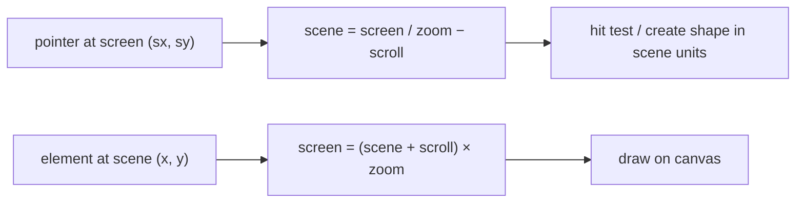
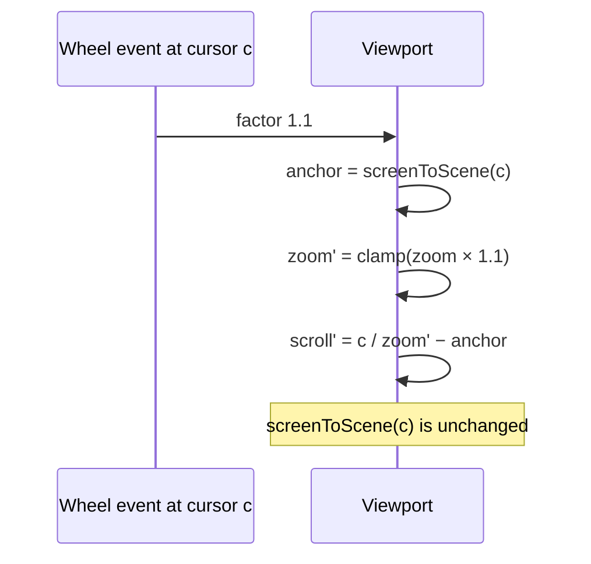

## Problem and purpose

A whiteboard should never run out of space, and users must be able to step back to see the whole diagram or zoom into one label. An **infinite canvas** stores shapes in an unbounded **scene coordinate system** and shows a movable, scalable window onto it (the **viewport**).

Same idea in maps (Google Maps), design tools (Figma), node editors (Blender, Unreal Blueprints), and image viewers.

## Core concepts and terminology

- **Scene (world) coordinates** — where shapes live; never change when you pan or zoom.
- **Screen coordinates** — pixels on the display; pointer events arrive in these.
- **Viewport** — `{scrollX, scrollY, zoom}` mapping between the two.
- **Zoom to cursor** — scaling so the point under the mouse stays put.
- **Culling** — drawing only elements that intersect the visible rectangle.

*Search keywords:* `infinite canvas pan zoom`, `zoom to cursor formula`, `screen to world coordinates`, `canvas setTransform`, `wheel event ctrlKey pinch`.

## How it works



Zoom-to-cursor: remember the scene point under the cursor, change `zoom`, then solve for the scroll that puts the same scene point back under the cursor:



## Related features and components

[[selection-and-transform]] (hit tests need scene coordinates) · [[hand-drawn-shapes]] (stroke widths scale with zoom) · [[real-time-collaboration]] (each user has their own viewport; cursors are sent in scene coordinates).

## Required technical knowledge

[[coordinate-transforms]] · [[spatial-index]] (culling) · [[canvas-2d-drawing]].

## Implementation techniques and APIs

> [!tested] TypeScript — `examples/whiteboard/typescript/src/viewport.ts`
> - **Used for:** Converting pointer positions to scene coordinates and zooming around the cursor.
> - **Input:** A viewport `{scrollX, scrollY, zoom}`, a cursor position in screen pixels, a zoom factor.
> - **Expected output:** A new viewport; `screenToScene(cursor)` returns the same scene point before and after zooming (zoom clamped to 0.1–30).
>
> ```ts
> import { screenToScene, zoomAt, pan } from "./src/viewport.ts";
>
> let view = { scrollX: 0, scrollY: 0, zoom: 1 };
> canvas.addEventListener("wheel", (e) => {
>   e.preventDefault();
>   if (e.ctrlKey) view = zoomAt(view, { x: e.offsetX, y: e.offsetY }, Math.exp(-e.deltaY * 0.01)); // pinch / Ctrl+wheel
>   else view = pan(view, -e.deltaX, -e.deltaY);                                                     // two-finger scroll
>   redraw();
> }, { passive: false });
> ```
> Tests: `screen and scene coordinates round-trip`, `zoomAt keeps the point under the cursor fixed`, `pan moves by screen pixels at any zoom`.

- **Rendering:** `ctx.setTransform(zoom, 0, 0, zoom, scrollX * zoom, scrollY * zoom)` once per frame, then draw in scene units.
- **Culling:** `visibleScene(view, width, height)` → query the [[spatial-index]] → draw only those elements.
- **Trackpads:** browsers report pinch as `wheel` events with `ctrlKey = true`.

## Error handling and edge cases

- Clamp zoom (here 0.1–30) — at extreme zoom, floating-point error and huge stroke widths appear.
- `wheel` listeners must be non-passive to call `preventDefault()`, or the page scrolls/zooms too.
- Keep hit tolerances in screen pixels: divide by zoom when testing in scene units.
- High-DPI screens: scale the canvas backing store by `devicePixelRatio` ([[canvas-2d-drawing]]).

## Testing and debugging

- Round-trip and zoom-anchor tests (above) with odd values (negative scroll, fractional zoom).
- Debug overlay: draw the scene origin and a 100-unit grid to see transforms working.

## Limitations and engineering trade-offs

- "Infinite" is limited by floating point: coordinates around 10⁷ lose sub-pixel precision; re-centre if users wander that far.
- Smooth animated zoom needs interpolation of the viewport, not just jumps.

## Competency checklist

> [!level1] Recognition
> Explain scene vs screen coordinates and why zoom must be anchored at the cursor.

> [!level2] Implementation
> Implement pan, zoom-to-cursor and coordinate conversion with tests; render through a canvas transform.

> [!level3] Engineering
> Add culling, smooth zoom, trackpad gestures, precision handling at large coordinates and per-user viewports in collaboration.

## References

- MDN, `CanvasRenderingContext2D.setTransform` — https://developer.mozilla.org/en-US/docs/Web/API/CanvasRenderingContext2D/setTransform
- MDN, `WheelEvent` — https://developer.mozilla.org/en-US/docs/Web/API/WheelEvent
- Steve Ruiz, *Creating a zoom UI* — https://www.steveruiz.me/posts/zoom-ui
