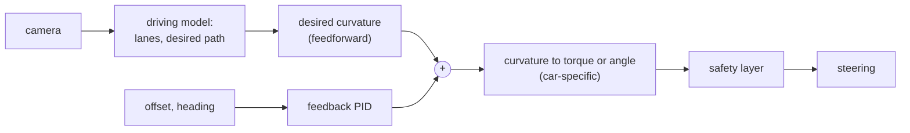

> [!danger] Educational only
> Code on this page runs in simulation. Never connect it to a vehicle.

## Problem and purpose

Holding a car precisely in the middle of its lane for hours is tiring. **Lane centering** estimates where the lane is, decides the path the car should follow, and continuously steers to follow it. Unlike lane-keep *assist* (which only nudges the car back at the edges), centering steers all the time.

Path following is the same problem for warehouse robots, agricultural tractors, drones on a route and line-following robots.

## Core concepts and terminology

- **Lateral offset** — distance from the lane centre; **heading error** — angle between car and lane direction.
- **Curvature** — 1 / turning radius; a convenient, speed-independent steering target.
- **Feedforward + feedback** — feedforward steers for the road's known curve; feedback corrects remaining error ([[pid-controller]]).
- **Steering interfaces** — some cars accept a steering **torque**, others a wheel **angle**; the controller adapts.
- **Driver override** — the driver can always steer against the system; high driver torque pauses it.

*Search keywords:* `lateral control curvature`, `pure pursuit`, `stanley controller`, `lane keeping PID`, `kinematic bicycle model`.

## How it works



## Related features and components

[[adaptive-cruise-control]] · [[independent-safety-layer]] (steering torque rate limits) · [[driver-monitoring]].

## Required technical knowledge

[[pid-controller]] · [[coordinate-transforms]] · [[on-device-ml-inference]] (where the path comes from) · [[fixed-rate-control-loops]].

## Implementation techniques and APIs

> [!tested] Python — `PID` with the `Lateral` simulator
> - **Used for:** Steering a simulated car from 1 m off-centre back to the lane centre.
> - **Input:** Car at 20 m/s, 1.0 m left of centre, heading straight; PID on lateral offset at 20 Hz, curvature output limited to ±0.02 1/m.
> - **Expected output:** Offset below 5 cm after 20 s; overshoot past the centre stays under 30 cm.
>
> ```python
> from drivekit.pid import PID
> from drivekit.sim import Lateral
>
> car = Lateral(y=1.0, psi=0.0, v=20.0)
> pid = PID(kp=0.004, ki=0.0005, kd=0.004, out_min=-0.02, out_max=0.02, rate_hz=20)
> for _ in range(400):                                  # 20 s
>     car.step(curvature=pid.update(0.0, car.y), dt=0.05)
> print(round(car.y, 3))                                # |y| < 0.05
> ```
> Test: `test_lane_centering_converges_without_large_overshoot`. The derivative term acts on the measurement, so it damps the heading (dy/dt ≈ v·heading) without kicking when the target changes.

## Error handling and edge cases

- Faded or missing lane lines: rely on the model's predicted path, or warn and hand back control.
- Tight curves beyond the steering limits: the system must alert, not silently cut a corner.
- Speed dependence: the same curvature error needs gentler gains at high speed — gain scheduling.
- Driver steering against the system must win immediately.

## Testing and debugging

- Simulated step responses: offset, overshoot, settling time; sweeps across speeds.
- Replay recorded drives and compare steering outputs ([[record-and-replay-testing]]).

## Limitations and engineering trade-offs

- Aggressive gains centre tightly but feel twitchy; soft gains feel natural but drift in wind or crowned roads (the integral term handles constant bias).
- Torque-controlled steering differs per car model; every car port needs tuning.

## Competency checklist

> [!level1] Recognition
> Explain offset, heading, curvature, feedforward vs feedback, and driver override.

> [!level2] Implementation
> Implement a lateral controller and tune it in a kinematic simulation to meet overshoot and settling targets.

## References

- Snider, *Automatic Steering Methods for Autonomous Automobile Path Tracking* (CMU, 2009) — pure pursuit, Stanley.
- openpilot lateral controllers (PID, torque, angle) — https://github.com/commaai/openpilot/tree/master/selfdrive/controls/lib
- Rajamani, *Vehicle Dynamics and Control* (bicycle model).
