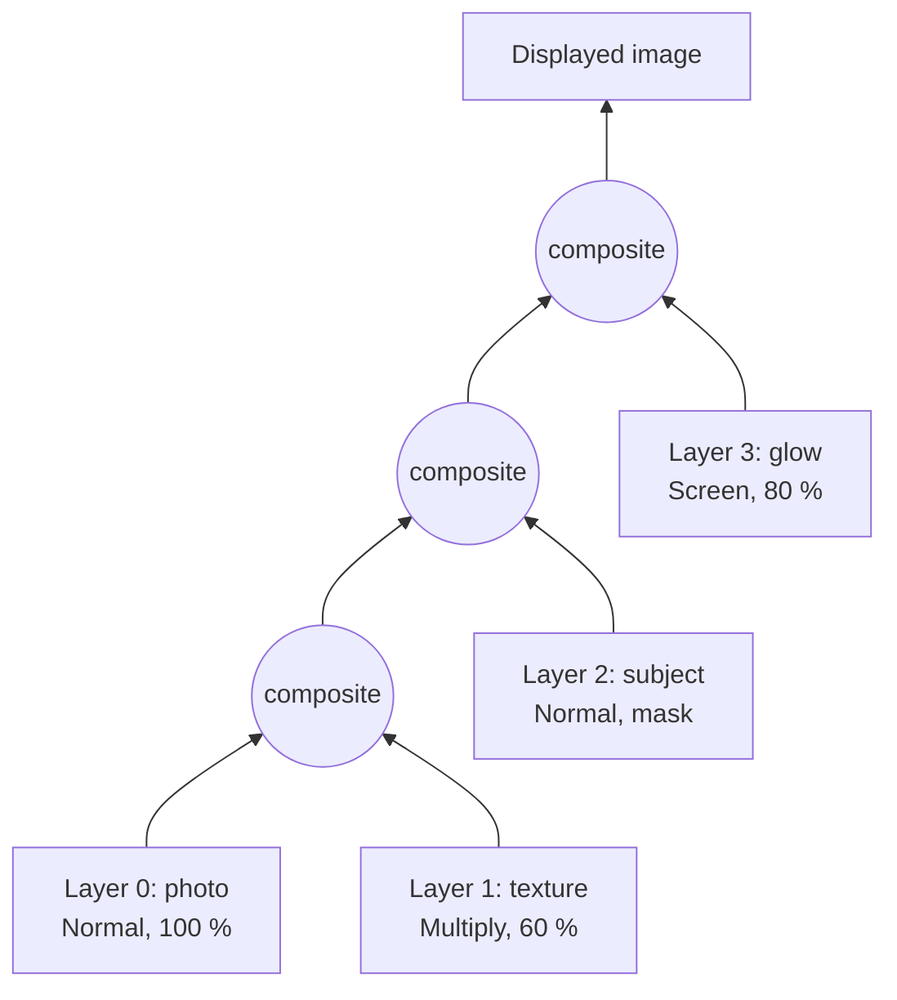

## Problem and purpose

When every edit is painted directly into one image, nothing can be moved, hidden or changed later. **Layers** keep each element (background photo, cut-out subject, text, shadow) in its own transparent image. The editor **composites** them bottom to top on every redraw, and **blend modes** decide how each layer's colours combine with what is beneath.

Same idea elsewhere: video editors (tracks), UI toolkits and browsers (CSS `mix-blend-mode`, z-ordered layers), game engines (render passes), map apps (tile layers).

## Core concepts and terminology

- **Layer stack** — ordered list; index 0 is the bottom. **Flatten** = composite all into one image.
- **Opacity** — scales the layer's alpha. **Fill** (Photoshop) scales content but not layer effects.
- **Blend mode** — function `B(backdrop, source)` per colour channel: Normal, Multiply, Screen, Overlay, …
- **Layer mask** — greyscale image: white shows the layer, black hides it, grey partly.
- **Non-destructive** — adjustments and masks are stored as parameters, not baked into pixels.

*Search keywords:* `alpha compositing source over`, `blend mode formulas multiply screen overlay`, `W3C compositing and blending`, `layer mask`, `premultiplied alpha`.

## How it works



For each pixel, each step computes (W3C Compositing and Blending; `Cb`/`ab` backdrop colour/alpha, `Cs`/`as` source colour/alpha after opacity and mask):

- **Used for:** Compositing one layer onto the running result with any blend mode.
- **Input:** Backdrop colour/alpha `Cb`, `ab`; source colour/alpha `Cs`, `as`; the mode's function `B`.
- **Expected output:** Result colour and alpha; e.g. opaque Multiply of 0.5 over 0.5 gives 0.25, alpha 1.

```
co = as·(1−ab)·Cs + as·ab·B(Cb, Cs) + (1−as)·ab·Cb
ao = as + ab·(1−as)          result colour = co / ao
```

Where the backdrop is transparent the blend mode has no effect — you just see the source. Details in [[alpha-compositing]].

| Mode | `B(Cb, Cs)` | Neutral colour | Typical use |
|---|---|---|---|
| Normal | `Cs` | — | ordinary stacking |
| Multiply | `Cb·Cs` | white | shadows, ink, texture |
| Screen | `Cb+Cs−Cb·Cs` | black | glows, light leaks |
| Overlay | Multiply or Screen depending on `Cb` | 50 % grey | contrast, texture |
| Darken / Lighten | `min` / `max` | white / black | removing backgrounds |
| Difference | `|Cb−Cs|` | black | aligning two layers |

## Related features and components

[[selections-and-masks]] (a selection becomes a layer mask) · [[undo-redo-history]] (layer property changes are commands) · [[tonal-adjustments]] (adjustment layers) · [[brush-painting]] (paints into one layer).

## Required technical knowledge

[[raster-images-and-pixel-formats]] · [[alpha-compositing]] · [[color-spaces-and-gamma]] (blending happens in the document's colour space, usually gamma-encoded sRGB).

## Implementation techniques and APIs

- **Data model:** `Layer {pixels, opacity, blend, visible, mask}`; `Document {width, height, layers[]}`.
- **Rendering:** flatten on demand; cache the composite of everything *below* the layer being edited so a brush stroke only re-composites one layer.
- **APIs:** Python NumPy (vectorized formulas, see [[numpy-image-processing]]); browser Canvas `globalCompositeOperation = "multiply"` and CSS `mix-blend-mode` ([[canvas-imagedata]]); GPU fragment shaders for real time.

> [!tested] Python — `pixkit/blend.py` and `pixkit/layers.py`
> - **Used for:** Building a two-layer document and flattening it with a blend mode and a mask.
> - **Input:** A white background layer and a red layer in Multiply mode, half hidden by a mask.
> - **Expected output:** Flattened RGBA pixels: red `[1, 0, 0, 1]` where the mask is 1, white `[1, 1, 1, 1]` where it is 0.
>
> ```python
> import numpy as np
> from pixkit import Document
>
> doc = Document(width=2, height=1)
> doc.new_layer("background", (1, 1, 1, 1))
> red = doc.new_layer("red", (1, 0, 0, 1))
> red.blend, red.mask = "multiply", np.array([[1.0, 0.0]], np.float32)
> print(doc.flatten())   # [[[1. 0. 0. 1.] [1. 1. 1. 1.]]]
> ```
> Tests: `test_blend_modes_opaque` (13 mode/value cases), `test_source_over_with_transparency`, `test_document_flatten_order_visibility_mask`.

> [!mwe] Browser canvas (TypeScript)
> - **Used for:** Letting the browser composite two images with a blend mode.
> - **Input:** A `<canvas>` element and two loaded `HTMLImageElement`s, `photo` and `texture`.
> - **Expected output:** The canvas shows the texture multiplied into the photo at 60 % opacity.
>
> ```ts
> const ctx = canvas.getContext("2d")!;
> ctx.drawImage(photo, 0, 0);
> ctx.globalAlpha = 0.6;                          // layer opacity
> ctx.globalCompositeOperation = "multiply";      // blend mode
> ctx.drawImage(texture, 0, 0);
> ctx.globalAlpha = 1;
> ctx.globalCompositeOperation = "source-over";   // reset for later drawing
> ```

## Error handling and edge cases

- **Transparent backdrop:** blend modes must not apply where `ab = 0` (the formula above handles it; naive `Cb·Cs` makes transparent areas black).
- **Division by zero** in Color Dodge/Burn and in `co / ao` when the result is fully transparent.
- **Layer sizes and offsets:** real layers can be smaller than the canvas or extend beyond it; composite only the overlapping rectangle.
- **Bit depth:** 8-bit blending accumulates rounding error over many layers; Photoshop offers 16- and 32-bit modes.

## Testing and debugging

- Table-driven tests per blend mode with hand-computed values and **neutral colours** (Multiply with white = unchanged).
- Compare against the W3C formulas or against a browser canvas rendering of the same inputs.
- Debug view: render each layer alone and the running composite after each step.

## Limitations and engineering trade-offs

- Flattening N full-resolution layers on every change is O(N × pixels); production editors cache partial composites and redraw only dirty tiles.
- Some Photoshop modes (Soft Light, Vivid Light, Hue/Saturation/Color/Luminosity) need extra formulas; W3C and Photoshop differ slightly in places, e.g. Soft Light.
- Blending in gamma-encoded space (Photoshop's default for 8/16-bit RGB) differs from physically correct linear-light blending; see [[color-spaces-and-gamma]].

## Competency checklist

> [!level1] Recognition
> Explain layers, opacity, masks and why Multiply darkens and Screen lightens; read the source-over formula.

> [!level2] Implementation
> Implement a layer stack with opacity, masks and at least five blend modes; test neutral colours and transparent backdrops.

> [!level3] Engineering
> Add layer offsets/bounds, partial re-compositing with caches, 16-bit/float pipelines, and match a reference implementation's output.

## References

- W3C, *Compositing and Blending Level 1* — https://www.w3.org/TR/compositing-1/
- Porter & Duff, *Compositing Digital Images*, SIGGRAPH 1984 — https://dl.acm.org/doi/10.1145/964965.808606
- Adobe, *Blending modes* (Photoshop user guide) — https://helpx.adobe.com/photoshop/using/blending-modes.html
- MDN, `globalCompositeOperation` — https://developer.mozilla.org/en-US/docs/Web/API/CanvasRenderingContext2D/globalCompositeOperation
