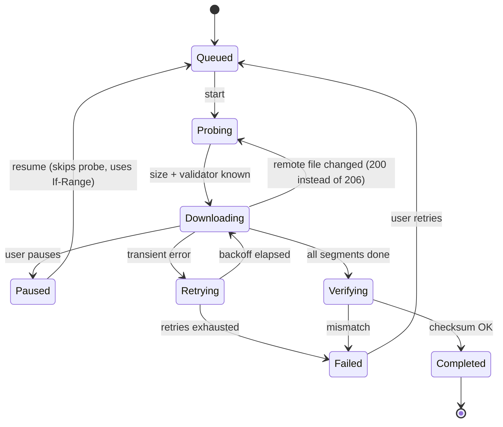
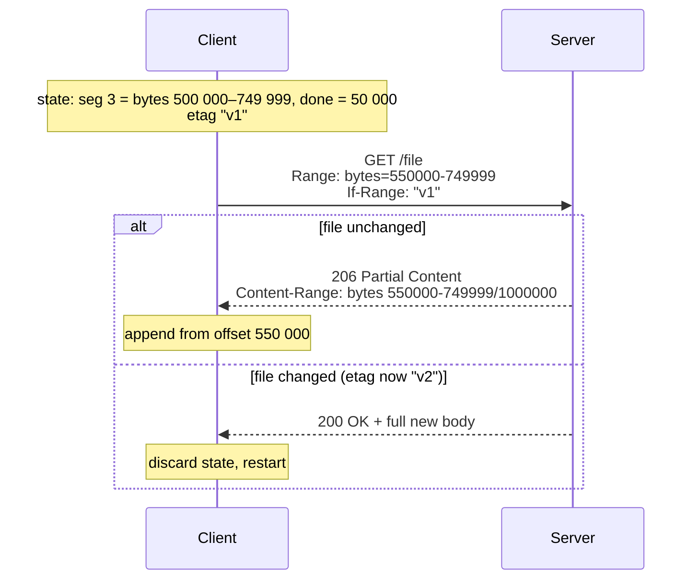
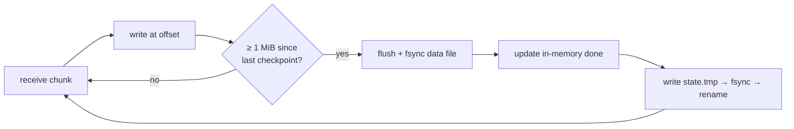

## Problem and purpose

Long transfers fail: Wi-Fi drops, laptops sleep, apps crash, users want to stop now and continue tonight. Without resume support, every failure restarts from byte zero. **Pause and resume** stores enough state to continue from the last byte that is safely on disk — and checks that the remote file is still the same one.

The same pattern appears in resumable uploads (tus protocol, Google Cloud resumable uploads, S3 multipart upload), database checkpoints, video players remembering playback position, and long-running batch jobs.

## Core concepts and terminology

- **Checkpoint** — a persisted record of progress (`segment → bytes done`).
- **Sidecar file** — a state file stored next to the data (`file.zip.part.json`).
- **Validator** — something that identifies a version of the remote file: `ETag` or `Last-Modified`.
- **Durability ordering** — data must be on disk *before* the checkpoint says so.
- **Idempotent retry** — a retry that cannot corrupt data even if the previous attempt partly succeeded.

*Search keywords:* `resumable download If-Range ETag`, `checkpoint fsync ordering`, `atomic rename state file`, `tus resumable upload protocol`.

## How it works



Resume request after a crash, with a change check:



The write-then-record order that makes progress trustworthy:



If the process dies between D and F, the state file under-reports progress — safe, some bytes are fetched twice. The reverse order could claim bytes that never reached disk — silent corruption.

## Related features and components

- [[segmented-download]] — segments are the unit of progress.
- [[download-queue-and-scheduler]] — pausing a queue pauses its tasks.
- [[file-integrity-verification]] — the final guard against anything a resume got wrong.

## Required technical knowledge

[[http-conditional-requests]] · [[http-range-requests]] · [[atomic-writes-and-crash-safety]] · [[finite-state-machine]] · [[retry-with-exponential-backoff]]

## Implementation techniques and APIs

1. **State format:** small JSON is enough — URL, total size, ETag/Last-Modified, list of `{start, end, done}`. Version the schema (`"v": 1`) once others depend on it.
2. **Atomic state writes:** write to a temp file in the same directory, `fsync`, then `os.replace()` / `rename(2)`.
3. **Cooperative cancellation:** a shared stop flag (`threading.Event`, `AbortController`, `std::atomic<bool>`) checked between chunks; sleeping retries wait on the same flag so pause is instant.
4. **Resume:** load the state, skip the probe, request `bytes=<start+done>-<end>` with `If-Range`. Any status other than 206 means "start over".

> [!tested] Python reference — `examples/download-manager/python/minidm/`
> `state.py` (atomic JSON sidecar), `downloader.py` `_commit()` (fsync-then-record), `run()` (restart once on `ResourceChanged`). Tests: `test_pause_then_resume_fetches_only_missing_bytes`, `test_changed_remote_file_restarts_from_scratch`.

> [!mwe] Pausing from another thread (Python 3.10+)
> - **Used for:** Pausing a running download from another thread and resuming it later.
> - **Input:** A `url` variable; the destination file `big.iso`.
> - **Expected output:** After `stop.set()`, `run()` returns `False` and `big.iso.part` + `big.iso.part.json` remain; the second `run()` fetches only the missing bytes and returns `True` with `big.iso` complete.
>
> ```python
> import threading
> from minidm import Downloader
>
> stop = threading.Event()
> dl = Downloader(url, "big.iso", stop_event=stop)
> t = threading.Thread(target=dl.run); t.start()
> ...                      # user clicks "Pause"
> stop.set(); t.join()     # workers exit after their current chunk; state is saved
> Downloader(url, "big.iso").run()   # later: resumes from the sidecar
> ```

## Error handling and edge cases

| Case | Handling |
|---|---|
| Corrupt or truncated state file | treat as no state; restart (never trust a half-written JSON) |
| `.part` file deleted but state present | restart |
| No validator from server (no ETag, no Last-Modified) | resume is a gamble; at least compare total size, and prefer checksum verification at the end |
| Weak ETag (`W/"..."`) | not allowed in `If-Range`; fall back to `Last-Modified` |
| Server returns 416 on resume | file shrank; restart |
| Disk full during write | fail the task with a clear message; keep state so user can free space and resume |
| Clock-based `Last-Modified` with 1-second resolution | two edits within one second look identical — prefer ETag |

## Testing and debugging

- **Pause test:** stop after ~⅓ of the bytes, assert the sidecar exists, resume, assert the second run requested no bytes below the checkpoints.
- **Crash test:** kill the process (`SIGKILL`) at random moments in a loop; every resume must end in a byte-identical file.
- **Change test:** between runs, change the server's body and ETag; assert the result is the *new* file.
- Inspect state with `cat file.part.json | python -m json.tool`.

## Limitations and engineering trade-offs

- **Checkpoint interval:** frequent checkpoints = less refetching after a crash, more `fsync` cost. 1–4 MiB per segment is typical.
- **Signed URLs** (S3 pre-signed, CDN tokens) expire; resuming later may need a fresh URL from the original page — store the referrer/page URL too.
- Servers that generate content dynamically cannot resume at all.

## Competency checklist

> [!level1] Recognition
> Explain why resume needs both a byte offset and a validator; name `If-Range`, `ETag`, `206`, and the fsync-before-record rule.

> [!level2] Implementation
> Persist progress atomically, resume with `If-Range`, restart on 200/416, and test pause + resume + changed-file cases.

> [!level3] Engineering
> Survive `SIGKILL` at any point, tune checkpoint frequency, handle expiring URLs and servers without validators, and reason about crash consistency on different filesystems.

## References

- RFC 9110 §13.1.5 *If-Range* — https://www.rfc-editor.org/rfc/rfc9110#section-13.1.5
- tus resumable upload protocol — https://tus.io/protocols/resumable-upload
- Dan Luu, *Files are hard* — https://danluu.com/file-consistency/
