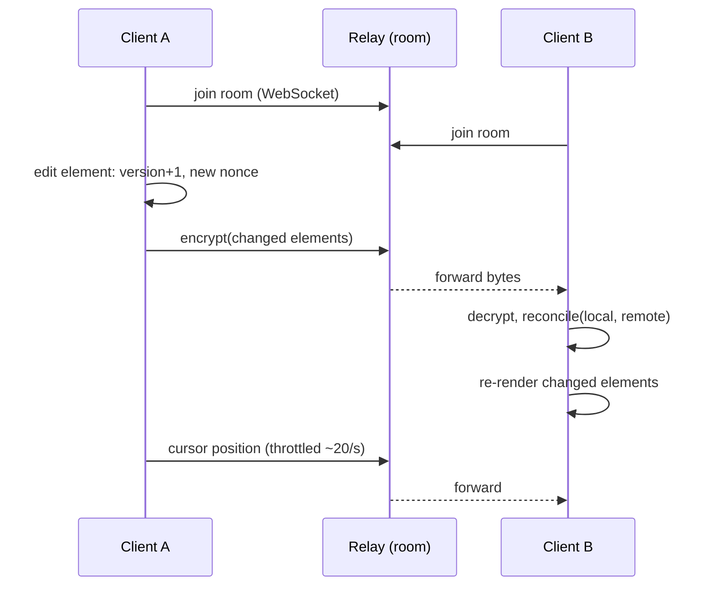
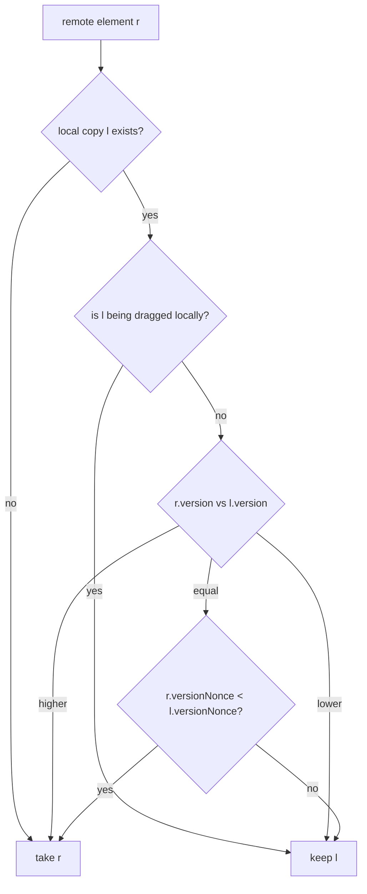

## Problem and purpose

Several people edit one drawing at the same time, each seeing the others' changes within a fraction of a second, without a "save" step and without anyone's work being silently scrambled. Three problems must be solved: **transport** (get updates to everyone quickly), **conflict resolution** (two people change the same thing), and **presence** (who is here, where is their cursor).

Same feature in Google Docs, Figma, Miro, multiplayer games, VS Code Live Share, Notion.

## Core concepts and terminology

- **Room** — the set of clients editing one scene.
- **Relay server** — forwards messages between clients in a room; here it cannot read them ([[end-to-end-encryption]]).
- **Last-writer-wins (LWW) per element** — each element has a `version`; higher wins, ties broken by a random `versionNonce` ([[conflict-resolution]]).
- **Tombstone** — deleted elements stay as `isDeleted: true` so deletions sync like edits.
- **Presence** — cursors, selections, usernames; ephemeral, never stored.
- **Convergence** — after all messages arrive, every client shows the same scene regardless of arrival order.

*Search keywords:* `real-time collaboration architecture`, `last writer wins element version`, `CRDT vs OT`, `presence cursors websocket`, `figma multiplayer`.

## How it works





## Related features and components

[[encrypted-sharing-links]] · [[selection-and-transform]] (protect the element under the cursor) · [[undo-redo-history]] (undo must only revert *your* changes) · [[scene-files-and-export]].

## Required technical knowledge

[[conflict-resolution]] · [[websockets]] · [[end-to-end-encryption]] · [[fractional-indexing]] (concurrent z-order) · [[debounce-and-throttle]] (cursor and update rates).

## Implementation techniques and APIs

> [!tested] TypeScript — `reconcile` in `src/reconcile.ts`
> - **Used for:** Merging collaborators' element updates deterministically.
> - **Input:** The local element map, an array of remote elements, optionally the id the local user is editing.
> - **Expected output:** A new map where each id holds the winner by (version, then lower versionNonce); the locally edited element is left untouched. Clients that receive the same updates in any order end up identical.
>
> ```ts
> import { reconcile } from "./src/reconcile.ts";
> scene = reconcile(scene, remoteElements, { editingId: draggingId });
> ```
> Tests: `winner: higher version, then lower nonce`, `deletion is a tombstone that wins like any edit`, `the element being edited locally is not overwritten`, `replicas converge whatever order updates arrive in` (300 random edits on 3 replicas).

> [!tested] End-to-end demo — `examples/whiteboard/typescript/relay/`
> - **Used for:** Watching two real clients edit the same element concurrently through an encrypted WebSocket relay.
> - **Input:** None; the smoke test starts the relay on a random port and runs `collab-demo.ts`.
> - **Expected output:** Both clients print the same scene (e.g. `box@x=40,w=100 circle@x=200,w=50`) and `converged: both clients show the same scene`. Note that one of the two concurrent edits (the resize) is lost — per-element LWW keeps one whole version.
>
> ```bash
> examples/whiteboard/smoke_test.sh
> ```

## Error handling and edge cases

- **Concurrent edits to different properties of one element** are lost under per-element LWW (the demo shows it). Per-property merge or CRDTs fix it at a cost ([[conflict-resolution]]).
- **Reconnect:** after a drop, send your full scene and receive others'; reconcile makes duplicates harmless.
- **New joiner:** someone must send the current scene; Excalidraw has existing clients broadcast it.
- **Tombstones grow forever** — compact them when everyone has seen the deletion (or on save).
- **Large scenes:** send only elements whose version changed since the last broadcast.

## Testing and debugging

- Property test: random edits on N replicas, deliver in shuffled orders, assert identical results (in sketchkit).
- Network fault injection: delay, drop and reorder messages in a fake transport.
- Two browser windows side by side, one throttled in DevTools to "Slow 3G".

## Limitations and engineering trade-offs

- LWW is simple, needs no server logic, and is good enough for whole-shape edits; text editing needs OT/CRDT.
- A relay with no persistence means a room exists only while someone is connected; persistence needs encrypted storage.
- Trusting clients: any participant can broadcast junk; validate element shapes before applying.

## Competency checklist

> [!level1] Recognition
> Explain rooms, relay servers, version/nonce LWW, tombstones, presence and convergence.

> [!level2] Implementation
> Implement element versioning, reconcile and a WebSocket relay; test convergence with shuffled delivery.

> [!level3] Engineering
> Handle reconnects, joiners, incremental sync, tombstone compaction, multiplayer undo and choose between LWW and CRDTs.

## References

- Excalidraw blog, *Building Excalidraw's P2P Collaboration Feature* — https://blog.excalidraw.com/building-excalidraw-p2p-collaboration-feature/
- Figma blog, *How Figma's multiplayer technology works* — https://www.figma.com/blog/how-figmas-multiplayer-technology-works/
- Martin Kleppmann et al., *Local-first software* — https://www.inkandswitch.com/local-first/
