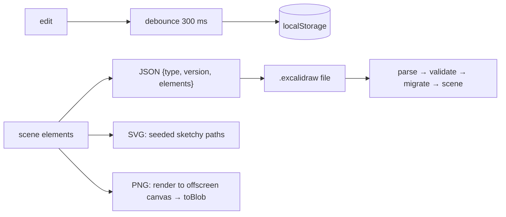

## Problem and purpose

Drawings must survive a closed tab, be shareable as files, and be exportable into documents and slides. Excalidraw autosaves to the browser, saves an open, versioned JSON format (`.excalidraw`), and exports PNG/SVG — optionally **embedding the scene inside the PNG/SVG** so the image can be re-opened for editing.

## Core concepts and terminology

- **Serialization** — turning the in-memory scene into text/bytes and back.
- **Format version** — number in the file so newer apps can migrate older files and reject unknown newer ones.
- **Validation** — never trust a loaded file's shape; check types and ranges.
- **Autosave** — save on change, but **debounced** so typing does not write on every keystroke ([[debounce-and-throttle]]).
- **Raster vs vector export** — PNG (pixels) vs SVG (shapes, scalable).

*Search keywords:* `json file format versioning migration`, `localStorage autosave debounce`, `canvas toBlob png export`, `embed json in png text chunk`, `svg export`.

## How it works



## Related features and components

[[hand-drawn-shapes]] (export reuses the seeded strokes) · [[encrypted-sharing-links]] (the JSON is what gets encrypted) · [[real-time-collaboration]].

## Required technical knowledge

[[vector-graphics-and-scene-model]] · [[debounce-and-throttle]] · [[atomic-writes-and-crash-safety]] (for desktop/file-system saves) · [[raster-images-and-pixel-formats]] (PNG export).

## Implementation techniques and APIs

> [!tested] TypeScript — `Scene.toJSON`, `Scene.fromJSON`, `Scene.toSVG` in `src/scene.ts`
> - **Used for:** Saving, loading with validation, and exporting a hand-drawn SVG.
> - **Input:** A scene; for loading, the file's text.
> - **Expected output:** JSON with `type: "sketchkit"`, `version: 1` and the live elements; `fromJSON` returns an equal scene or throws `not a sketchkit file`, `unsupported file version 99` or `element 3: x must be a finite number` (every element is validated; missing optional fields get defaults, unknown element types are kept); `toSVG` returns the same SVG string on every call, with rotated ellipses carrying a `transform="rotate(...)"`.
>
> ```ts
> import { Scene } from "./src/scene.ts";
> import { debounce } from "./src/timing.ts";
>
> const autosave = debounce(() => localStorage.setItem("scene", scene.toJSON()), 300);
> onSceneChange(autosave);
> const restored = Scene.fromJSON(localStorage.getItem("scene") ?? '{"type":"sketchkit","version":1,"elements":[]}');
> download("drawing.svg", restored.toSVG());
> ```
> Tests: `JSON round trip and validation`, `loading validates every element, not only the file header`, `SVG export is deterministic and hand-drawn`, `SVG export keeps the rotation of ellipses`, `debounce: one call after the burst ends`.

- **PNG export in the browser:** draw the scene on an `OffscreenCanvas` sized to the content bounds × scale, then `canvas.convertToBlob({ type: "image/png" })`.
- **Embedding the scene** (as Excalidraw does): store the JSON in a PNG `tEXt` chunk or an SVG `<metadata>` element; on import, look for it before treating the file as a plain image.
- **Saving files:** File System Access API (`showSaveFilePicker`) where supported, otherwise a download link.

## Error handling and edge cases

- `localStorage` quota (often ~5 MB per origin) — large images need IndexedDB.
- Older files: migrate (add defaults for new fields) instead of rejecting.
- Malformed files: validate and show an error; never `eval` or trust embedded HTML.
- Empty scene export: return a valid empty image, not a crash.

## Testing and debugging

- Round-trip test: save → load → deep-equal.
- Golden files: keep one file per format version in the test suite to prove migrations keep working.
- Deterministic SVG output enables snapshot tests.

## Limitations and engineering trade-offs

- JSON is readable and diff-friendly but larger than binary formats; gzip it for storage.
- Embedding the scene in exports increases file size but makes images editable again.

## Competency checklist

> [!level1] Recognition
> Explain format versioning, validation, debounced autosave and raster vs vector export.

> [!level2] Implementation
> Implement save/load with validation and versioning, debounced autosave, and SVG export with tests.

## References

- Excalidraw, *JSON schema* (developer docs) — https://docs.excalidraw.com/docs/codebase/json-schema
- MDN, `OffscreenCanvas.convertToBlob` — https://developer.mozilla.org/en-US/docs/Web/API/OffscreenCanvas/convertToBlob
- PNG specification, textual chunks — https://www.w3.org/TR/png-3/#11textinfo
- MDN, File System Access API — https://developer.mozilla.org/en-US/docs/Web/API/File_System_API
