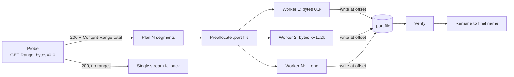
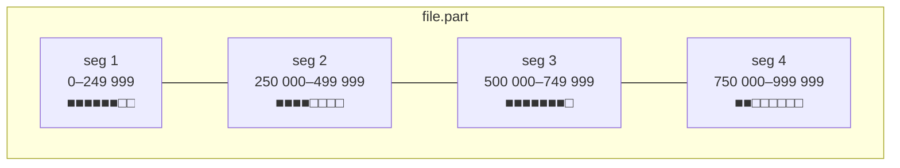

## Problem and purpose

A single HTTP connection often cannot use all available bandwidth: servers cap per-connection speed, TCP needs time to ramp up, and on long-distance links one flow is limited by latency and packet loss. **Segmented download** splits a file into byte ranges and fetches them over several connections at once, then writes each range into its place in the output file.

Used by: [[internet-download-manager|IDM]], aria2, browser "parallel downloading" flags, cloud SDKs (AWS S3 Transfer Manager's multipart download, `gsutil -o GSUtil:parallel_thread_count`), package managers, video players (segment prefetching).

## Core concepts and terminology

- **Segment / chunk / part** — a contiguous byte range `[start, end]` assigned to one worker.
- **Probe** — the first request that discovers file size and whether the server accepts ranges.
- **Positional write** — writing at an explicit offset (`pwrite`) instead of appending.
- **Preallocation** — reserving the final file size up front.
- **Dynamic re-segmentation (work stealing)** — splitting a slow segment so an idle worker can take half.

*Search keywords:* `HTTP range request parallel download`, `multi-connection download accelerator`, `Accept-Ranges bytes`, `206 Partial Content`, `pwrite concurrent writes`, `aria2 split min-split-size`.

## How it works



Segment layout in the file — each worker owns a disjoint region, so no locking is needed for data writes:



### Dynamic re-segmentation

With a static split, the download finishes only when the slowest segment does. IDM-style managers avoid that:

> [!pseudocode] Work stealing between segments
> ```
> when worker W finishes its segment:
>     S = unfinished segment with the most remaining bytes
>     if S.remaining > MIN_SPLIT:
>         mid = S.next_offset + S.remaining / 2
>         new = Segment(mid, S.end)
>         S.end = mid - 1           # owner of S stops earlier
>         W.start(new)
> ```
> The shrinking of `S.end` must be visible to S's worker (shared state + lock, or a message), and the worker must stop reading at the new end even though its HTTP request asked for more — it closes the connection early.

## Related features and components

- [[pause-and-resume]] — segments are also the unit of resumable progress.
- [[bandwidth-limiting]] — a shared limiter caps the sum of all segments.
- [[download-queue-and-scheduler]] — limits how many connections all downloads together may open.

## Required technical knowledge

[[http-range-requests]] · [[parallel-tcp-throughput]] · [[worker-pool]] · [[random-access-file-io]] · [[retry-with-exponential-backoff]]

## Implementation techniques and APIs

| Step | Technique | Python | TypeScript (Node) | C++ |
|---|---|---|---|---|
| Probe | `Range: bytes=0-0`, read `Content-Range` | `urllib.request`, `httpx` | `fetch` | libcurl `CURLOPT_RANGE` / `CURLOPT_NOBODY` |
| Workers | thread pool or async tasks | `ThreadPoolExecutor`, `asyncio.TaskGroup` | `Promise.all` | `std::thread` + one `CURL*` per thread |
| Write | positional write | `f.seek()+write` per handle, `os.pwrite` (POSIX) | `FileHandle.write(buf, 0, len, pos)` | `pwrite(2)` |
| Preallocate | set length | `f.truncate(n)` | `FileHandle.truncate(n)` | `ftruncate(2)`, `posix_fallocate(3)` |

Cookbook: [[http-streaming-in-python]] · [[python-threads-and-asyncio]] · [[node-fetch-and-file-handles]] · [[libcurl-easy-interface]]

## Minimal working examples

> [!mwe] TypeScript, Node.js ≥ 22.18 — `examples/download-manager/typescript/segmented-download.ts`
> ```ts
> const { total, ranges } = await probe(url);           // Range: bytes=0-0
> const file = await open(`${dest}.part`, "w");
> await file.truncate(total);                            // preallocate
> await Promise.all(split(total, 4).map((r) => fetchRange(url, r, file)));
> await file.sync(); await file.close();
> await rename(`${dest}.part`, dest);
> ```
> Full file (≈90 lines) includes retry with jittered backoff. Smoke-tested by `examples/download-manager/smoke_test.sh`.

> [!tested] Python reference — `examples/download-manager/python/minidm/downloader.py`
> Segmented + resumable + rate-limited + checksum-verified, standard library only. 20 pytest cases including dropped connections, 503 retries, pause/resume, and remote file changes.

## Error handling and edge cases

| Case | Symptom | Handling |
|---|---|---|
| Server ignores `Range` | `200 OK` with full body | fall back to one stream; never write a 200 body at a non-zero offset |
| Unknown size | no `Content-Range` total, no `Content-Length` (chunked) | single stream only |
| Tiny file | more segments than bytes | enforce a minimum segment size (e.g. 256 KiB–1 MiB) |
| Server caps connections per IP | `429`, `503`, or resets | back off; reduce connections dynamically |
| Redirect to signed CDN URL that expires | `403` mid-download | re-resolve the original URL, keep the validator check |
| Wrong `Content-Range` start | data would land at wrong offset | verify `start` in each 206 response |
| Connection closes early | fewer bytes than requested | treat as transient; resume from last written byte |

## Testing and debugging

- Run a local server that supports ranges and can **inject faults** (drop after N bytes, return 503, change ETag). See [[testing-network-code-locally]].
- Assert that the output equals the source byte-for-byte (compare hashes) and that retries **never re-request bytes already written**.
- Debug with `curl -v -r 0-99 URL` to see what the server returns; `curl -I` shows `Accept-Ranges`.
- Log per-segment throughput; one slow segment points at re-segmentation needs, all slow points at the link.

## Limitations and engineering trade-offs

- **Fairness:** N connections take roughly N times the bottleneck share from other users — why many servers limit connections per client.
- **Diminishing returns:** beyond the point where the link is saturated, more connections only add overhead (handshakes, TLS, server load). 4–8 is a common sweet spot; measure.
- **HTTP/2 and HTTP/3** multiplex streams over one connection, so parallel *streams* do not get extra TCP flows; parallelism helps only when the bottleneck is per-stream server throttling.
- **Disk pattern:** parallel writes at distant offsets are fine on SSDs; on HDDs they cause seeks — preallocation and larger write buffers help.
- **Complexity:** resumable segmented state is far more complex than one stream. Start simple — see [[build-a-download-manager]].

## Competency checklist

> [!level1] Recognition
> Explain why one connection may be slower than four; name the headers `Range`, `Content-Range`, `Accept-Ranges` and status `206`.

> [!level2] Implementation
> Write a downloader that probes, splits into N ranges, downloads them in parallel with positional writes, falls back to single stream, and passes a byte-for-byte comparison test.

> [!level3] Engineering
> Add dynamic re-segmentation, adaptive connection counts based on measured throughput, and explain behaviour on HTTP/2 and under per-IP limits.

## References

- RFC 9110 §14 *Range Requests* — https://www.rfc-editor.org/rfc/rfc9110#section-14
- aria2 options `--split`, `--min-split-size`, `--max-connection-per-server` — https://aria2.github.io/manual/en/html/aria2c.html
- `pwrite(2)` — https://man7.org/linux/man-pages/man2/pwrite.2.html
