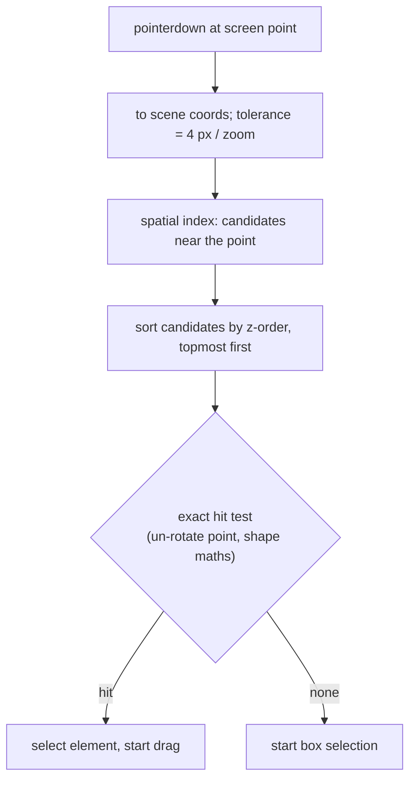

## Problem and purpose

Before moving or editing a shape, the user must pick it: click on it, or drag a box around several. The editor must answer "what is under this pixel?" correctly for thin lines, rotated shapes, overlapping shapes and thousands of elements — fast enough to run on every pointer move (for hover highlighting).

Same problem in every vector editor (Figma, Illustrator), CAD, map apps (click a road), games (click a unit), and charting libraries (tooltips).

## Core concepts and terminology

- **Hit testing** — deciding whether a point touches a shape ([[hit-testing]]).
- **Tolerance** — extra margin so thin lines are clickable; defined in screen pixels.
- **Z-order** — stacking order; a click selects the **topmost** hit.
- **Bounding box** — axis-aligned rectangle around a shape; quick reject before exact tests.
- **Box (marquee) selection** — select elements fully inside a dragged rectangle.
- **Transform handles** — resize corners/edges and a rotation handle around the selection.

*Search keywords:* `hit testing vector shapes`, `point to segment distance`, `rotated rectangle hit test`, `marquee selection`, `resize handles rotation math`.

## How it works



Rotated shapes: instead of rotating the shape, rotate the **point** by the opposite angle around the shape's centre, then test against the unrotated shape.

## Related features and components

[[infinite-canvas]] (coordinate conversion) · [[real-time-collaboration]] (the element being dragged is protected from remote overwrites) · [[undo-redo-history]] (a drag is one undoable step).

## Required technical knowledge

[[hit-testing]] · [[spatial-index]] · [[coordinate-transforms]] · [[fractional-indexing]] (z-order).

## Implementation techniques and APIs

> [!tested] TypeScript — `Scene.hit` and `Scene.selectInBox` in `src/scene.ts`
> - **Used for:** Click selection of the topmost element and box selection of fully enclosed elements.
> - **Input:** A scene, a point in scene coordinates (or a box), a tolerance in scene units.
> - **Expected output:** `hit` returns the topmost element under the point or `undefined`; `selectInBox` returns the elements whose rotated bounds lie entirely inside the box, in z-order.
>
> ```ts
> import { Scene } from "./src/scene.ts";
> import { screenToScene } from "./src/viewport.ts";
>
> const p = screenToScene({ x: e.offsetX, y: e.offsetY }, view);
> const target = scene.hit(p, 4 / view.zoom);              // 4 screen pixels at any zoom
> const boxed = scene.selectInBox({ minX: 40, minY: 40, maxX: 160, maxY: 160 });
> ```
> Tests: `hit returns the topmost element; deleted elements are skipped`, `box selection takes only fully contained elements`, `rectangle hit test uses tolerance and undoes rotation`.

- **Dragging:** on pointermove, `dx/zoom, dy/zoom` added to each selected element's x, y via `updateElement`.
- **Pointer capture:** `canvas.setPointerCapture(e.pointerId)` keeps receiving moves when the pointer leaves the canvas.

## Error handling and edge cases

- Filled vs outline-only shapes: Excalidraw hits transparent shapes only near the outline; filled ones anywhere inside.
- Deleted (tombstoned) elements must be invisible to hit tests.
- Negative width/height after dragging a resize handle past the opposite edge — normalize the box.
- Equal z-order keys from concurrent inserts — break ties by id so every client agrees.

## Testing and debugging

- Unit tests per shape type, including rotated ones and points exactly on the tolerance boundary.
- Property test: spatial-index query equals brute force (in sketchkit's tests).
- Debug overlay: draw bounding boxes and the hit-tolerance outline.

## Limitations and engineering trade-offs

- Exact hit tests on long freehand strokes are O(points); the spatial index keeps the candidate list short.
- Pixel-perfect picking (render IDs to a hidden canvas, read the pixel) is simpler for complex shapes but costs a render pass.

## Competency checklist

> [!level1] Recognition
> Explain hit testing, tolerance, z-order and why rotated shapes are tested by un-rotating the point.

> [!level2] Implementation
> Implement click and box selection with tolerance, rotation and z-order; drag selected elements.

> [!level3] Engineering
> Add resize/rotate handles with correct maths, spatial indexing for 10 000+ elements, and collaboration-safe dragging.

## References

- Real-Time Collision Detection (Ericson), ch. 5 basic primitive tests.
- MDN, `Element.setPointerCapture` — https://developer.mozilla.org/en-US/docs/Web/API/Element/setPointerCapture
- tldraw source (open-source whiteboard, readable hit-testing code) — https://github.com/tldraw/tldraw
