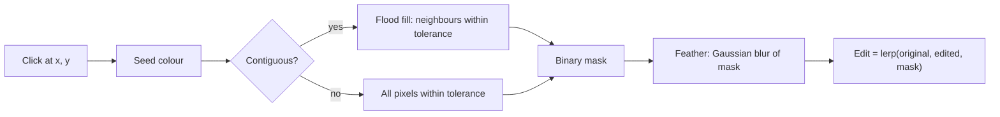

## Problem and purpose

Most edits should affect only part of an image: brighten the face, not the sky; delete the background, not the person. A **selection** marks which pixels an operation may change. Internally it is a **mask**: one value per pixel from 0 (not selected) to 1 (fully selected), with in-between values for soft edges.

## Core concepts and terminology

- **Marquee** — rectangle or ellipse selection. **Lasso** — freehand polygon.
- **Magic wand** — select pixels similar in colour to a clicked pixel; **tolerance** (Photoshop default 32 on a 0–255 scale) and **contiguous** (connected only) options. Under the hood: [[flood-fill]].
- **Feather** — blur the mask edge so edits fade out instead of cutting sharply.
- **Anti-aliasing** — partial coverage values on shape edges to avoid jaggies.
- **Selection arithmetic** — add (Shift), subtract (Alt/Option), intersect (Shift+Alt).
- **Layer mask** — a selection saved onto a layer to hide parts of it non-destructively.

*Search keywords:* `magic wand tolerance flood fill`, `selection mask feather gaussian`, `marching ants`, `alpha mask compositing`.

## How it works



An edit through a mask is a per-pixel blend: `result = original + mask × (edited − original)`.

## Related features and components

[[layers-and-blend-modes]] (layer masks) · [[tonal-adjustments]] and [[image-filters]] (applied through the selection) · [[brush-painting]] (painting on a mask = refining the selection).

## Required technical knowledge

[[flood-fill]] · [[convolution-and-kernels]] (feathering) · [[raster-images-and-pixel-formats]] (masks are single-channel images).

## Implementation techniques and APIs

> [!tested] Python — `pixkit/selection.py`
> - **Used for:** Selecting a region by colour, softening its edge, and applying an edit only inside it.
> - **Input:** An RGBA float image `img`, a click at (120, 80), tolerance 32.
> - **Expected output:** `mask` is an `(H, W)` float array (1 inside the clicked region, fading over a few pixels at the edge); `result` equals `img` outside the selection and the inverted image inside.
>
> ```python
> from pixkit import magic_wand, feather
>
> mask = magic_wand(img, x=120, y=80, tolerance=32, contiguous=True)
> mask = feather(mask, radius=2.0)
> edited = img.copy(); edited[..., :3] = 1 - img[..., :3]           # e.g. invert
> result = img + mask[..., None] * (edited - img)                    # edit through the mask
> ```
> Tests: `test_magic_wand_contiguous_vs_global_and_tolerance`, `test_magic_wand_connectivity`, `test_shapes_feather_combine`.

- **Rendering "marching ants":** trace the mask's 0.5 contour (marching squares) and draw a dashed, animated outline.
- **Browser:** `ctx.clip()` with a path gives a hard vector selection; for soft selections keep your own mask array ([[canvas-imagedata]]).

## Error handling and edge cases

- Seed outside the image → reject before indexing.
- Very large contiguous regions: recursive flood fill overflows the stack — use an explicit queue or scanline fill.
- Tolerance semantics differ between tools (max channel difference, Euclidean RGB distance, perceptual ΔE); document yours.
- Anti-aliased image edges contain blended colours that tolerance may miss — users fix this with "Refine Edge"/feathering.

## Testing and debugging

- Synthetic images with known regions (two squares, diagonal pixels) make expected masks exact; see the tests above.
- Visualize masks as greyscale images or as a red overlay.

## Limitations and engineering trade-offs

- Colour similarity selects by colour, not by object; modern tools add ML segmentation ("Select Subject").
- Feathering with a Gaussian is simple but also softens corners; edge-aware refinement costs more.

## Competency checklist

> [!level1] Recognition
> Explain masks, tolerance, contiguous vs global selection, feathering and selection arithmetic.

> [!level2] Implementation
> Implement rectangle/ellipse/magic-wand selections, feather them, combine them, and apply an edit through a mask.

## References

- Adobe, *Select with the Magic Wand tool* — https://helpx.adobe.com/photoshop/user-guide.html
- Flood fill — https://en.wikipedia.org/wiki/Flood_fill
- Marching squares — https://en.wikipedia.org/wiki/Marching_squares
