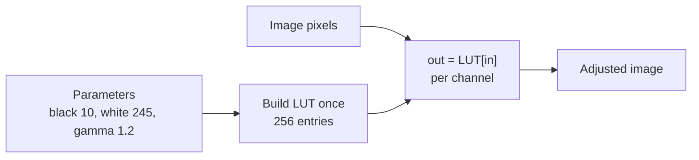

## Problem and purpose

Photos come out too dark, too flat or too contrasty. **Tonal adjustments** remap each pixel's brightness through a function: Levels stretches a range, Curves applies an arbitrary tone curve, Invert flips it. Because the output depends only on the input value (not on neighbours), every such adjustment can be precomputed as a **lookup table**.

Same pattern elsewhere: camera picture profiles, video colour grading (3-D LUT `.cube` files), display gamma, game post-processing, thermal-camera palettes.

## Core concepts and terminology

- **Histogram** — count of pixels per brightness level; guides where to set black and white points.
- **Levels** — input black point, white point and midtone **gamma**; output range.
- **Curves** — user-drawn curve through control points; steeper = more contrast in that tonal range.
- **Clipping** — values pushed beyond 0 or 255 lose detail.
- **Adjustment layer** — stores the adjustment's parameters as a layer, so it stays editable (non-destructive).

*Search keywords:* `levels black point white point gamma formula`, `tone curve LUT`, `histogram equalization`, `3D LUT cube`.

## How it works



Levels formula used here: `t = clamp((v − black) / (white − black), 0, 1) ^ (1 / gamma)`, then map `t` to the output range.

## Related features and components

[[selections-and-masks]] (adjust through a mask) · [[layers-and-blend-modes]] (adjustment layers) · [[undo-redo-history]].

## Required technical knowledge

[[lookup-tables]] · [[color-spaces-and-gamma]] · [[raster-images-and-pixel-formats]] (8-bit vs 16-bit precision).

## Implementation techniques and APIs

> [!tested] Python — `pixkit/adjust.py`
> - **Used for:** Applying Levels and Curves to an 8-bit image through lookup tables.
> - **Input:** `img_u8`, a uint8 `(H, W, 4)` image.
> - **Expected output:** uint8 images of the same shape, alpha unchanged. With these Levels, input 10 maps to 0, input 245 to 255, and midtones get brighter; the curve maps 64 → 96 exactly.
>
> ```python
> from pixkit import apply_lut, curves_lut, levels_lut
>
> brighter = apply_lut(img_u8, levels_lut(black=10, white=245, gamma=1.2))
> s_curve = apply_lut(img_u8, curves_lut([(0, 0), (64, 48), (192, 208), (255, 255)]))
> lifted = apply_lut(img_u8, curves_lut([(0, 0), (64, 96), (255, 255)]))
> ```
> Tests: `test_levels_identity_and_endpoints`, `test_curves_hit_control_points_and_invert`, `test_apply_lut_leaves_alpha`.

- Histogram for the UI: `np.bincount(channel.ravel(), minlength=256)`.
- **Auto levels:** set black/white at the 0.1 % and 99.9 % percentiles of the histogram.

## Error handling and edge cases

- `white <= black` divides by zero — reject.
- Gamma ≤ 0 is invalid.
- 8-bit LUTs on 8-bit data cause **banding** (posterization) after strong adjustments; process in 16-bit or float.
- Curves with non-increasing control points invert tones — allowed, but warn in the UI.

## Testing and debugging

- Identity parameters must produce the identity LUT exactly.
- Check endpoints and a hand-computed midpoint (see the tests).
- Plot the LUT; a broken curve is obvious as a graph.

## Limitations and engineering trade-offs

- Per-channel LUTs on RGB shift hue when contrast changes; adjusting luminosity only (or in Lab) avoids it.
- Linear interpolation between curve points (used here) has corners; Photoshop draws a smooth spline — a monotone cubic spline avoids overshoot.

## Competency checklist

> [!level1] Recognition
> Read a histogram; explain black/white points, gamma, curves and why a LUT makes them fast.

> [!level2] Implementation
> Build Levels/Curves/Invert LUTs, apply them per channel, and test identity and endpoints.

## References

- Adobe, *Levels adjustment* — https://helpx.adobe.com/photoshop/using/levels-adjustment.html
- Adobe, *Curves adjustment* — https://helpx.adobe.com/photoshop/using/curves-adjustment.html
- Monotone cubic interpolation — https://en.wikipedia.org/wiki/Monotone_cubic_interpolation
