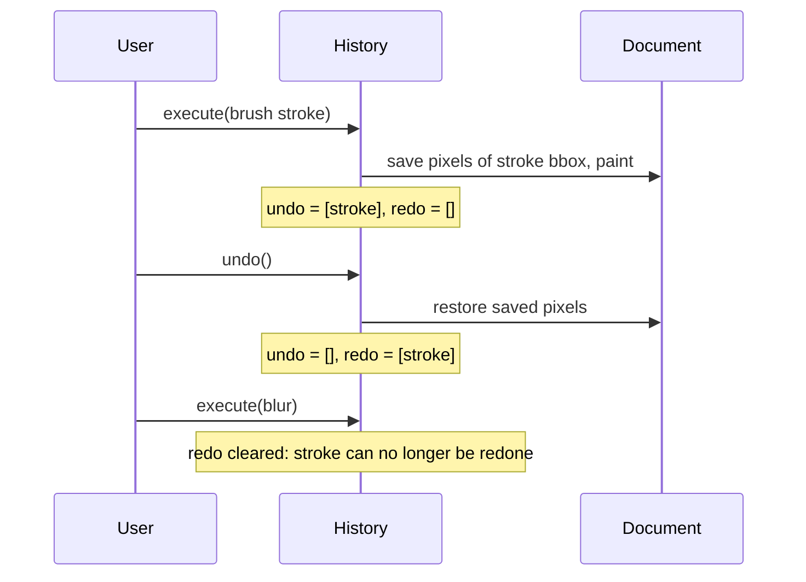
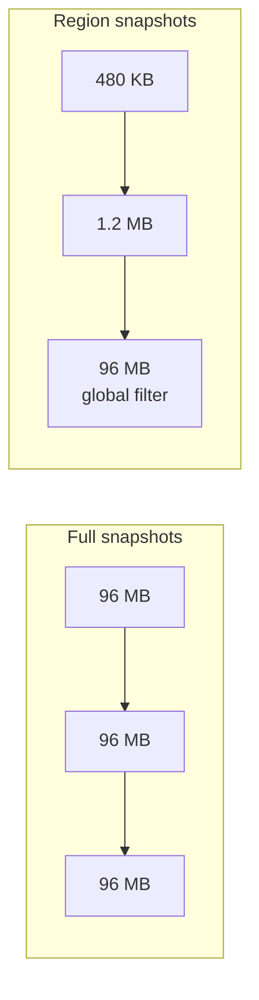

## Problem and purpose

People experiment. Without undo, every brush stroke is a commitment and users work slowly and fearfully. **Undo/redo** lets them step back and forward through their edits; Photoshop's **History panel** shows the list and lets them jump to any earlier state.

Every serious editor has it: text editors, IDEs, spreadsheets, CAD tools, Figma (with multiplayer undo), databases (transaction rollback).

## Core concepts and terminology

- **Command** — an object representing one edit, with `do()` and `undo()` ([[command-pattern]]).
- **Undo stack / redo stack** — executed commands, and undone commands that can be redone.
- **Branch discard** — a new edit after undo clears the redo stack (linear history).
- **History limit** — maximum number of steps kept; Photoshop's default is 50 history states.
- **Snapshot / memento** — stored copy of state before an edit; for images, only the **touched region**.
- **Copy-on-write tiles** — share unchanged tiles between states, copy only modified ones ([[copy-on-write]]).

*Search keywords:* `command pattern undo redo`, `memento pattern`, `undo stack memory image editor`, `copy-on-write tiles undo`.

## How it works



Memory: storing a full copy of a 6000×4000 RGBA 8-bit image per step costs 96 MB; 50 steps would be 4.8 GB. Storing only the stroke's bounding box (say 300×200 px) costs 240 KB before + 240 KB after.



## Related features and components

Every other feature produces commands: [[brush-painting]], [[image-filters]], [[tonal-adjustments]], [[layers-and-blend-modes]], [[selections-and-masks]].

## Required technical knowledge

[[command-pattern]] · [[copy-on-write]] · [[raster-images-and-pixel-formats]] (memory size of images) · [[finite-state-machine]] (tools often are state machines that emit commands when they finish).

## Implementation techniques and APIs

- **Snapshot granularity:** whole image (simple, huge) → bounding box (good default) → tiles with copy-on-write (production).
- **Redo:** replay stored "after" pixels instead of recomputing the filter — faster and deterministic.
- **Coalescing:** merge rapid repeated changes (dragging an opacity slider) into one command.
- **Memory budget:** limit by step count *and* bytes; spill old snapshots to disk.

> [!tested] Python — `pixkit/history.py`
> - **Used for:** Undoable pixel and layer edits with a step limit.
> - **Input:** A one-layer document; a `PixelEdit` that inverts a 4×4 region, then `undo()` and `redo()`.
> - **Expected output:** After undo the pixels equal the original exactly; after redo they equal the edited image; `invert.nbytes` is 512 (two 4×4×4 float32 patches).
>
> ```python
> import numpy as np
> from pixkit import Document, History, PixelEdit
>
> doc = Document(8, 8); doc.new_layer("paint", (0, 0, 0, 1))
> hist = History(doc, limit=50)
> invert = PixelEdit(0, (2, 6, 2, 6),                      # layer 0, rows 2-5, cols 2-5
>                    lambda p: np.concatenate([1 - p[..., :3], p[..., 3:]], -1), "invert")
> hist.execute(invert)
> hist.undo()   # region restored
> hist.redo()   # stored result replayed, fn not re-run
> print(invert.nbytes)   # 512
> ```
> Tests: `test_history_undo_redo_and_branching`, `test_history_limit_and_add_layer`.

> [!tested] C++ — `examples/image-editor/cpp/undo_stack.cpp`
> - **Used for:** The same pattern in C++ with `std::unique_ptr<Command>` ownership.
> - **Input:** None; the program fills two overlapping rectangles and exercises undo/redo.
> - **Expected output:** `undo_stack: all checks passed` (every step is checked with `assert`).
>
> ```bash
> g++ -std=c++17 -O2 examples/image-editor/cpp/undo_stack.cpp -o undo_stack && ./undo_stack
> ```

## Error handling and edge cases

- An exception inside `do()` must leave the document unchanged and the command off the stack.
- Commands referring to layers by index break if layers are reordered — store stable layer IDs.
- Global edits (Image Size, rotate canvas) touch everything; expect full-size snapshots.
- Saving does not clear history in Photoshop, but closing the document does — decide and document your rule.

## Testing and debugging

- Property test: random sequence of edits, then undo all → pixels equal the original byte for byte; redo all → equal the final state.
- Assert `nbytes` stays within budget after long sessions.
- Log `(label, bytes)` per command; a History panel is just that list.

## Limitations and engineering trade-offs

- Linear history loses undone branches; Photoshop's non-linear history and Snapshots, or Git-like branching, keep them at a memory cost.
- Collaborative editors (Figma, Google Docs) need **local** undo that skips other users' edits — far harder than single-user undo.

## Competency checklist

> [!level1] Recognition
> Explain the two stacks, branch discard, and why snapshots store regions instead of whole images.

> [!level2] Implementation
> Implement command-based undo/redo with region snapshots, a step limit and exhaustive round-trip tests.

> [!level3] Engineering
> Implement tile-level copy-on-write, byte budgets with disk spill, coalescing, and stable layer IDs.

## References

- Gamma et al., *Design Patterns* (1994), Command and Memento.
- *Game Programming Patterns*, "Command" (includes undo) — https://gameprogrammingpatterns.com/command.html
- Adobe, *Undo and history* (Photoshop user guide) — https://helpx.adobe.com/photoshop/user-guide.html
