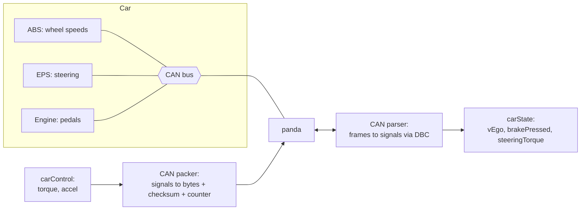

> [!danger] Educational only
> Sending messages on a real vehicle's bus can disable safety systems. Learn with recorded logs and virtual buses only.

## Problem and purpose

Modern cars are networks of dozens of electronic control units (ECUs) — engine, brakes, power steering, cameras — talking over **CAN buses**. To read speed and pedal states, and to command steering and acceleration, openpilot must speak each car's dialect: which message id carries which signal, at which bit position, scale and checksum. Each supported car model is a **car port**.

## Core concepts and terminology

- **CAN frame** — id + up to 8 data bytes (CAN FD: 64); broadcast to every node on the bus.
- **DBC file** — text database describing messages and signals (bit layout, scale, offset, units).
- **Signal packing** — Intel (little-endian) vs Motorola (big-endian) bit order, signed values, factor/offset ([[can-bus]]).
- **Checksum and counter** — many cars require these in commands and reject frames without them.
- **Car port** — DBC + interface code + tuning + safety limits for one model; openpilot keeps DBCs and car code in the **opendbc** repository.
- **Panda** — comma's USB-to-CAN interface, which also runs the safety firmware.

*Search keywords:* `DBC file format`, `CAN signal motorola intel byte order`, `cantools decode`, `opendbc`, `cabana CAN reverse engineering`.

## How it works



## Related features and components

[[independent-safety-layer]] (checks every outgoing frame) · [[drive-logging-and-replay]] (raw CAN is logged) · [[adaptive-cruise-control]] · [[lane-centering]].

## Required technical knowledge

[[can-bus]] · bit manipulation · [[cryptographic-hash-functions]] (only to contrast: CAN checksums detect errors, they are not security).

## Implementation techniques and APIs

> [!tested] Python — `drivekit/can.py`
> - **Used for:** Decoding and encoding signals with DBC semantics (Intel/Motorola, scale/offset, signed) plus counters.
> - **Input:** A `Signal` definition and frame bytes; values to encode.
> - **Expected output:** `decode` of a 16-bit Motorola signal at start bit 7 over bytes `12 34` gives `0x1234`; a speed encoded as 27.78 decodes to 27.78 ± 0.005 (factor 0.01, offset −50); an 11-bit signed signal rejects 1024.
>
> ```python
> from drivekit.can import Signal, decode, encode
>
> speed = Signal("VEHICLE_SPEED", start_bit=0, size=16, factor=0.01, offset=-50.0)
> torque = Signal("STEER_TORQUE", start_bit=16, size=11, signed=True)   # bits 16-26: must not overlap speed (0-15)
> data = bytearray(8)
> encode(speed, 27.78, data); encode(torque, -300, data)
> print(round(decode(speed, bytes(data)), 2), decode(torque, bytes(data)))   # 27.78 -300.0
> ```
> Tests: `test_intel_little_endian_known_bytes`, `test_motorola_big_endian_known_bytes`, `test_roundtrip_random_signals` (1000 random signals; bits outside the signal stay untouched).

Production tools: **cantools** and **python-can** ([[can-bus-in-python]]), opendbc's C++ parser, **cabana** (comma's CAN analysis UI) for reverse engineering unknown signals.

## Error handling and edge cases

- Overlapping signal definitions silently corrupt each other: writing a signal at bits 8–18 over one at bits 0–15 turns a speed of 27.78 into 493.7. Check DBC layouts for overlaps; encoding itself must not touch bits outside its signal (tested).
- Wrong byte order is the most common bug: values look random or jump by 256.
- Missing/repeated counters mean dropped frames or a stuck sender — treat the data as invalid.
- Different trims of the same model can use different messages; fingerprint the car from the ids it sends.

## Testing and debugging

- Golden decodes from recorded frames with known physical values (speedometer reading, steering angle).
- Round-trip encode/decode property tests.
- Cabana / PlotJuggler: plot candidate bits against known actions (press brake, turn wheel) to find signals.

## Limitations and engineering trade-offs

- Some cars authenticate messages (SecOC) — openpilot cannot control those without the keys.
- Each new car is reverse engineering plus tuning; there is no universal standard for actuator messages.

## Competency checklist

> [!level1] Recognition
> Explain CAN frames, DBC signals, byte order, factor/offset, checksums and counters.

> [!level2] Implementation
> Decode and encode signals correctly for both byte orders with round-trip tests; parse a real DBC with cantools.

> [!level3] Engineering
> Reverse engineer a signal from logs, build a car port with checksum/counter handling and car-specific safety limits.

## References

- opendbc — https://github.com/commaai/opendbc
- cantools — https://cantools.readthedocs.io/
- CSS Electronics, *CAN bus explained* and *DBC file explained* — https://www.csselectronics.com/pages/can-dbc-file-database-intro
- cabana (in openpilot `tools/cabana`) — https://github.com/commaai/openpilot/tree/master/tools/cabana
