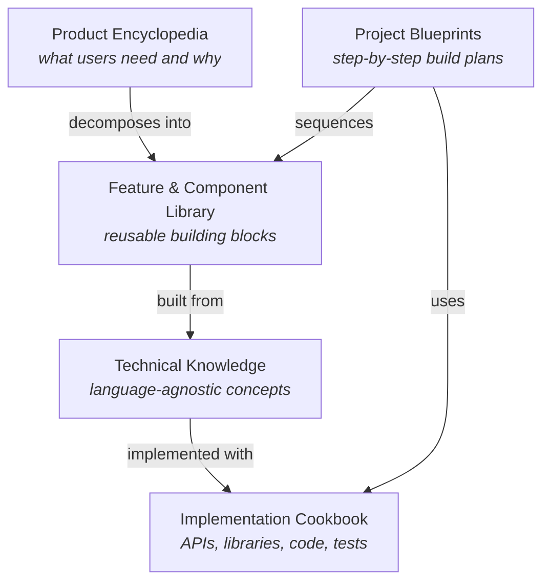
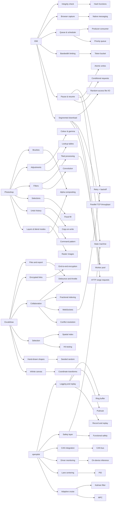

**Learn software engineering by understanding how real-world software products solve real-world problems.**

This wiki starts from products people already use, asks *what pain does this solve and how*, and follows the answer down to the algorithms, protocols, data structures and APIs you need to build it yourself — with or without an AI assistant at your side.

## The knowledge map

Every page belongs to one of five layers. Links run in both directions: a product links down to the concepts it needs, and every concept page shows (in **Backlinks**, right sidebar) which features and products use it.

| Layer | Start here | Answers the question |
|---|---|---|
| Product Encyclopedia | [[products/index\|Products]] | What problem does this product solve, for whom, and with which features? |
| Feature & Component Library | [[features/index\|Features]] | What does a feature consist of, and where else does it appear? |
| Technical Knowledge | [[concepts/index\|Concepts]] | Which algorithm, protocol, structure or pattern makes it work? |
| Implementation Cookbook | [[cookbook/index\|Cookbook]] | Which API, library and code do I use in Python, TypeScript or C++? |
| Project Blueprints | [[blueprints/index\|Blueprints]] | In what order do I build it, and how do I know each step works? |

Plus [[field-notes/index|Field Notes]]: short write-ups of real bugs and odd failures met in practice.

## Where to begin

1. Read [[how-to-learn|How to learn with this wiki]] — the three competency levels and how to study without an AI assistant.
2. Follow the first complete slice: **[[internet-download-manager|Internet Download Manager (IDM)]]** → [[segmented-download]] → [[http-range-requests]] → [[http-streaming-in-python]] → [[build-a-download-manager]].
3. Or the graphics slice: **[[adobe-photoshop|Adobe Photoshop]]** → [[layers-and-blend-modes]] → [[alpha-compositing]] → [[numpy-image-processing]] → [[build-a-layered-image-editor]].
4. Or the collaboration slice: **[[excalidraw|Excalidraw]]** → [[real-time-collaboration]] → [[conflict-resolution]] → [[websockets-in-typescript]] → [[build-a-collaborative-whiteboard]].
5. Or the robotics slice: **[[openpilot]]** → [[independent-safety-layer]] → [[pid-controller]] → [[control-and-estimation-in-python]] → [[build-a-driver-assist-stack]].
6. Keep the [[glossary]] open; every term there links to the page that explains it.

> [!tip] Use the graph
> The **Graph View** in the right sidebar shows the neighbourhood of the current page. Click the expand icon for the whole wiki. Concepts with many incoming links are the ones most worth mastering first.

## Coverage so far

Four products are traced end-to-end; others are queued in the [[roadmap]].

