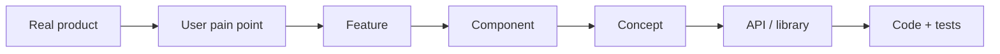
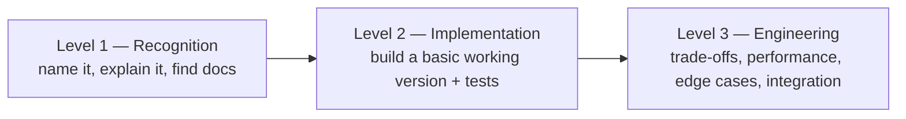

## Why this wiki exists

AI coding assistants are fast, but they are not always available — offline work, restricted networks, rate limits, confidential codebases, or simply a bug the assistant cannot see. The aim here is that you can still make progress on your own: slower, but correct, because you know **what the problem is called, how it is normally solved, where the authoritative documentation lives, and how to verify your solution**.

## Problem first, syntax last

Learning a framework first gives you answers without questions. Starting from a pain point ("downloads restart from zero when Wi-Fi drops") gives every concept a reason to exist ("so the client must ask the server for *only the missing bytes* → HTTP range requests").

## The three competency levels

Every concept and feature page ends with a checklist for each level. Levels 1 and 2 are the minimum target for commonly used techniques.

> [!level1] Level 1 — Recognition
> - Explain the problem the technique solves in two sentences.
> - Use the correct terminology so a web search returns the right results.
> - Know which authoritative source to open (RFC, language docs, man page).

> [!level2] Level 2 — Implementation
> - Write a basic working version without copying the page's code.
> - Use the standard library or the usual third-party library correctly.
> - Handle the common errors and write tests that prove it works.

> [!level3] Level 3 — Engineering
> - Choose between alternatives and justify the trade-off.
> - Measure and optimize; handle rare edge cases; debug production failures.
> - Integrate the solution into a larger system without breaking its guarantees.

## How to read code on these pages

Code is labelled by how much you can trust it:

> [!pseudocode] Pseudocode
> Explains an idea. Not runnable. Translate it yourself — that is the exercise.

> [!mwe] Minimal working example
> Runs as shown with the stated versions. Intentionally incomplete: no production error handling.

> [!tested] Tested reference implementation
> Lives under `examples/` in the repository and is exercised by CI. Read it after you have tried yourself.

## A study loop that works without AI

1. **Read the product page** and write down, in your own words, the pain points and features.
2. **Pick one feature**, read its page, and draw its component diagram on paper before looking at the one provided.
3. **Open each linked concept** and complete the Level 1 checklist. Note the search keywords.
4. **Implement** from the concept page plus official docs only. Use the cookbook page when you are stuck on an API.
5. **Test** using the testing section. Then compare with the tested reference implementation.
6. **Write a field note** when you meet a surprising bug — that is how [[field-notes/index|Field Notes]] grow.

## Finding answers on your own

| You know… | Search for… | Read… |
|---|---|---|
| The symptom only | the exact error message in quotes, plus the library name | issue trackers, Stack Overflow, field notes |
| The concept name | `<concept> RFC` or `<concept> site:developer.mozilla.org` | the specification or MDN |
| The API name | `<language> <module> docs` | official reference docs, then source code |
| Nothing yet | the user-visible behaviour + "how does X work" | engineering blogs, then follow their references |

Each page has a **Search keywords** line for exactly this purpose.
