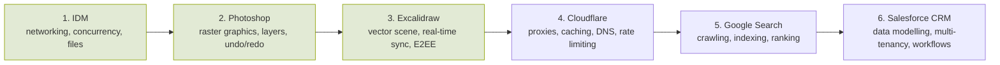

The wiki grows one product slice at a time. A slice is done when the product page, its features, the concepts they need, at least one cookbook page per concept, and a blueprint exist and link to each other.

The order maximizes reuse: each slice reuses concepts from the previous ones (Cloudflare reuses [[token-bucket]], [[http-conditional-requests]], [[retry-with-exponential-backoff]]; Photoshop reused [[worker-pool]] for tiled filters).

## Planned pages

| Slice | Products | New features | New concepts |
|---|---|---|---|
| 4 | Cloudflare | CDN edge caching, DDoS protection, rate limiting, DNS, TLS termination | reverse proxy, HTTP caching (RFC 9111), consistent hashing, anycast, sliding-window counters, TLS handshake |
| 5 | Google Search | crawling, indexing, query autocomplete, ranking, spell correction | inverted index, tokenization, BM25/TF-IDF, trie, PageRank, Bloom filter, MapReduce |
| 6 | Salesforce CRM | record management, custom fields, workflow automation, reports, permissions | relational modelling, multi-tenant schema, RBAC, event-driven architecture, OLAP aggregation |

## Done

- **Slice 1 — [[internet-download-manager|IDM]]**: 6 features, 14 concepts, 6 cookbook pages, 1 blueprint, tested Python reference implementation, TypeScript and C++ minimal examples.
- **Slice 2 — [[adobe-photoshop|Photoshop]]**: 6 features, 9 concepts (graphics, flood fill, command pattern, copy-on-write), 3 cookbook pages, 1 blueprint, tested Python reference `pixkit`, C++ blur cross-checked against it, C++ undo stack, TypeScript ImageData operations. Reuses [[worker-pool]] and [[finite-state-machine]] from slice 1.
- **Slice 3 — [[excalidraw|Excalidraw]]**: 6 features, 10 concepts (vector scene, coordinate transforms, hit testing, spatial index, seeded random numbers, fractional indexing, conflict resolution, WebSockets, end-to-end encryption, debounce/throttle), 3 TypeScript cookbook pages, 1 blueprint, tested TypeScript reference `sketchkit` with an encrypted WebSocket relay demo. Reuses [[undo-redo-history]], [[retry-with-exponential-backoff]] and [[cryptographic-hash-functions]].
