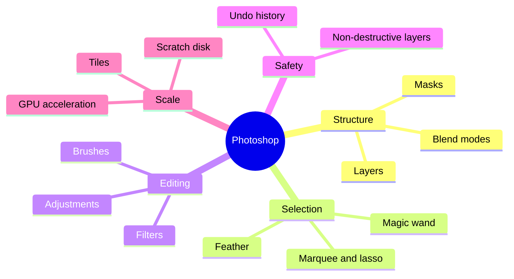
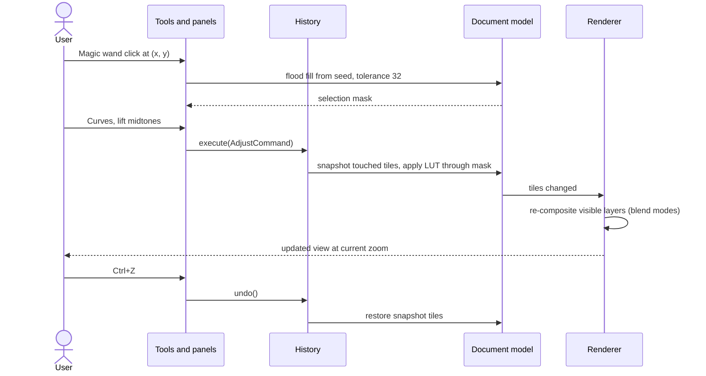
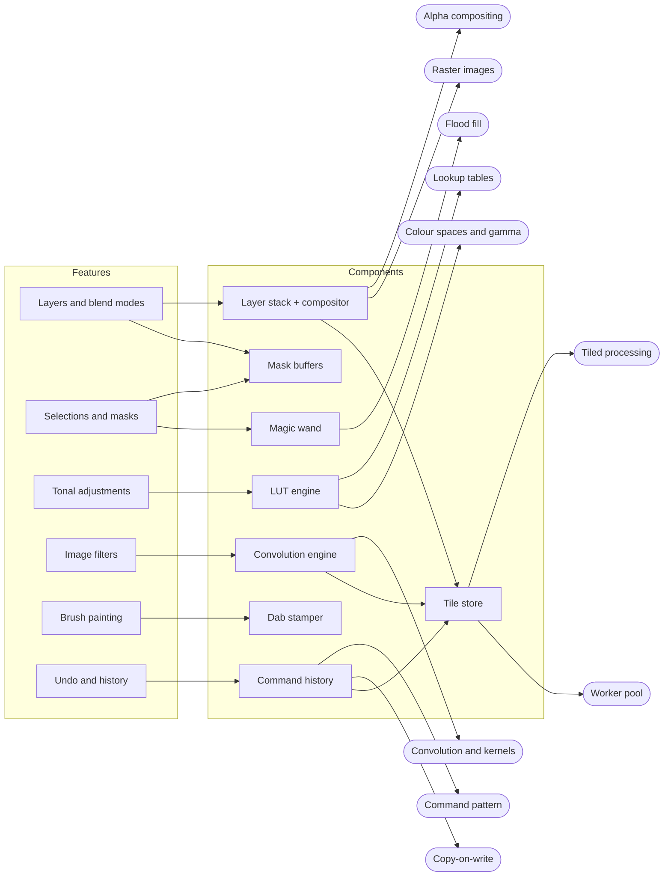
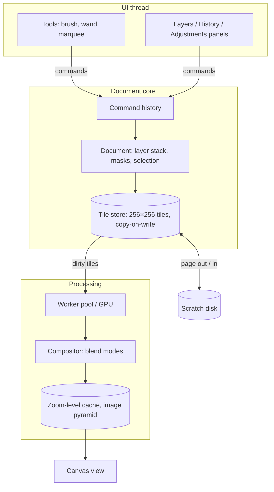

## Purpose

Adobe Photoshop is a **raster image editor**: it edits images made of pixels — photographs, scans, digital paintings, textures, UI mock-ups. Thomas and John Knoll wrote the first version; Adobe released Photoshop 1.0 for the Macintosh in February 1990. Comparable products: GIMP, Krita, Affinity Photo, Photopea (browser), Pixelmator.

Photoshop is written mainly in **C++**. In 2021 Adobe shipped Photoshop on the web by compiling the same C++ code base to **WebAssembly** with Emscripten instead of rewriting it — a good example of why performance-critical, long-lived products stay in C++.

## Users and pain points

| User situation | Pain without an image editor | What Photoshop does about it |
|---|---|---|
| Photo is too dark, flat or colour-cast | Re-shoot, or live with it | Tonal and colour adjustments — [[tonal-adjustments]] |
| Composite several photos or add text over an image | Edits are baked in; one mistake ruins the result | Stack independent, reorderable layers with blend modes — [[layers-and-blend-modes]] |
| Change only part of an image (sky, face, background) | Edits affect everything | Select a region, then edit through the selection — [[selections-and-masks]] |
| Soft, noisy or detailed images | Detail lost or exaggerated | Blur, sharpen, noise reduction — [[image-filters]] |
| Retouching or digital painting | Mouse input looks jagged | Pressure-aware, anti-aliased brushes — [[brush-painting]] |
| Trying things out | Fear of destroying the image | Multi-step undo and history — [[undo-redo-history]] |
| Gigapixel scans, print-resolution posters | Image does not fit in memory, every edit is slow | Tiled processing, caches and scratch disks — [[tiled-image-processing]] |

## Core features

## Main workflow

A typical retouch, and what happens underneath each step:

## Feature decomposition

| Feature | Components | Concepts | Cookbook |
|---|---|---|---|
| [[layers-and-blend-modes]] | layer stack, compositor | [[alpha-compositing]], [[raster-images-and-pixel-formats]] | [[numpy-image-processing]], [[canvas-imagedata]] |
| [[selections-and-masks]] | mask buffers, magic wand, feather | [[flood-fill]], [[convolution-and-kernels]] | [[numpy-image-processing]], [[canvas-imagedata]] |
| [[tonal-adjustments]] | LUT engine | [[lookup-tables]], [[color-spaces-and-gamma]] | [[numpy-image-processing]] |
| [[image-filters]] | convolution engine | [[convolution-and-kernels]], [[tiled-image-processing]] | [[numpy-image-processing]], [[image-processing-in-cpp]] |
| [[brush-painting]] | dab stamper, stroke buffer | [[alpha-compositing]] | [[numpy-image-processing]] |
| [[undo-redo-history]] | command history, tile snapshots | [[command-pattern]], [[copy-on-write]] | [[image-processing-in-cpp]] |

## Architecture sketch

Photoshop's internals are not public. This sketch shows the structure common to raster editors, including open-source ones whose code you can read (GIMP with its GEGL image library, Krita):

Design points worth noticing:

- **Every edit is a command** with an undo; the History panel is the command list ([[command-pattern]]). Photoshop keeps 50 history states by default (Preferences → Performance).
- **Images are stored in tiles.** Photoshop's Performance preferences expose *Cache Tile Size* and *Cache Levels*, and it pages tiles to a *scratch disk* when memory runs out. Tiles make undo cheap ([[copy-on-write]]), parallel filters easy ([[tiled-image-processing]]) and huge images possible.
- **The view is not the document.** The screen shows a cached, downsampled composite (Cache Levels); edits invalidate only affected tiles.
- **Non-destructive editing** (adjustment layers, layer masks, Smart Objects) stores *recipes* instead of changed pixels, so they can be revised later.

## Build it yourself

Follow **[[build-a-layered-image-editor]]**: from loading pixels to layers, blend modes, filters, selections, brushes and undo, in eight milestones with tests. The result is the tested Python reference `examples/image-editor/python` (`pixkit`), plus C++ and TypeScript examples.

## References

- Adobe, *Photoshop File Formats Specification* (PSD) — https://www.adobe.com/devnet-apps/photoshop/fileformatashtml/
- web.dev, *Photoshop's journey to the web* (C++ to WebAssembly) — https://web.dev/articles/ps-on-the-web
- Bjarne Stroustrup, *C++ Applications* (lists Photoshop) — https://stroustrup.com/applications.html
- W3C, *Compositing and Blending Level 1* (blend-mode formulas) — https://www.w3.org/TR/compositing-1/
- GIMP / GEGL source (readable open-source raster engine) — https://gitlab.gnome.org/GNOME/gegl
