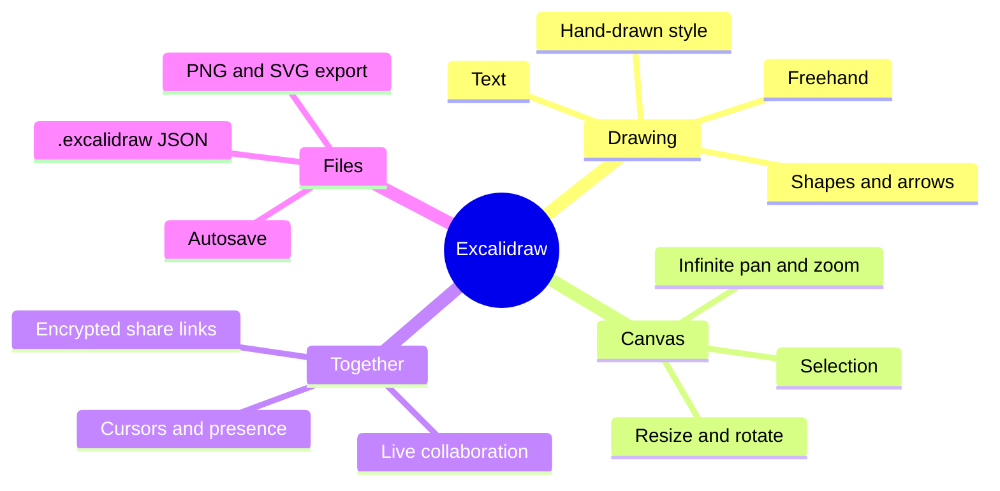
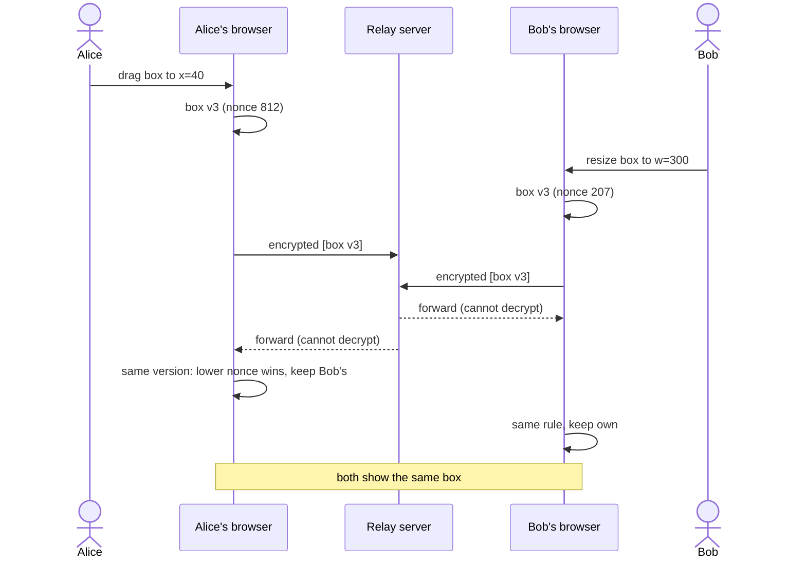
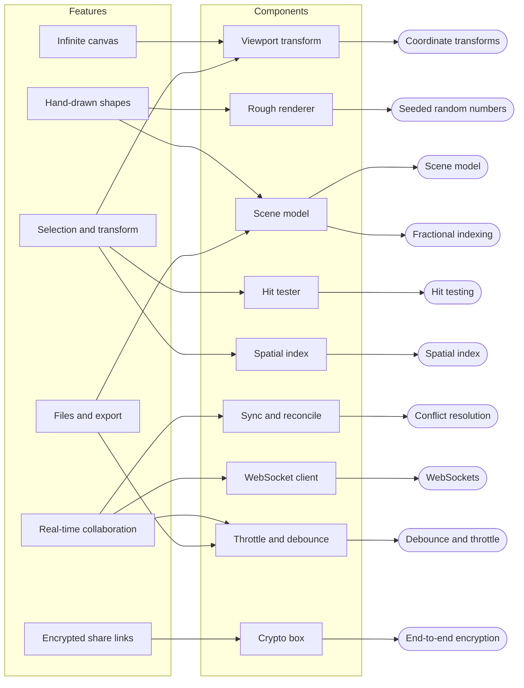
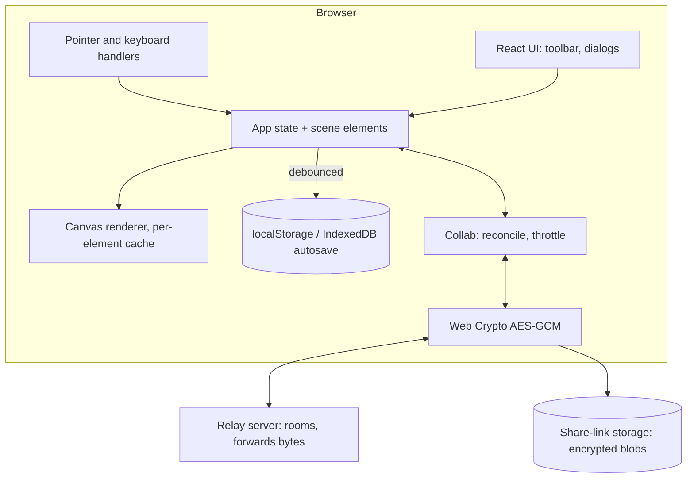

## Purpose

Excalidraw is an open-source **virtual whiteboard** for sketching diagrams that look hand-drawn. It runs in the browser, needs no account, and lets several people draw on the same canvas in real time. Christopher Chedeau started it in January 2020; the main repository is **TypeScript** (React UI, HTML canvas rendering) under the **MIT** licence. It is also published as an embeddable React component (`@excalidraw/excalidraw`) used inside other tools. Comparable products: Miro, FigJam, tldraw, Microsoft Whiteboard, draw.io.

## Users and pain points

| User situation | Pain without it | What Excalidraw does about it |
|---|---|---|
| Explaining an architecture in a meeting | Diagram tools are slow and look too "final" to invite feedback | Fast, deliberately rough shapes — [[hand-drawn-shapes]] |
| The diagram grows beyond the screen | A fixed-size page runs out of room | Unlimited canvas with pan and zoom — [[infinite-canvas]] |
| Rearranging a drawing | Fiddly selection of small or overlapping shapes | Click/box selection, move, resize, rotate — [[selection-and-transform]] |
| Remote team sketching together | Screen-sharing lets only one person draw | Live multi-user editing with cursors — [[real-time-collaboration]] |
| Sharing a sensitive diagram by link | The hosting company could read it | Encrypted in the browser; key only in the link — [[encrypted-sharing-links]] |
| Keeping and reusing work | Lock-in, lost drafts | Autosave, open JSON file format, PNG/SVG export — [[scene-files-and-export]] |
| Mistakes | Fear of breaking the drawing | Undo/redo — [[undo-redo-history]] |

## Core features

## Main workflow

Two people editing the same box at the same time:

## Feature decomposition

| Feature | Components | Concepts | Cookbook |
|---|---|---|---|
| [[infinite-canvas]] | viewport transform | [[coordinate-transforms]] | [[canvas-2d-drawing]] |
| [[hand-drawn-shapes]] | rough renderer, scene model | [[seeded-pseudorandom-numbers]], [[vector-graphics-and-scene-model]] | [[canvas-2d-drawing]] |
| [[selection-and-transform]] | hit tester, spatial index | [[hit-testing]], [[spatial-index]], [[coordinate-transforms]] | [[canvas-2d-drawing]] |
| [[real-time-collaboration]] | sync, WebSocket client, throttling | [[conflict-resolution]], [[websockets]], [[fractional-indexing]], [[debounce-and-throttle]] | [[websockets-in-typescript]] |
| [[encrypted-sharing-links]] | crypto box | [[end-to-end-encryption]] | [[web-crypto-aes-gcm]] |
| [[scene-files-and-export]] | scene model, autosave | [[vector-graphics-and-scene-model]], [[debounce-and-throttle]] | [[canvas-2d-drawing]] |

## Architecture sketch

Design points worth noticing:

- **Elements are plain immutable records** (`{id, type, x, y, width, height, angle, seed, version, versionNonce, isDeleted, …}`). Editing creates a new record with a higher `version`; that single rule powers rendering caches, undo and collaboration.
- **The server is dumb on purpose.** It forwards encrypted bytes between clients in a room. All merging happens in clients with a deterministic rule, so the server needs no knowledge of the drawing.
- **Hand-drawn but stable.** Each element stores a random `seed`; the sketchy strokes are generated from it, so the wobble is identical on every redraw and every collaborator's screen.
- **Rendering is cached per element:** an element is re-rasterized only when its `version` changes; panning just re-blits cached bitmaps through the viewport transform.

## Build it yourself

Follow **[[build-a-collaborative-whiteboard]]**: viewport, shapes, hit testing, selection, files, then encrypted real-time collaboration. The finished engine is the tested TypeScript reference `examples/whiteboard/typescript` (`sketchkit`) with a WebSocket relay and a two-client demo.

## References

- Excalidraw source (TypeScript, MIT) — https://github.com/excalidraw/excalidraw
- Excalidraw blog, *End-to-End Encryption in the Browser* — https://blog.excalidraw.com/end-to-end-encryption/
- Excalidraw blog, *Building Excalidraw's P2P Collaboration Feature* — https://blog.excalidraw.com/building-excalidraw-p2p-collaboration-feature/
- Rough.js (hand-drawn rendering library) — https://roughjs.com/
- Excalidraw relay server — https://github.com/excalidraw/excalidraw-room
