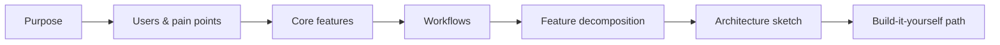

Products are the entry point: each page explains **who uses the product, which pain points it removes, and which features do the work** — then links down into reusable features and concepts.

| Product | Category | Core engineering themes | Status |
|---|---|---|---|
| [[internet-download-manager\|Internet Download Manager]] | Desktop utility | HTTP range requests, parallel I/O, resumability, rate limiting | Draft — complete slice |
| [[adobe-photoshop\|Adobe Photoshop]] | Creative desktop app (C++) | Raster images, compositing, convolution, undo/redo, tiling | Draft — complete slice |
| [[excalidraw\|Excalidraw]] | Collaborative web app (TypeScript) | Vector scene, hit testing, real-time sync, end-to-end encryption | Draft — complete slice |
| [[openpilot]] | Driver assistance, robotics (Python + C/C++) | Control, estimation, CAN, safety layers, messaging, replay testing | Draft — complete slice |
| Cloudflare | Network infrastructure | Reverse proxy, caching, DNS, DDoS mitigation | Planned |
| Google Search | Web search | Crawling, inverted index, ranking, autocomplete | Planned |
| Salesforce CRM | Enterprise SaaS | Data modelling, multi-tenancy, workflow automation, permissions | Planned |

See the [[roadmap]] for the order and the concepts each slice adds.

## How a product page is structured

