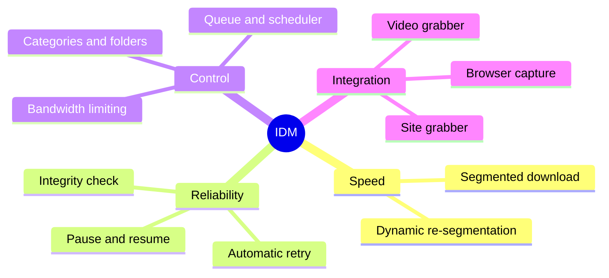
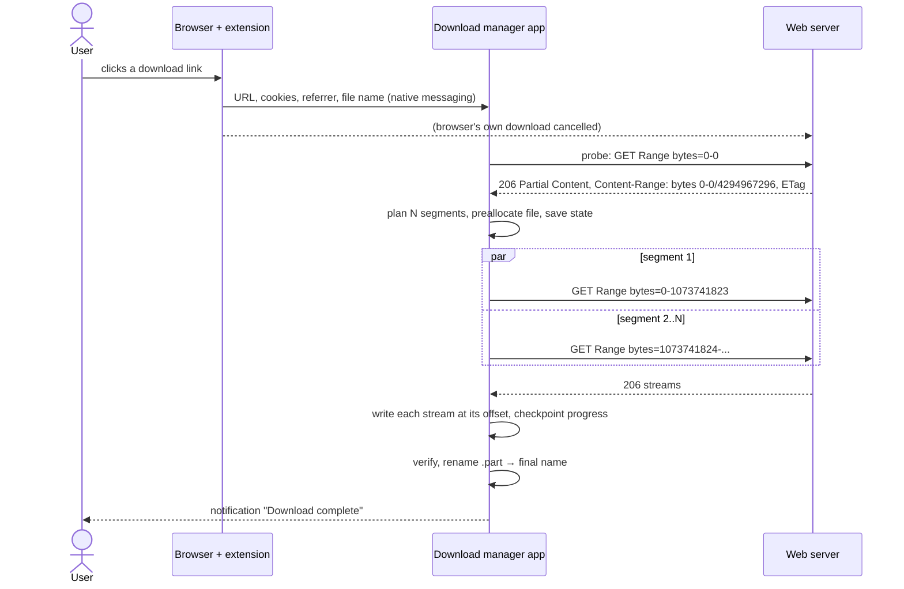
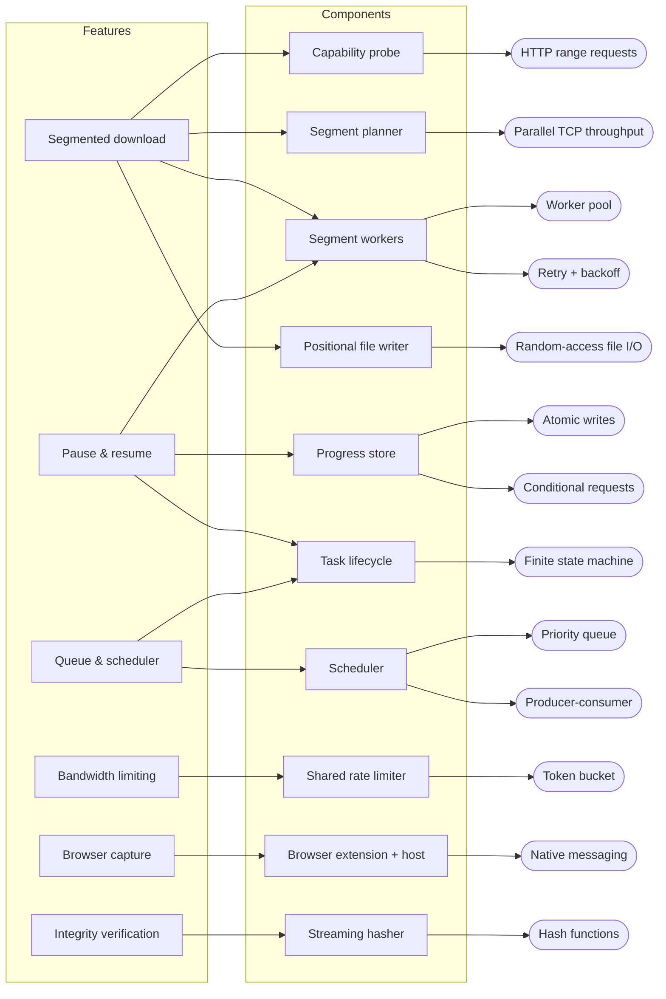
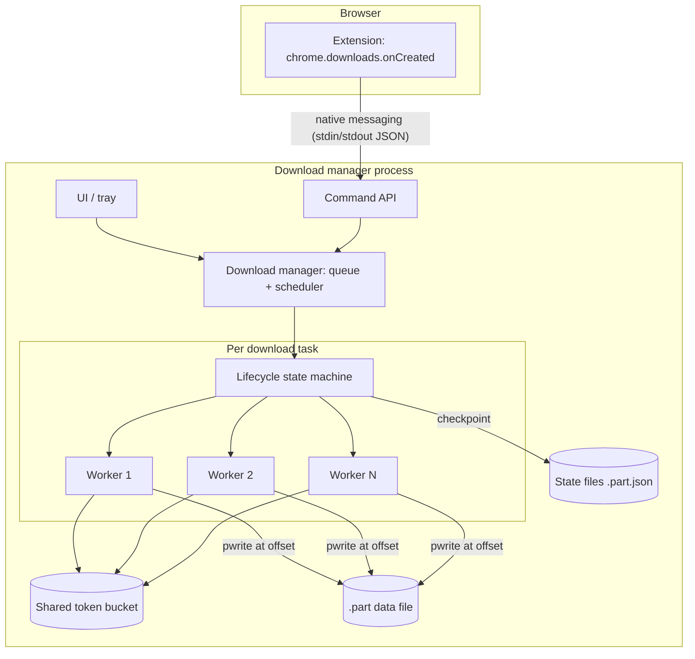

## Purpose

Internet Download Manager (IDM, by Tonec Inc., Windows, first released in the late 1990s) is a desktop **download manager**: it takes over file downloads from web browsers and makes them faster, resumable and organized. Comparable products: Free Download Manager, aria2 (command line), JDownloader, and the download managers built into browsers.

## Users and pain points

| User situation | Pain without a download manager | What IDM does about it |
|---|---|---|
| Large file on a fast connection, but each server connection is throttled or slow to ramp up | One TCP connection uses only part of the available bandwidth | Opens several connections and downloads different parts in parallel — [[segmented-download]] |
| Unstable Wi-Fi, mobile hotspot, VPN drops | A 4 GB download fails at 95 % and restarts from zero | Remembers progress and continues where it stopped — [[pause-and-resume]] |
| Many files to fetch | Browser download list is a flat, unmanaged list | Queues, categories, start/stop schedules — [[download-queue-and-scheduler]] |
| Shared or metered connection | Download saturates the link; video calls and other users suffer | Caps the transfer rate — [[bandwidth-limiting]] |
| Downloads start inside the browser | User must copy links manually into another program | Browser extension hands downloads to the app — [[browser-download-capture]] |
| Corrupted or tampered files | Broken installer discovered only when run | Verify against a published checksum — [[file-integrity-verification]] (common in download managers; IDM itself relies on antivirus scanning instead) |

## Core features

## Main workflows

**Interrupted workflow:** the network drops → workers fail with timeouts → each is retried with [[retry-with-exponential-backoff|exponential backoff]] → if the app is closed, progress is already in a sidecar state file → on restart, each unfinished segment is requested from its last confirmed byte with `If-Range` to make sure the file has not changed ([[http-conditional-requests]]).

## Feature decomposition

How each user-facing feature breaks down into components and the technical concepts behind them:

| Feature | Components | Concepts | Cookbook |
|---|---|---|---|
| [[segmented-download]] | probe, segment planner, workers, positional writer | [[http-range-requests]], [[parallel-tcp-throughput]], [[worker-pool]], [[random-access-file-io]] | [[http-streaming-in-python]], [[python-threads-and-asyncio]], [[node-fetch-and-file-handles]], [[libcurl-easy-interface]] |
| [[pause-and-resume]] | progress store, task lifecycle, retry loop | [[atomic-writes-and-crash-safety]], [[http-conditional-requests]], [[finite-state-machine]], [[retry-with-exponential-backoff]] | [[testing-network-code-locally]] |
| [[download-queue-and-scheduler]] | queue, scheduler, concurrency limit | [[priority-queue]], [[producer-consumer-queue]], [[finite-state-machine]] | [[python-threads-and-asyncio]] |
| [[bandwidth-limiting]] | shared limiter | [[token-bucket]] | — |
| [[browser-download-capture]] | extension, native host | [[browser-extension-native-messaging]] | — |
| [[file-integrity-verification]] | streaming hasher | [[cryptographic-hash-functions]] | [[file-hashing-in-python]] |

## Architecture sketch

Design points worth noticing:

- **One task = one state machine** (`queued → probing → downloading → paused/failed → verifying → completed`). The UI only sends events; it never touches workers directly. See [[finite-state-machine]].
- **Workers are I/O-bound**, so threads or async I/O both work; CPU is rarely the bottleneck. See [[worker-pool]] and [[async-io-event-loop]].
- **Durability order matters:** data bytes are flushed before the progress file claims them. See [[atomic-writes-and-crash-safety]].
- **Dynamic segmentation:** IDM-style managers split the largest unfinished segment when a worker becomes idle, so fast connections are never left waiting for a slow one (a form of work stealing). See [[segmented-download#dynamic-re-segmentation|dynamic re-segmentation]].

## Build it yourself

Follow the blueprint **[[build-a-download-manager]]**. It goes from a single-stream downloader to a resumable, segmented, rate-limited manager in seven milestones, each with acceptance tests. The finished result is the [[build-a-download-manager#reference-implementation|tested Python reference implementation]].

## References

- RFC 9110 *HTTP Semantics*, §14 Range Requests and §13.1.5 If-Range — https://www.rfc-editor.org/rfc/rfc9110
- MDN, *HTTP range requests* — https://developer.mozilla.org/en-US/docs/Web/HTTP/Guides/Range_requests
- aria2 manual (open-source multi-connection downloader; readable source) — https://aria2.github.io/manual/en/html/aria2c.html
- Chrome Extensions, `chrome.downloads` API — https://developer.chrome.com/docs/extensions/reference/api/downloads
- IDM product site — https://www.internetdownloadmanager.com/
