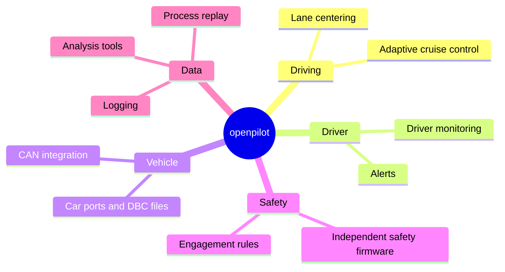
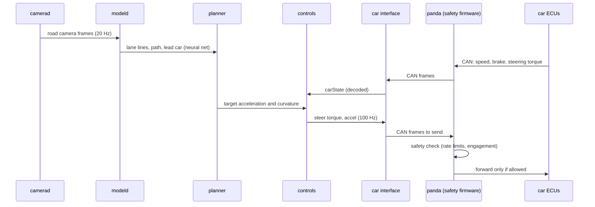
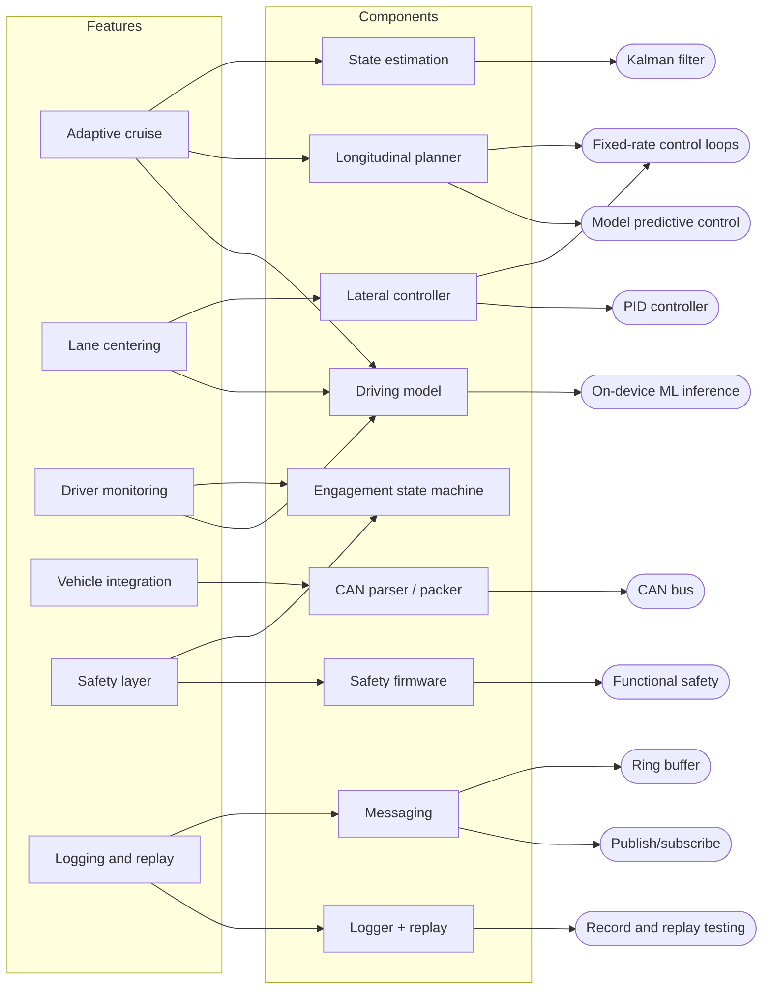
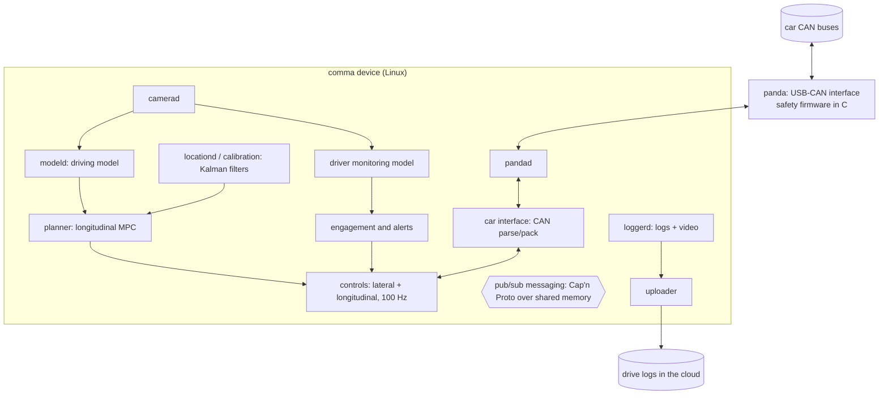

> [!danger] Educational content only
> This slice explains how driver-assistance software works. The example code in this wiki is a learning aid: it has never been validated for any vehicle and must never be connected to one. Real systems rely on independent hardware safety layers, formal safety processes and millions of kilometres of testing.

## Purpose

openpilot is an open-source **advanced driver-assistance system (ADAS)** from comma.ai (open-sourced in 2016, MIT licence). It runs on a dashboard-mounted device (currently the comma 3X) that plugs into a supported car's internal network and provides **adaptive cruise control** and **automated lane centering** on hundreds of car models, replacing or upgrading the car's stock assistance. It is an SAE **Level 2** system: it steers, accelerates and brakes, but the driver must watch the road at all times, and a camera-based **driver monitor** enforces that.

Most of the code is **Python** (planning, control, process orchestration, tools), with **C/C++** where timing or safety demands it (camera and sensor daemons, messaging, the panda's safety firmware in C).

## Users and pain points

| User situation | Pain without it | What openpilot does about it |
|---|---|---|
| Long highway drives, stop-and-go traffic | Constant speed adjustments are tiring | Keeps a safe following distance automatically — [[adaptive-cruise-control]] |
| Holding the lane for hours | Fatigue, drifting | Keeps the car centred in its lane — [[lane-centering]] |
| Assistance that lulls drivers into inattention | Misuse of Level 2 systems | Camera watches the driver; alerts, then disengages — [[driver-monitoring]] |
| Car's stock system is weak or missing | Hardware already exists but software is limited | Talks to the car's own steering/gas/brake modules over CAN — [[vehicle-integration]] |
| Software controlling a car can have bugs | Unsafe commands could reach the actuators | Separate firmware blocks unsafe commands — [[independent-safety-layer]] |
| Improving behaviour without regressions | Hard to know a change is better | Every drive logged; changes replayed against real data — [[drive-logging-and-replay]] |

## Core features

## Main workflow

One control cycle while engaged (openpilot's main control loop runs at 100 Hz):

## Feature decomposition

| Feature | Components | Concepts | Cookbook |
|---|---|---|---|
| [[adaptive-cruise-control]] | longitudinal planner, lead estimation | [[model-predictive-control]], [[kalman-filter]], [[fixed-rate-control-loops]] | [[control-and-estimation-in-python]] |
| [[lane-centering]] | lateral controller | [[pid-controller]], [[coordinate-transforms]], [[on-device-ml-inference]] | [[control-and-estimation-in-python]] |
| [[driver-monitoring]] | monitoring model, alert logic | [[on-device-ml-inference]], [[finite-state-machine]] | — |
| [[vehicle-integration]] | CAN parser/packer, car ports | [[can-bus]] | [[can-bus-in-python]] |
| [[independent-safety-layer]] | safety firmware, engagement rules | [[functional-safety]], [[finite-state-machine]] | [[realtime-cpp]] |
| [[drive-logging-and-replay]] | logger, process replay | [[record-and-replay-testing]], [[publish-subscribe-messaging]], [[ring-buffer]] | [[realtime-cpp]] |

## Architecture sketch

Process names differ between openpilot versions; the structure is what matters. Design points worth noticing:

- **Many small processes, one message bus.** Each daemon does one job and publishes typed messages (schemas in Cap'n Proto, via comma's `cereal` and `msgq` libraries). A crash or slowdown in one is visible to the others through message timestamps and validity flags ([[publish-subscribe-messaging]]).
- **Safety is enforced outside the main computer.** The panda firmware checks every outgoing actuator message against car-specific limits and engagement state, so a bug in Python cannot command an unsafe steering jerk ([[independent-safety-layer]]).
- **Everything is logged.** Inputs and outputs of every process are recorded; changes are tested by replaying real drives through the new code and diffing the outputs ([[drive-logging-and-replay]]).
- **Learn from data, control with classical methods.** A neural network perceives the road; well-understood control (MPC, PID) and estimation (Kalman filters) turn perception into actuator commands with explicit limits.

## Build it yourself

Follow **[[build-a-driver-assist-stack]]**, a simulation-only project: CAN decoding, state estimation, cruise control with MPC, lane centering, an independent safety checker, pub/sub messaging, and record/replay tests. The result is the tested Python reference `examples/driver-assist/python` (`drivekit`) plus C++ twins of the safety checker and the lock-free ring buffer.

## References

- openpilot source (MIT) — https://github.com/commaai/openpilot
- openpilot `docs/SAFETY.md` (safety model) — https://github.com/commaai/openpilot/blob/master/docs/SAFETY.md
- panda (CAN interface and safety firmware) — https://github.com/commaai/panda
- opendbc (DBC files and car interfaces) — https://github.com/commaai/opendbc
- SAE J3016, *Levels of Driving Automation* — https://www.sae.org/standards/content/j3016_202104/
